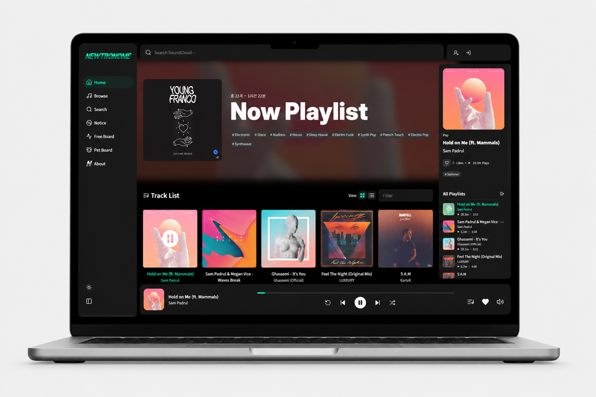
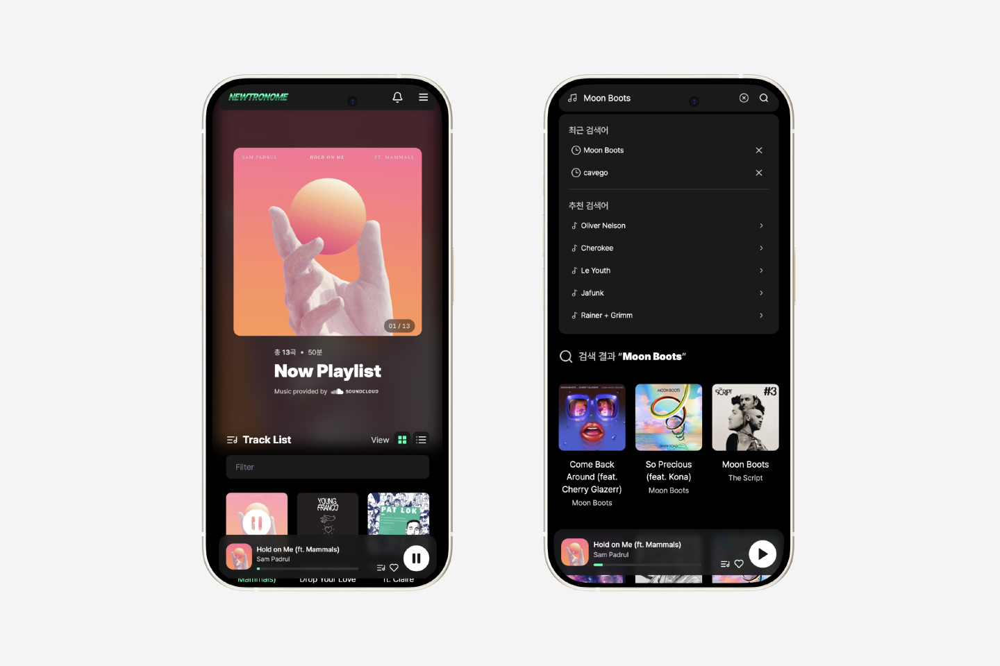

# Newtronome

[서비스 바로가기](https://newtronome.jsjweb0.workers.dev/) · [GitHub](https://github.com/jsjweb0/newtronome)

SoundCloud 플레이리스트 재생과 iTunes 곡 검색·미리듣기를 제공하는 음악 서비스입니다. 재생 상태 관리, 외부 API 연동, 사용자별 트랙 저장과 게시판을 구현한 개인 프로젝트입니다.

## 화면 미리보기





### 서비스 확인 순서

1. 플레이리스트에서 곡을 재생하고 하단 플레이어의 현재 곡·재생 시간을 확인합니다.
2. 곡을 검색하고 미리듣기를 실행해 SoundCloud 재생이 정지하는지 확인합니다.
3. 검색 결과에서 아티스트 곡 패널을 열고, 닫았다 다시 열어 조회 결과가 재사용되는지 확인합니다.

음악 탐색과 미리듣기는 로그인 없이 이용할 수 있습니다. Likes 저장과 게시글·댓글 작성에는 로그인이 필요합니다.

## 주요 기능

- **음악 재생**: SoundCloud 플레이리스트 재생, 이전·다음·랜덤 이동, 현재 곡과 재생 시간 표시
- **검색·미리듣기**: iTunes 곡 검색, 최근·추천 검색어, 검색 결과 추가 표시, SoundCloud 재생과 미리듣기의 상호 정지
- **아티스트 곡 탐색**: 아티스트 ID 기반 Lookup으로 최대 5곡 조회, 패널에서 미리듣기, 아티스트별 응답 캐시 재사용
- **트랙 저장**: 로그인 사용자별 Likes 목록 관리, 저장한 곡을 한 곡씩 재생하고 재생이 끝나면 자동 정지
- **인증·게시판**: Firebase 회원가입·로그인, 게시글·댓글 CRUD, 검색·정렬·페이지 이동, 사용자별 작성 글·댓글 조회
- **반응형·접근성**: 화면 크기에 따른 목록·패널 배치, 검색 폼과 재생 버튼의 키보드 조작 및 상태를 반영한 접근성 레이블

## 기술 스택

| 구분        | 사용 기술                                         |
| ----------- | ------------------------------------------------- |
| 프론트엔드  | React, TypeScript, Vite, Tailwind CSS             |
| 상태 관리   | Zustand, React Context, TanStack Query            |
| 인증·데이터 | Firebase Authentication, Firestore                |
| 음악 연동   | SoundCloud Widget API, iTunes Search / Lookup API |
| 테스트      | Vitest, Testing Library, Playwright               |
| 배포        | Cloudflare Workers Static Assets, GitHub Actions  |

### 상태 관리 역할

| 도구               | 담당 상태                                                         |
| ------------------ | ----------------------------------------------------------------- |
| TanStack Query     | iTunes 검색·아티스트 곡, 게시글·댓글 등 원격 데이터의 조회와 캐시 |
| Zustand            | 여러 화면이 공유하는 현재 곡·재생 여부·재생 시간                  |
| React Context      | 인증·테마·토스트·알림 등 앱 전반의 상태                           |
| 컴포넌트 로컬 상태 | 검색 입력값·열린 패널 등 화면 내부 상태                           |

## 주요 구현과 문제 해결

### 외부 음악 재생 연동과 비동기 충돌 처리

기존에는 비공식 API로 플레이리스트와 스트림 URL을 조회해 Client ID나 요청 규격이 바뀌면 재생이 중단됐습니다. 공식 SoundCloud Widget API로 전환하면서 Client ID 관리와 스트림 URL 변환을 없앴습니다. `useSoundCloudWidget`은 Widget 인스턴스와 이벤트 연결을 맡고, 화면에서 공유하는 재생 상태는 Zustand로 관리합니다.

음악 검색은 iTunes API를 사용합니다. 검색어·아티스트별 Query Key로 조회 결과를 구분하고, TanStack Query의 `AbortSignal`을 `fetch`에 전달해 더 이상 사용하지 않는 요청을 취소합니다. 오디오 미리듣기는 별도의 재생 요청 번호를 비교해 이전 요청이 늦게 완료되어도 최신 재생 상태를 변경하지 않도록 처리합니다.

미리듣기가 시작되면 SoundCloud를 정지하고, SoundCloud 재생 이벤트가 발생하면 미리듣기를 정지합니다. 새 검색이나 페이지 이동 시에는 미리듣기 상태를 정리합니다. 플레이리스트는 로딩·빈 목록·오류를 구분합니다. 빈 목록이 확정되면 이전 곡과 재생 시간이 초기화되는지 테스트했습니다.

### 서버 상태 캐시와 변경 후 화면 동기화

아티스트 곡 조회는 ID별 Query Key와 5분의 `staleTime`을 사용합니다. 캐시가 남아 있고 fresh 상태라면 같은 아티스트의 패널을 다시 열 때 응답을 재사용합니다. 새 검색을 시작하면 패널을 닫고 미리듣기를 정지하되 캐시는 유지합니다.

기존에는 `PostsProvider`와 `useRef`를 사용해 게시판 목록을 직접 캐싱했습니다. 기능이 늘면서 캐시 무효화와 요청 상태를 직접 관리해야 했고, 동시에 발생한 요청을 안정적으로 제어하기도 어려웠습니다. 초기에는 Firestore 접근 로직까지 Provider에 포함되어 UI 상태와 데이터 접근 책임이 섞여 있었습니다.

먼저 Firestore 접근 로직을 service 계층으로 분리한 뒤 게시판의 서버 상태를 TanStack Query로 이전했습니다. 게시글 Query Key는 게시판 종류·게시글 ID·사용자 ID에 따라 목록·상세·내 게시글로 구분했습니다. 생성·수정·삭제 후에는 변경의 영향을 받는 Query만 무효화하고, 로딩·오류 상태와 같은 요청의 캐시 공유는 TanStack Query가 관리합니다.

게시글의 댓글 조회 결과에는 사용자별 `liked` 상태가 포함됩니다. 따라서 조회 키에 게시판 종류·게시글 ID와 조회 사용자 UID를 넣었습니다. 내 댓글은 사용자별로, 댓글 수는 게시글별로 구분합니다.

조회수는 저장 성공 후 `setQueryData`로 해당 상세와 목록을 갱신합니다. 요청 시점의 게시판·게시글 ID를 mutation variables로 전달했습니다. 늦게 끝난 요청이 다른 게시글의 캐시를 변경하지 않도록 하기 위해서입니다. 백그라운드 refetch가 발생해도 수정 중인 입력값은 유지되도록 했습니다. 좋아요 실시간 상태는 Firestore `onSnapshot`으로 구독하고, 댓글 좋아요 저장 후 관련 댓글 Query를 무효화합니다.

TypeScript 타입만으로 외부 데이터의 형태를 보장할 수 없어 iTunes 응답과 Firestore 문서를 런타임에서 검증·변환합니다. 잘못된 검색 항목이나 Firestore 문서는 제외하고, 저장 트랙의 형식 오류는 오류 상태로 전달합니다.

### 반응형 레이아웃과 접근성

왼쪽 메뉴는 큰 화면에서 접고 펼칠 수 있는 고정 사이드바로, 작은 화면에서는 상단 드롭다운으로 표시합니다. 사이드바 너비에 맞춰 본문과 하단 플레이어의 위치·너비도 조정합니다.
오른쪽 플레이리스트는 큰 화면에서 본문 옆에 표시하고 작은 화면에서는 필요할 때 열어볼 수 있도록 구성했습니다. 패널 내부에 스크롤을 적용하고 하단 플레이어 높이를 고려한 여백을 뒀습니다. 아티스트 곡 패널도 화면 크기와 사이드바 상태에 맞춰 너비·위치를 조정합니다.

메뉴와 곡 선택에는 링크·버튼을 사용하고 패널 열기·닫기와 곡 재생·일시정지에 맞춰 접근성 이름을 바꿉니다. 검색 입력에는 label을 연결하고 Enter 키로 검색할 수 있도록 했습니다. 아티스트 패널은 Dialog와 DialogTitle로 구성해 닫기 버튼에 초기 포커스를 지정했으며 조회 중·오류·빈 결과를 구분해 안내합니다.

구현 근거: [검색 화면](src/features/itunes/pages/ITunesSearchPage.tsx), [아티스트 곡 패널](src/features/itunes/components/ArtistTracksPanel.tsx)

## 테스트

```bash
npm run typecheck
npm run lint
npm run test:run
npm run build
```

브라우저 테스트는 최초 실행 전 Chromium을 설치합니다.

```bash
npx playwright install chromium
npm run test:e2e
```

- **훅·컴포넌트 테스트**: 늦게 도착한 곡 정보·재생 시간 응답, 미리듣기 재생 요청의 성공·실패 순서, 빈 목록 상태 정리
- **아티스트 조회 테스트**: Lookup 응답 검증, 아티스트별 캐시 분리, 패널 재열기 시 요청 재사용, 5분 경과 후 재조회, 새 검색 시 패널 닫힘
- **게시판 Query 테스트**: 게시글·댓글 Query Key 분리, mutation 성공 후 관련 캐시 무효화, 실패 시 기존 캐시 유지
- **Firestore 규칙 테스트**: 관리자 claim이 있는 사용자의 공지 삭제 허용, 관리자 이메일만 있는 사용자의 삭제 거부
- **브라우저 테스트**: 데스크톱·모바일 Chromium에서 음악 목록 로딩과 재생 상태를 확인하고, 게시판에서는 게시글·댓글 CRUD, 목록·상세 동기화, 검색·정렬·페이지 이동, mutation 실패 시 입력값 유지, 오래된 응답과 빠른 연속 클릭 처리를 검증

Firestore 규칙 테스트는 Java가 설치된 환경에서 로컬 Firestore Emulator로 별도 실행합니다. 위의 `test:run`에는 포함되지 않습니다.

```bash
npm run test:rules
```

브라우저 테스트는 실제 React 화면과 TanStack Query 동작을 실행합니다. SoundCloud 이벤트와 게시판 서비스 응답은 테스트에서 제어하며, 게시판 테스트는 운영 Firebase에 접근하지 않는 격리된 메모리 데이터를 사용합니다. 규칙 단위 테스트만으로는 실제 Firebase 인증·보안 규칙·네트워크를 함께 사용하는 사용자 흐름까지 검증할 수 없습니다. 이 흐름과 실제 음원 출력, 브라우저 자동재생 정책은 별도로 확인해야 합니다.

Playwright 시나리오 작성과 실패 조건 탐색에 AI 도구를 보조적으로 사용하고, 생성된 테스트를 실제 코드 구조와 사용자 동작에 맞춰 검토했습니다.

## 설치·실행·배포

CI와 같은 Node.js 22 환경을 권장합니다.

```bash
npm ci
npm run dev
```

### 데이터 연결 환경

기본 설정으로 실행하면 기존 서비스의 Firebase 프로젝트와 외부 음악 API에 연결됩니다. 독립된 데이터 환경에서 실행하려면 src/firebase.ts를 본인 Firebase 설정으로 변경하고 인증·Firestore 규칙을 설정해야 합니다.

### 배포

Cloudflare Workers Static Assets로 배포하며, `main` 브랜치에 push하면 GitHub Actions가 빌드 후 Cloudflare Workers와 GitHub Pages에 자동 배포합니다.

## 폴더 구조

```txt
src/
  assets/          이미지, 폰트, 전역 스타일
  components/      공통 UI와 레이아웃
  contexts/        인증, 테마, 토스트, 알림 상태
  features/
    board/         게시글·댓글 Query Hook, Query Key, Firestore 서비스와 타입
    bookmarks/     저장 트랙 UI와 데이터 처리
    itunes/        검색·미리듣기와 API 응답 검증
    player/        Widget 연동 훅, 스토어, 타입
  hooks/           공통 훅
  layouts/         페이지 레이아웃
  pages/           인증, 게시판, 사용자 페이지
  utils/           포맷팅과 데이터 변환
public/mock/       로컬 게시글·댓글 목업
workers/           정적 파일 제공과 외부 API 프록시
tests/e2e/         브라우저 테스트
firestore.rules    Firestore 접근 제어 규칙
wrangler.toml      Cloudflare 배포 설정
```

## 알려진 제약과 향후 개선

- 게시판 목록은 전체 데이터를 조회한 뒤 클라이언트에서 검색·정렬·페이지 이동을 처리합니다. 데이터가 늘어나면 서버 조회 범위를 제한하는 방식으로 개선해야 합니다.
- iTunes 검색은 미국 스토어 기준이며, 최대 100개 결과를 받아 20개씩 표시합니다.
- 플레이리스트 전체 로딩은 Widget 내부 렌더링 방식에 의존하므로 곡 수나 Widget 동작이 바뀌면 다시 확인해야 합니다.
- 게시판 브라우저 테스트는 Firestore 서비스 경계를 모킹하므로 실제 Firebase Authentication·Firestore 보안 규칙·네트워크 환경을 포함한 통합 테스트가 추가로 필요합니다.
- 게시판 E2E는 Chromium 중심으로 검증했으며 Firefox와 WebKit 호환성은 추가 확인이 필요합니다.
- 부모 게시글 삭제 시 Firestore 하위 댓글을 정리하는 정책과 테스트를 추가할 예정입니다.
