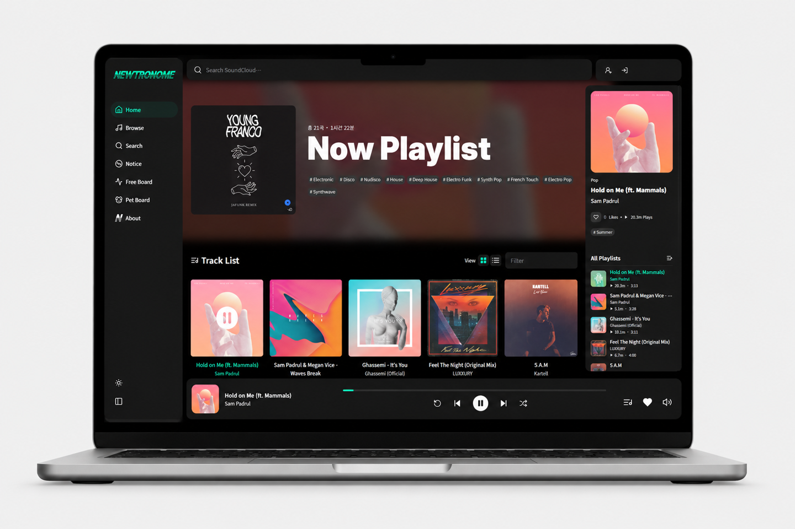
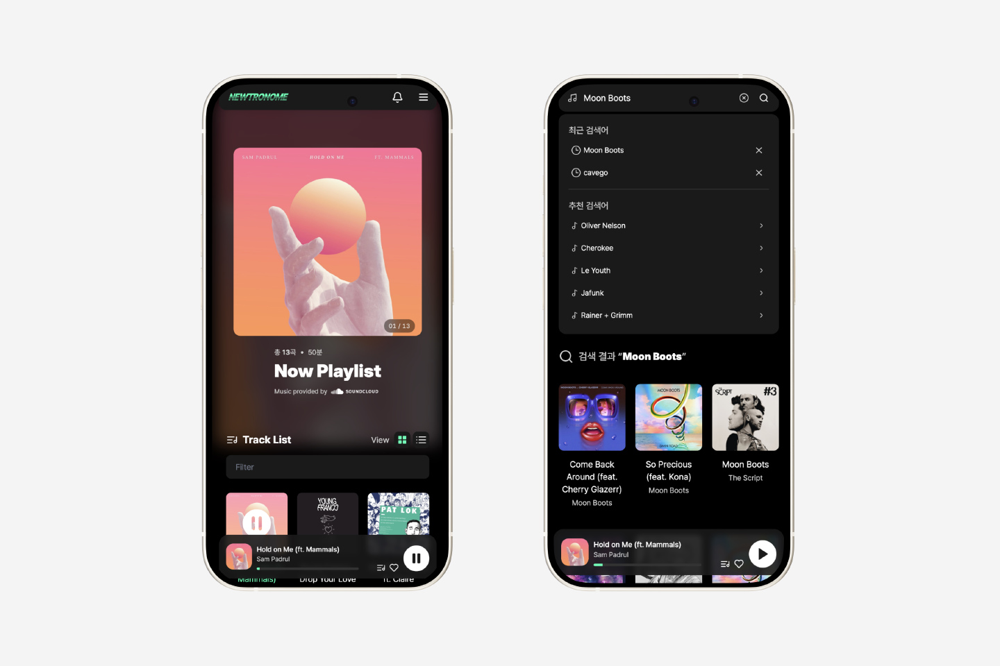

# Newtronome

[서비스 바로가기](https://newtronome.jsjweb0.workers.dev/) · [GitHub](https://github.com/jsjweb0/newtronome)

직접 고른 누디스코·하우스 음악을 SoundCloud 플레이리스트로 소개하고 랜덤으로 재생하는 음악 큐레이션 서비스입니다. iTunes 곡 검색·미리듣기, 사용자별 트랙 저장, 게시판도 함께 제공합니다.

| 항목      | 내용                                                         |
| --------- | ------------------------------------------------------------ |
| 개발 기간 | 2025.08 최초 제작 · 2026.07부터 리팩터링 및 기능 개선 진행 중 |
| 담당 범위 | 1인 개발 (기획, 디자인, 프론트엔드, Firestore 데이터 설계, 배포) |
| AI 활용   | 구현은 ChatGPT·Codex와 함께 진행, 기능·동작 정책 결정과 코드 리뷰 반영, 테스트 검증을 담당 |
| 디자인    | 메인 화면 레이아웃은 레퍼런스 참고, 게시판·공통 컴포넌트는 shadcn/ui 코드를 가져와 프로젝트에 맞게 수정, 별도 시안 없이 코드로 구현 |





## 반응형·접근성

| 구분       | 구현 내용                                                                                       |
| ---------- | ----------------------------------------------------------------------------------------------- |
| 반응형     | 큰 화면은 접이식 사이드바와 고정 플레이리스트, 작은 화면은 드롭다운 메뉴와 열고 닫는 플레이리스트 |
| 키보드     | 본문 바로가기 링크, 모바일 플레이리스트의 포커스 가두기와 `Escape` 닫기, 열린 동안 뒤쪽 화면 `inert` 처리, 닫은 뒤 여는 버튼으로 포커스 복귀 |
| 스크린리더 | 재생·패널 버튼의 상태별 접근성 이름, 재생 위치 슬라이더의 `aria-valuetext`, 페이지별 문서 제목     |
| 대화상자   | 아티스트 곡 패널을 Dialog로 구성하고 닫기 버튼에 초기 포커스                                     |
| 모션       | `prefers-reduced-motion` 설정 시 배너 슬라이더 자동 재생 중지                                   |
## 핵심 요약

- **재생**: 비공식 API 의존을 공식 SoundCloud Widget API로 바꾸고 Widget 이벤트와 React 상태(Zustand)를 동기화했습니다.
- **비동기 상태**: Query Key, 요청 번호, mutation variables로 늦게 끝난 요청이 최신 화면을 덮어쓰지 않게 했습니다.
- **서버 상태**: 게시판의 직접 구현한 캐시를 TanStack Query로 전환하고 변경 후 영향받는 Query만 갱신합니다.
- **데이터 무결성**: 게시글 번호 발급과 좋아요·권한 검사를 클라이언트 계산에서 Firestore 트랜잭션과 보안 규칙으로 옮겼습니다.
- **검증**: 단위·컴포넌트 테스트, Playwright E2E, Firestore 규칙 테스트를 PR마다 GitHub Actions에서 실행합니다.

### 서비스 확인 순서

1. 플레이리스트에서 곡을 재생하고 하단 플레이어의 현재 곡·재생 시간을 확인합니다.
2. 곡을 검색하고 미리듣기를 실행해 SoundCloud 재생이 정지하는지 확인합니다.
3. 검색 결과의 "다른 곡 보기"로 아티스트 최신곡 패널을 열고, 패널 안에서 다른 곡을 미리듣기합니다.

음악 탐색과 미리듣기는 로그인 없이 이용할 수 있습니다. Likes 저장과 게시글·댓글 작성에는 로그인이 필요합니다.

## 기술 스택

| 구분        | 사용 기술                                         |
| ----------- | ------------------------------------------------- |
| 프론트엔드  | React, TypeScript, Vite, Tailwind CSS             |
| 상태 관리   | Zustand, React Context, TanStack Query            |
| 인증·데이터 | Firebase Authentication, Firestore                |
| 음악 연동   | SoundCloud Widget API, iTunes Search / Lookup API |
| 테스트      | Vitest, Testing Library, Playwright               |
| 배포        | Cloudflare Workers Static Assets, GitHub Actions  |

### 상태 관리 역할

| 도구               | 담당 상태                                                         |
| ------------------ | ----------------------------------------------------------------- |
| TanStack Query     | iTunes 검색·아티스트 곡, 게시글·댓글 등 원격 데이터의 조회와 캐시 |
| Zustand            | 여러 화면이 공유하는 현재 곡·재생 여부·재생 시간                  |
| React Context      | 인증·테마·토스트·알림 등 앱 전반의 상태                           |
| 컴포넌트 로컬 상태 | 검색 입력값·열린 패널 등 화면 내부 상태                           |

초기에는 Context API로 음악 재생 상태를 공유했지만 재생 시간처럼 자주 바뀌는 값 때문에 구독 범위가 넓어졌습니다. 재생 상태를 Zustand로 옮기고 컴포넌트별로 필요한 값만 선택해 구독하도록 바꿨습니다.

## 문제 해결 사례

### 1. 비공식 API 의존 제거와 Widget 상태 동기화

**문제 — 외부 변경에 따른 재생 중단**
기존에는 비공식 API로 플레이리스트와 스트림 URL을 조회했습니다. Client ID나 요청 규격이 바뀌면 재생이 중단됐습니다.

**해결 — 공식 Widget API 전환**
공식 SoundCloud Widget API로 바꿔 Client ID 관리와 스트림 URL 변환을 없앴습니다. [useSoundCloudWidget](src/features/player/hooks/useSoundCloudWidget.ts)은 Widget 인스턴스와 이벤트 연결을 맡고 여러 화면이 공유하는 현재 곡·재생 여부·재생 시간은 Zustand 스토어로 관리합니다. Widget 응답은 런타임에서 검증해 잘못된 재생 시간이나 트랙 데이터를 무시합니다.

**문제 — 소스 전환 중 선택 유실**
플레이리스트와 Likes 단일 곡 재생은 Widget 하나를 함께 씁니다. 소스를 바꿔 로딩하는 동안 사용자가 다른 곡을 고르면 그 선택이 무시되거나, Widget이 이전 곡 위치로 이동했습니다.

`fetch` 요청이라면 `AbortSignal`로 취소하거나 늦은 응답을 버리면 되지만, Widget의 `load`는 완료 콜백만 받을 뿐 진행 중인 로딩을 취소할 수 없습니다. 그래서 로딩이 끝날 때까지 사용자의 선택을 미뤄 두기로 했습니다.

**해결 — 마지막 선택만 미뤘다가 실행**
로딩 중의 선택을 곡 번호가 아닌 "실행할 함수"로 `ref`에 저장해 두었다가 로딩이 끝나면 마지막 선택 하나만 실행합니다. 로딩이 실패하거나 컴포넌트가 정리되면 대기 중인 선택을 버립니다. 응답이 오지 않는 로딩은 시간 제한 후 오류 상태로 바꾸고 다시 시도할 수 있습니다.

**검증** — [Widget 훅 테스트](src/features/player/hooks/useSoundCloudWidget.test.tsx)에서 로딩 중 여러 번 선택하면 마지막 곡만 재생되는지, 로딩 실패 시 대기 중인 선택이 버려지는지 확인합니다. [재생 E2E](tests/e2e/playback.spec.js)에서는 빈 플레이리스트, Widget 오류, READY 이벤트 누락 시 화면 상태를 검사합니다.

### 2. 늦게 도착한 비동기 응답이 최신 상태를 덮어쓰는 문제

같은 원인의 문제가 여러 곳에서 발생했습니다. 이전 요청의 응답이 나중에 도착해 사용자가 마지막으로 선택한 상태를 바꾸는 문제입니다. 상황마다 맞는 방법을 골랐습니다.

| 상황                             | 해결 방법                                                                                  |
| -------------------------------- | ------------------------------------------------------------------------------------------ |
| 아티스트 A 조회 중 B 선택        | 아티스트 ID별 Query Key로 응답을 분리하고, `AbortSignal`로 쓸모없어진 A 요청 취소          |
| 미리듣기 곡을 빠르게 바꿈        | 재생 요청마다 번호를 매기고 최신 번호가 아닌 `play()` 결과는 무시                         |
| 게시글 A 조회수 요청 중 B로 이동 | 요청 시점의 게시판·게시글 ID를 mutation variables로 전달해 A의 응답이 B 캐시를 바꾸지 않음 |

**검증** — [검색 화면 테스트](src/features/itunes/pages/ITunesSearchPage.test.tsx)에서 늦은 A 응답과 이전 재생 실패가 최신 미리듣기를 바꾸지 않는지, [게시판 경합 E2E](tests/e2e/board-races.spec.ts)에서 늦은 조회수·삭제 요청과 백그라운드 refetch 중 수정 입력 유지를 확인합니다.

### 3. 게시판 서버 상태를 TanStack Query로 전환

**문제 — 직접 구현한 캐시와 책임 혼재**
게시판은 `PostsProvider`에서 `useRef`로 목록을 캐싱하고, 게시판별 요청 version을 비교해 늦은 응답을 걸러 냈습니다. 기능이 늘면서 캐시 무효화와 요청 상태를 모두 직접 관리해야 했고 Firestore 접근 로직까지 Provider에 섞여 있었습니다.

**해결 — 데이터 접근 분리와 Query Key 설계**

- Firestore 접근을 service 계층으로 분리하고 게시판 서버 상태를 TanStack Query로 옮겼습니다.
- 게시글 Query Key는 게시판 종류·게시글 ID·사용자 ID로 목록과 상세, 내 게시글을 구분합니다.
- 댓글 조회 결과에는 사용자별 `liked` 상태가 포함되므로 조회 사용자 UID를 Query Key에 넣었습니다.
- 생성·수정·삭제 후에는 영향받는 Query만 무효화합니다. 조회수는 저장 성공 후 `setQueryData`로 상세와 목록을 갱신합니다.

**결과**
요청 실패 시 작성 중인 입력과 기존 조회 데이터를 유지하는 동작을 테스트로 확인했습니다.

TanStack Query는 아티스트 곡 조회에 먼저 적용했습니다. 아티스트 ID별 Query Key와 5분 `staleTime`을 적용해, 캐시가 최신 상태인 5분 동안은 같은 아티스트의 패널을 다시 열어도 요청 없이 저장된 응답을 씁니다. 이후 iTunes 일반 검색과 게시판으로 범위를 넓혔습니다.

근거 코드: [postQueryKeys.ts](src/features/board/queries/postQueryKeys.ts), [commentQueryKeys.ts](src/features/board/queries/commentQueryKeys.ts) · 검증: [게시판 오류 E2E](tests/e2e/board-errors.spec.ts), [검색 화면 테스트](src/features/itunes/pages/ITunesSearchPage.test.tsx)(아티스트 곡 캐시 재사용)

### 4. 클라이언트를 신뢰하지 않는 게시판 데이터 설계

게시글 번호 발급, 관리자 권한, 좋아요 수정을 클라이언트 계산에 맡기지 않고 Firestore 트랜잭션과 보안 규칙으로 검증합니다.

<details>
<summary>상세 내용 보기</summary>

**문제 — 게시글 번호 중복 가능성**
글쓰기 화면이 게시글 목록 전체를 불러온 뒤 `가장 큰 번호 + 1`을 클라이언트에서 계산해 저장했습니다. 두 사용자가 동시에 글을 쓰면 같은 번호가 발급될 수 있었고 번호 계산만을 위해 글쓰기 화면에서도 목록을 조회해야 했습니다.

**해결 — 트랜잭션과 보안 규칙으로 이중 검증**

- `postCounters/{게시판}` 카운터 문서를 `runTransaction`으로 읽고 1 증가시킨 값을 게시글 문서 ID로 저장합니다. 동시에 같은 카운터를 수정하면 Firestore가 트랜잭션을 다시 실행합니다.
- Firestore 규칙에서도 `getAfter`로 "카운터가 정확히 1 증가했고, 새 문서 ID가 그 값과 같은지" 검사합니다. 앱 코드를 거치지 않은 요청도 번호를 건너뛰거나 중복시킬 수 없습니다.
- 작성 시각은 클라이언트 시간이 아닌 `serverTimestamp()`로 저장합니다. 규칙은 이 값이 `request.time`과 같은지 확인합니다.

**문제 — 이메일 기반 권한 판별**
관리자는 특정 이메일 문자열로, 작성자는 UID 또는 이메일로 판별했습니다. 권한 기준이 코드와 규칙에 하드코딩되어 있었고 판별 기준도 여러 개였습니다.

**해결 — Custom Claim과 UID로 통일**
Firebase Admin SDK 스크립트([set-admin-claim.mjs](scripts/set-admin-claim.mjs))로 관리자 계정에 `admin` Custom Claim을 부여하고 규칙과 UI 모두 `token.admin`과 UID로만 판별하도록 바꿨습니다. 게시글·댓글에 이메일 필드를 저장하지 못하도록 규칙에서 허용 필드도 제한했습니다.

**좋아요 조작 방지**
좋아요 수정은 한 번에 본인 UID 하나만 추가하거나 제거할 수 있고 `likeCount`도 그에 맞춰 정확히 1만 증가·감소하도록 규칙에서 제한합니다.

**검증** — [Firestore 규칙 테스트](tests/firestore.rules.test.ts)에서 카운터를 건너뛰거나 다른 ID로 생성하는 요청, 클라이언트 작성 시각, 다른 사용자 UID, 이메일만 있고 Claim이 없는 관리자 요청이 거부되는지 Emulator로 테스트합니다.

근거 코드: [postsService.ts](src/features/board/services/postsService.ts), [firestore.rules](firestore.rules)

</details>

### 그 밖의 개선

- **TypeScript 점진 전환**: Context·플레이어·게시판 순서로 JavaScript 파일을 나눠 전환했습니다.
- **외부 데이터 런타임 검증**: 타입만으로 실제 응답을 보장할 수 없어 iTunes 응답, Widget 응답, Firestore 문서를 검증·변환합니다. 잘못된 항목은 제외하고 저장 트랙의 형식 오류는 오류 상태로 표시합니다.
- **번들 분리**: 페이지 라우트를 지연 로딩하고 Firebase와 React를 별도 청크로 분리했습니다.
- **배포 후 청크 로딩 실패 대비**: 새 배포로 이전 청크 파일이 사라지면 열려 있던 탭이 화면을 표시하지 못할 수 있습니다. `vite:preloadError`가 발생하면 `sessionStorage` 기록으로 세션당 한 번만 새로고침하고, 그래도 실패하면 [PageErrorBoundary](src/components/ui/PageErrorBoundary.tsx)가 새로고침·홈 이동 버튼을 안내합니다.
- **댓글 보존 정책**: 게시글이 삭제돼도 작성자의 활동 기록을 위해 댓글은 유지하며, 원본 글이 없는 댓글은 이동 링크를 비활성화합니다.

## 테스트와 CI

| 테스트                   | 검증 내용                                                                  |
| ------------------------ | -------------------------------------------------------------------------- |
| Vitest + Testing Library | 재생 상태, 비동기 응답 순서, 검색·캐시, Query Key·무효화, mutation 실패 처리 |
| Playwright               | 재생 UI, 게시글·댓글 CRUD, 경합·오류 시나리오                              |
| Firestore Emulator       | 인증·권한·필드 조건에 따른 보안 규칙                                       |

| 워크플로                                         | 실행 시점      | 내용                                               |
| ------------------------------------------------ | -------------- | -------------------------------------------------- |
| [PR Checks](.github/workflows/pr-checks.yml)     | PR             | typecheck, lint, 단위 테스트, build, Firestore 규칙 |
| [Playwright](.github/workflows/playwright.yml)   | PR, `main` push | Chromium E2E                                       |
| [Deploy](.github/workflows/deploy.yml)           | `main` push    | Cloudflare Workers, GitHub Pages 배포              |

로컬 실행:

```bash
npm run typecheck
npm run lint
npm run test:run
npm run build
```

브라우저 테스트는 최초 실행 전 Chromium을 설치합니다.

```bash
npx playwright install chromium
npm run test:e2e
```

Firestore 규칙 테스트는 Java가 설치된 환경에서 로컬 Emulator로 실행하며 `test:run`에는 포함되지 않습니다.

```bash
npm run test:rules
```

E2E에서 SoundCloud 이벤트와 게시판 서비스 응답은 테스트가 제어하며, 게시판 테스트는 운영 Firebase에 접근하지 않는 메모리 데이터를 사용합니다.

AI가 만든 변경은 PR 단위로 나눠 코드 리뷰를 받고, 지적 사항을 우선순위대로 반영한 뒤 타입 검사·테스트·빌드와 실제 화면으로 확인했습니다.

## 설치·실행·배포

CI와 같은 Node.js 22 환경을 권장합니다.

```bash
npm ci
npm run dev
```

### 데이터 연결 환경

기본 설정으로 실행하면 기존 서비스의 Firebase 프로젝트와 외부 음악 API에 연결됩니다. 독립된 데이터 환경에서 실행하려면 `src/firebase.ts`를 본인 Firebase 설정으로 변경하고 인증·Firestore 규칙과 게시판별 `postCounters` 문서를 준비해야 합니다.

### 배포

Cloudflare Workers Static Assets로 배포합니다. `main` 브랜치에 push하면 GitHub Actions가 빌드 후 Cloudflare Workers와 GitHub Pages에 자동 배포합니다.

## 폴더 구조

```txt
src/
  assets/          이미지, 폰트, 전역 스타일
  components/      공통 UI와 레이아웃
  contexts/        인증, 테마, 토스트, 알림 상태
  features/
    board/         게시글·댓글 Query Hook, Query Key, Firestore 서비스와 타입
    bookmarks/     저장 트랙 UI와 데이터 처리
    itunes/        검색·미리듣기와 API 응답 검증
    player/        Widget 연동 훅, 스토어, 타입
  hooks/           공통 훅
  layouts/         페이지 레이아웃
  pages/           인증, 게시판, 사용자 페이지
  utils/           포맷팅과 데이터 변환
scripts/           관리자 Custom Claim 설정 스크립트
workers/           정적 파일 제공
tests/e2e/         브라우저 테스트
tests/             Firestore 규칙 테스트
firestore.rules    Firestore 접근 제어 규칙
wrangler.toml      Cloudflare 배포 설정
```

## 알려진 제약과 향후 개선

- **게시판 페이지네이션**: 현재는 게시판의 모든 글을 한 번에 조회해 클라이언트에서 검색·정렬·페이지 이동을 처리하므로, 글이 늘어나면 로딩 시간과 Firestore 읽기 횟수가 함께 늘어납니다. 커서 기반 페이지네이션으로 한 페이지 분량만 조회하도록 개선할 계획이며, Firestore는 본문 부분 검색을 지원하지 않아 검색 방식도 함께 검토해야 합니다.
- iTunes 검색은 미국 스토어 기준이며 최대 100개 결과를 받아 20개씩 표시합니다.
- **iPhone Safari의 iTunes 검색 실패 개선**: iPhone Safari에서 iTunes 검색 요청이 Music 앱 스킴(`musics://`)으로 리디렉트되어 브라우저의 CORS 정책에 의해 차단되는 현상을 확인했습니다. Mac Safari에서는 정상 동작했습니다. 서버 측 프록시를 시도했으나 Apple API의 429 응답으로 검색이 실패해 직접 호출로 복구했습니다. 프록시의 요청 제한 원인과 대응 방법을 검토할 예정이며, 아티스트 곡 조회도 iPhone에서 추가 확인이 필요합니다.
- 플레이리스트 전체 로딩은 Widget 내부 렌더링 방식에 의존하므로 곡 수나 Widget 동작이 바뀌면 다시 확인해야 합니다.

### 자동 테스트로 확인하지 않은 부분

- 게시판 E2E는 Firestore 서비스 경계를 모킹하므로 실제 Firebase Authentication·보안 규칙·네트워크를 포함한 통합 테스트가 추가로 필요합니다. 실제 음원 출력과 브라우저 자동재생 정책도 자동 테스트 범위 밖입니다.
- 좋아요 조작 거부, 로그인 계정 전환 중 늦은 프로필 응답 처리, 청크 로딩 실패 복구는 아직 전용 자동 테스트가 없습니다.
- 자동 E2E는 Chromium에서만 실행합니다. Chrome과 iPhone Safari는 수동으로 테스트했고, Firefox 호환성은 추가 확인이 필요합니다.
