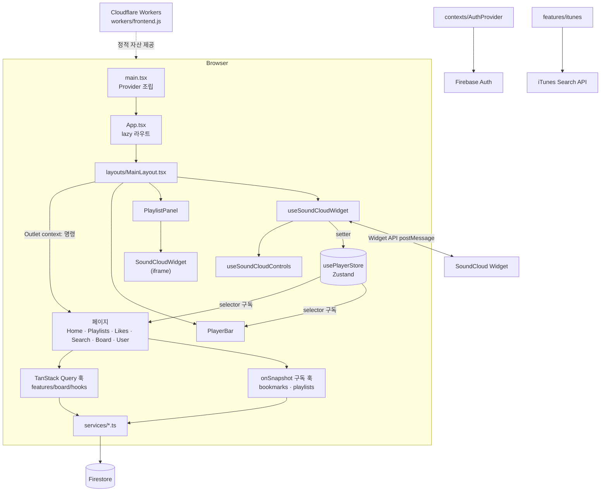
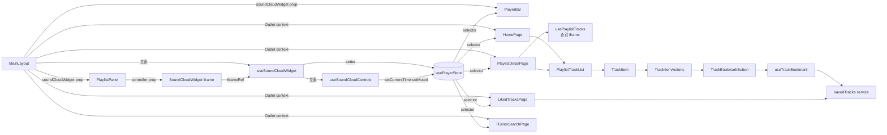
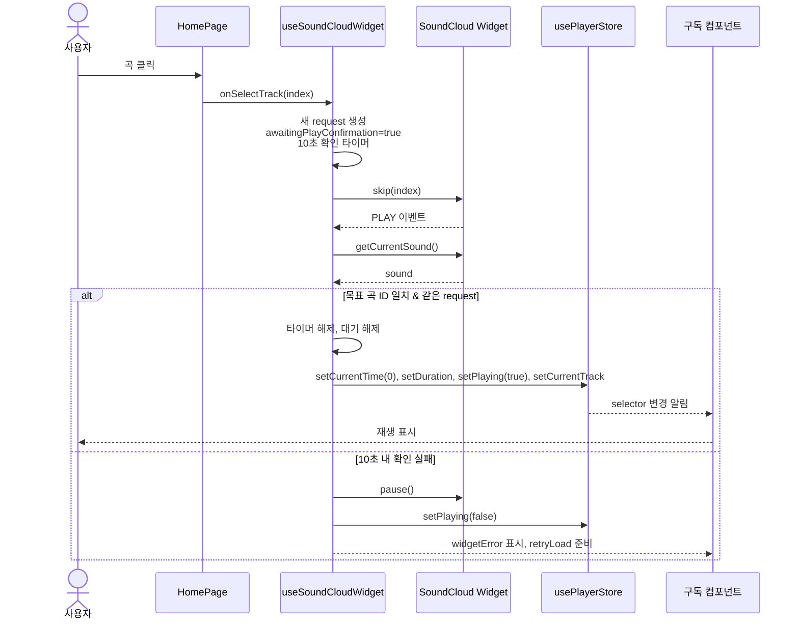
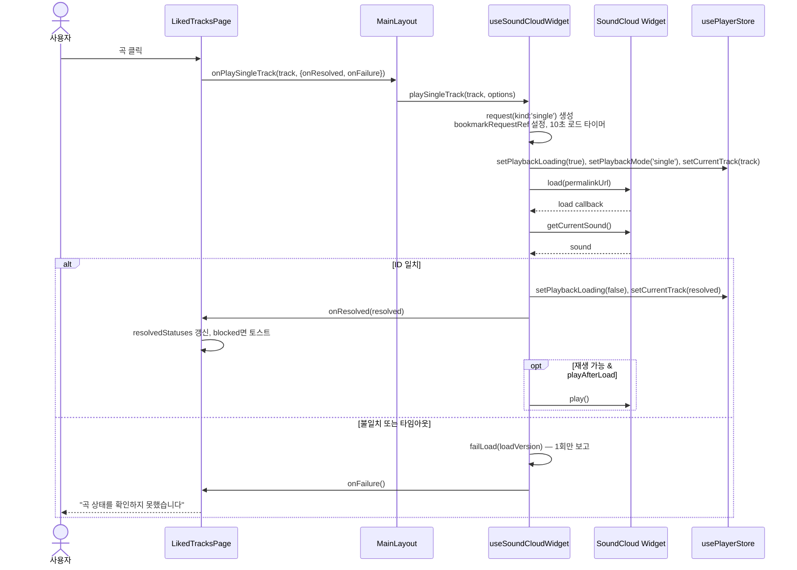
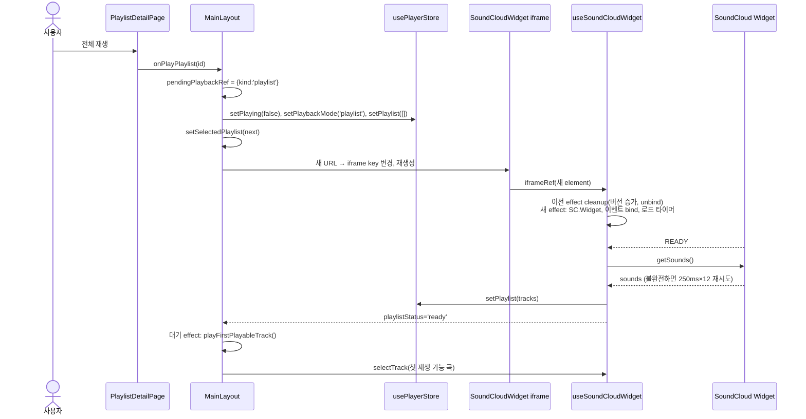
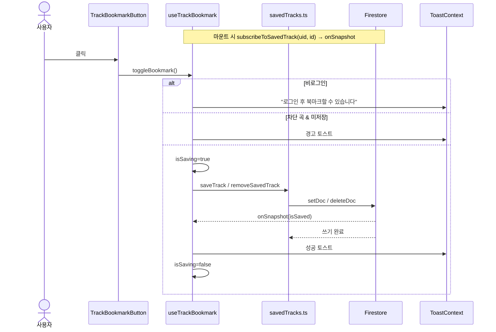
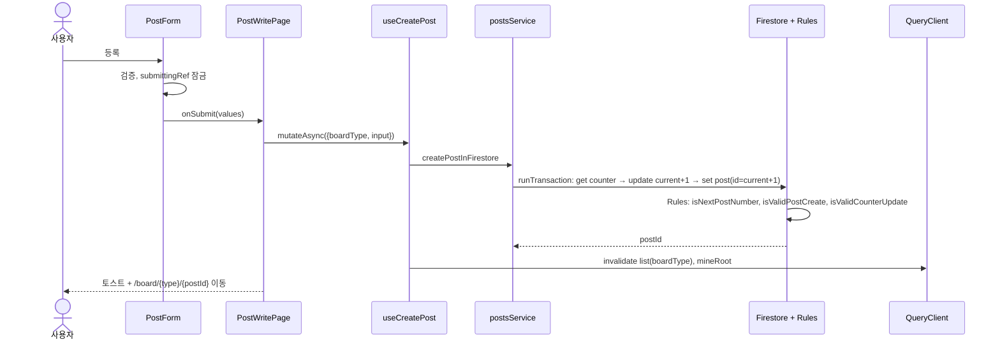
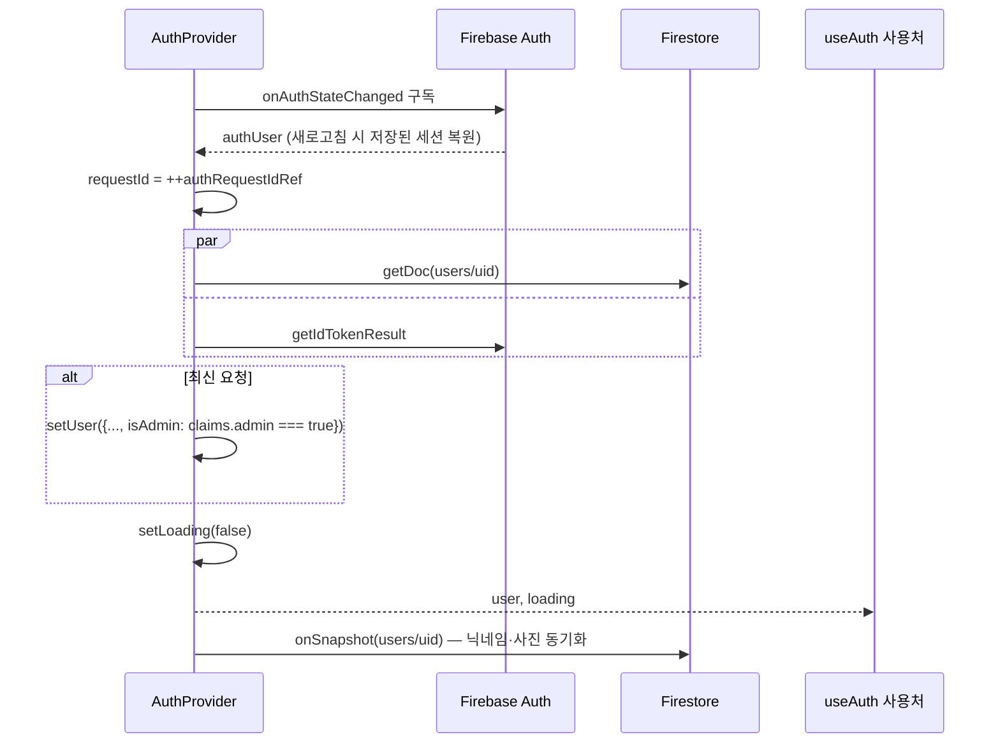

# NEWTRONOME 아키텍처 가이드

> 대상: 프로젝트를 인수인계받는 개발자, 기술 면접 준비
> 기준 커밋: `07466c0` (main)
> 원칙: 모든 설명은 실제 파일·함수를 근거로 한다. 설계 의도는 코드 주석이나 `docs/player-refactoring-plan.md`에 적힌 경우에만 "의도"로 쓰고, 나머지는 동작만 설명한다.
> 줄 번호는 기준 커밋 시점 값이다. 코드가 바뀌면 함수 이름으로 찾는다.

---

## 1. 프로젝트 개요와 전체 아키텍처

NEWTRONOME은 직접 큐레이션한 SoundCloud 플레이리스트를 재생하는 웹 앱이다. 다음 기능이 하나의 레이아웃 안에서 함께 동작한다.

- 재생: SoundCloud 플레이리스트 전체 재생, 개별 곡 재생
- 좋아요(북마크): 곡·플레이리스트 저장
- iTunes 30초 미리듣기 검색
- 게시판: 공지·자유게시판, 댓글, 좋아요



계층은 다섯 가지다.

| 계층 | 역할 | 대표 파일 |
|---|---|---|
| 진입·조립 | Provider 순서, 라우트 분할 | `src/main.tsx`, `src/App.tsx` |
| 레이아웃 | 선택된 플레이리스트, 재생 위젯 소유, 페이지에 명령 제공 | `src/layouts/MainLayout.tsx` |
| 페이지·UI | 사용자 입력 처리, 상태 구독 | `src/pages/*`, `src/features/*/pages`, `src/components/*` |
| 상태·로직 | 재생 상태, 서버 상태, 구독 | `features/player/stores`, `features/*/hooks`, `contexts/*` |
| 외부 연동 | Firestore·외부 API 호출, 응답 검증 | `features/*/services`, `features/*/utils`, `src/firebase.ts` |

---

## 2. 기술 스택별 역할과 실제 사용 위치

| 기술 | 역할 | 실제 사용 위치 |
|---|---|---|
| React 19 | UI | 전체. `main.tsx`에서 `React.StrictMode`로 렌더링 |
| TypeScript | 타입 검사 | `npm run typecheck`(`tsc --noEmit`), CI에서 실행 |
| Vite 6 | 개발 서버·빌드 | `vite.config.js`. `manualChunks`로 `firebase`, `react-vendor` 청크 분리 |
| React Router 7 | 라우팅 | `App.tsx`(라우트 13개, 모두 `lazy`), `MainLayout`의 `<Outlet context>`, `constants/routes.ts` |
| Zustand 5 | 재생 상태 전역 저장 | `features/player/stores/usePlayerStore.ts` 한 곳뿐 |
| TanStack Query 5 | 게시판·iTunes 서버 상태 캐시 | `features/board/hooks/*`(13개), `features/board/queries/*QueryKeys.ts`, `features/itunes/hooks/*` |
| Firebase Auth | 로그인·회원가입·비밀번호 변경 | `contexts/AuthProvider.tsx`, `pages/user/AccountProfile.tsx` |
| Firestore | 게시판·좋아요·북마크·프로필 저장 | `features/*/services/*.ts`, `components/ui/LikeButton.tsx`, `pages/user/AccountProfile.tsx` |
| Firestore Security Rules | 실제 권한 판단 | `firestore.rules`, 테스트 `tests/firestore.rules.test.ts` |
| SoundCloud Widget API | 음악 재생 | `index.html`의 `api.js`, `features/player/hooks/useSoundCloudWidget.ts`, `features/playlists/hooks/usePlaylistTracks.ts` |
| iTunes Search API | 검색·30초 미리듣기 | `features/itunes/services/searchITunesTracks.ts`, `getArtistTracks.ts`, `ITunesSearchPage.tsx`의 `<audio>` |
| Tailwind CSS 4 | 스타일 | `@tailwindcss/vite`, `src/assets/css/index.css` |
| Headless UI | 접근성 있는 다이얼로그 | `components/ui/ConfirmDialog.tsx`, `features/itunes/components/ArtistTracksPanel.tsx` |
| Swiper | 히어로 이미지 슬라이더 | `components/ui/Slider.tsx` → `features/playlists/components/PlaylistHero.tsx` |
| dayjs | 날짜 표시 | `utils/format.ts`, 게시판 컴포넌트 |
| lucide-react | 아이콘 | 전체 |
| Vitest + Testing Library | 단위·컴포넌트 테스트 | `src/**/*.test.ts(x)`, `workers/frontend.test.js` |
| Firebase Emulator + rules-unit-testing | Rules 테스트 | `npm run test:rules` |
| Playwright (+ axe-core) | e2e·접근성 | `tests/e2e/*.spec.*`, SoundCloud Mock(`tests/e2e/soundcloud.js`) |
| Cloudflare Workers Static Assets | 배포 | `wrangler.toml`(SPA fallback), `workers/frontend.js`(`env.ASSETS.fetch` 전달) |
| GitHub Actions | CI·배포 | `.github/workflows/pr-checks.yml`, `deploy.yml`, `playwright.yml` |

---

## 3. 디렉터리와 주요 파일

```
src/
├─ main.tsx                 Provider 조립, Vite 청크 로드 실패 시 1회 새로고침
├─ App.tsx                  라우트 정의(lazy)
├─ firebase.ts              Firebase 앱·auth·db·analytics 초기화
├─ layouts/MainLayout.tsx   재생 오케스트레이션 + 화면 골격
├─ features/
│  ├─ player/               재생 핵심
│  │  ├─ hooks/useSoundCloudWidget.ts   위젯 연결·요청 수명·이벤트 처리
│  │  ├─ hooks/useSoundCloudControls.ts 재생·탐색·음소거·이전/다음/랜덤
│  │  ├─ stores/usePlayerStore.ts       표시용 재생 상태
│  │  ├─ components/SoundCloudWidget.tsx 위젯 iframe
│  │  ├─ utils/mapSoundCloudWidgetTrack.ts 위젯 응답 → PlayerTrack 검증·변환
│  │  └─ types/                          PlayerTrack, TrackSelectionRequest, SDK 타입
│  ├─ playlists/            정적 플레이리스트 데이터, 목록·상세, 저장
│  │  ├─ data/playlists.ts               PLAYLISTS 배열(18개)
│  │  ├─ hooks/usePlaylistTracks.ts      상세 페이지 전용 숨김 iframe으로 곡 목록 조회
│  │  ├─ hooks/usePlaylistBookmark.ts    플레이리스트 저장 구독·토글
│  │  └─ pages/PlaylistsPage.tsx, PlaylistDetailPage.tsx
│  ├─ bookmarks/            곡 좋아요
│  │  ├─ services/savedTracks.ts         저장·삭제·구독, isSavedTrack 검증
│  │  ├─ hooks/useTrackBookmark.ts       곡 1개 저장 상태 구독·토글
│  │  ├─ components/TrackBookmarkButton.tsx
│  │  └─ pages/LikedTracksPage.tsx
│  ├─ itunes/               검색·미리듣기
│  │  ├─ services/searchITunesTracks.ts, getArtistTracks.ts
│  │  ├─ hooks/useITunesSearch.ts, useArtistTracks.ts
│  │  ├─ utils/itunesResponse.ts         응답 검증
│  │  └─ pages/ITunesSearchPage.tsx
│  └─ board/                게시판 데이터 계층
│     ├─ services/postsService.ts, commentsService.ts
│     ├─ hooks/*                          Query·Mutation 훅 13개
│     ├─ queries/postQueryKeys.ts, commentQueryKeys.ts
│     └─ types/, utils/
├─ pages/                   홈, 로그인·회원가입, 게시판 페이지, 계정·내 활동
├─ components/              ui(공용), board(게시판 UI), layout(PlayerBar·Sidebar·HeaderButtons),
│                           player(PlaylistPanel), track(TrackItem), auth, icons
├─ contexts/                Auth · Toast · DarkMode · Notification (Context 파일과 Provider 파일 분리)
├─ hooks/useForm.ts         로그인·회원가입 폼 상태
├─ utils/                   format, image(toHighResArtwork), profile 검증, role, pagination 등
└─ constants/routes.ts      경로·제목 상수
firestore.rules · firebase.json · wrangler.toml · workers/ · tests/ · docs/
```

**배치 규칙 참고**: 플레이어·플레이리스트·북마크·iTunes는 `features/<기능>`에 페이지까지 모여 있다. 게시판은 데이터 계층만 `features/board`에 있고, UI는 `components/board`, 페이지는 `pages/board`에 있다. 플레이어 UI(`PlayerBar`, `PlaylistPanel`)는 `components/`에 있다.

---

## 4. Provider와 라우트 구성

`src/main.tsx`의 Provider 순서는 다음과 같다(바깥 → 안).

```
React.StrictMode
└ QueryClientProvider (new QueryClient(), 기본 옵션)
  └ DarkModeProvider
    └ BrowserRouter
      └ NotificationProvider
        └ ToastProvider        (Toast 컴포넌트를 ref로 호출)
          └ AuthProvider       (useToast, useNavigate 사용 → Toast·Router 안쪽이어야 함)
            └ App
```

`App.tsx`는 모든 페이지를 `MainLayout`의 자식 라우트로 둔다. 따라서 **어느 페이지로 이동해도 `MainLayout`과 재생 위젯은 언마운트되지 않고 재생이 이어진다.** 페이지는 `MainLayout` 안의 `<Suspense>`와 `PageErrorBoundary key={location.pathname}`로 감싸져 있다.

---

## 5. 재생 상태 모델

### 5.1 상태가 나뉘는 세 곳

| 위치 | 내용 | 누가 읽는가 |
|---|---|---|
| `usePlayerStore` (Zustand) | `tracks`, `currentTrack`, `playbackMode('playlist'｜'single')`, `isPlaying`, `currentTime`, `duration`, `isMuted`, `isPlaybackLoading` | 페이지, `PlayerBar`, 훅 내부(`getState()`) |
| `useSoundCloudWidget` 로컬 state | `isReady`, `playlistStatus('loading'｜'ready'｜'empty'｜'error')`, `widgetTrack`, `widgetError`, `frameVersion`, `iframeElement` | `MainLayout`이 받아 Outlet context·props로 전달 |
| `useSoundCloudWidget` ref | `widgetRef`, `currentRequestRef`, `widgetLoadVersionRef`, `playbackLookupVersionRef`, `bookmarkRequestRef`, 타이머 ref들, `retryLoadRef` | 훅 내부 전용(렌더링과 무관한 수명 관리) |

`docs/player-refactoring-plan.md`에 따르면 스토어는 화면 표시 상태이고, 요청 수명과 SDK 응답 검증은 위젯 훅이 맡는다.

### 5.2 요청 객체 `TrackSelectionRequest`

`features/player/types/player.types.ts`에 정의되어 있다.

```ts
| { kind: 'playlist'; playlistUrl; trackId; index; playAfterLoad; awaitingPlayConfirmation }
| { kind: 'single';   track; options?: { onResolved?, onFailure? }; playAfterLoad }
```

- 곡을 고를 때마다 **새 객체**를 만들어 `currentRequestRef`에 넣는다(`selectTrack` 188~197행, `playSingleTrack`의 `loadSingleTrack` 698~705행).
- 비동기 콜백은 자신이 만든 요청 객체를 기억하고, 실행 시점에 `currentRequestRef.current !== request`이면 결과를 버린다. 같은 곡을 A→B→A로 다시 골라도 객체가 달라 구별된다(계획 문서 DEC-04).
- `playAfterLoad`: 로드가 끝나면 재생할지 여부. `pause()`(50행)는 이 값만 `false`로 바꾸고 로드 정리는 계속 진행한다(DEC-02). `toggle()`(83행)과 `play()`(357행)도 이 값을 갱신한다.
- `awaitingPlayConfirmation`: 같은 플레이리스트 안에서 `skip`으로 곡을 바꾼 뒤, 위젯이 목표 곡을 실제로 재생했는지 기다리는 중인지 여부(DEC-05).

### 5.3 버전 ref

| ref | 증가 시점 | 쓰임 |
|---|---|---|
| `widgetLoadVersionRef` | 위젯 연결(effect 시작), `load` 요청, 실패 처리, cleanup | `load` 콜백·타이머·`getSounds` 응답이 최신 로드에 속하는지 확인 |
| `playbackLookupVersionRef` | PLAY·PAUSE 이벤트, `skip` 요청, 재생 확인 타임아웃 | `getCurrentSound`·`getDuration` 응답이 최신 재생 이벤트에 속하는지 확인 |

계획 문서 DEC-06은 "새 선택 없이 발생하는 자연 전환·PLAY/PAUSE 조회는 요청 객체와 유효 기간이 달라서 버전을 유지했다"고 적고 있다.

---

## 6. 주요 기능별 실행 흐름

### 6.1 앱 시작과 첫 플레이리스트 로드

1. `MainLayout`이 `PLAYLISTS` 중 하나를 무작위로 골라 `selectedPlaylist` 초깃값으로 쓴다(`useState(() => PLAYLISTS[random])`).
2. `useSoundCloudWidget(selectedPlaylist.soundCloudUrl)` 호출 → `PlaylistPanel` 안의 `SoundCloudWidget`이 iframe을 렌더링한다. iframe의 `ref`가 `iframeRef` 콜백으로 연결되어 `iframeElement` state가 설정된다.
3. 위젯 effect(364행)가 실행된다.
   - `window.SC`가 없으면 `playlistStatus='error'`
   - 있으면 `SC.Widget(iframe)` 생성, 로드 버전 증가, 10초 로드 타이머 시작(`startLoadTimer`)
   - READY·PLAY·PAUSE·FINISH·PLAY_PROGRESS·ERROR 이벤트 바인딩
4. READY(`handleReady`, 520행) → `isReady=true`, 현재 곡·길이 조회. 플레이리스트 모드면 `updatePlaylistTracks`(465행)를 호출한다.
5. `updatePlaylistTracks`는 `widget.getSounds`를 호출한다. 배열이 아니거나 일부 곡 정보가 비어 있으면 **250ms 간격으로 최대 12회** 재시도하고(`PLAYLIST_LOAD_RETRY_DELAY_MS`, `PLAYLIST_LOAD_MAX_RETRIES`), 완성되면 `setPlaylist(tracks)`와 `playlistStatus='ready'`로 설정한다. 끝내 불완전하면 `failLoad`.
6. 홈(`HomePage.tsx`)은 스토어의 `tracks`를 구독해 `PlaylistHero`와 `PlaylistTrackList`를 렌더링한다.

### 6.2 같은 플레이리스트 안에서 곡 선택 (`selectTrack`, 170행)

- 차단 곡(`playbackStatus === 'blocked'`)이면 무시한다.
- 새 요청 객체를 만든다.
- **이미 플레이리스트 모드이고 로딩 중이 아니면**: `awaitingPlayConfirmation=true`, 10초 재생 확인 타이머를 걸고 `widget.skip(index)`(233행)를 호출한다. 이후 PLAY 이벤트에서 목표 곡 ID가 확인되면 대기를 해제하고 `isPlaying=true`로 만든다(`updateCurrentTrack`). 10초 안에 확인되지 않으면 일시정지와 오류 메시지를 표시하고 `retryLoadRef`에 강제 로드 재시도를 넣는다.
- **그 외(단일 곡 모드에서 돌아오는 경우, 강제 로드)**: `isPlaybackLoading=true`, 로드 버전 증가, 스토어를 선택 곡으로 미리 갱신한 뒤 `widget.load(playlistUrl, { start_track: index, callback })`(318행)를 호출한다. 콜백의 `confirmLoadedTrack`은 250ms 간격으로 `getCurrentSound`를 다시 조회한다. 곡 ID가 일치하고 필수 정보가 채워지면 로딩을 해제하고, `playAfterLoad`가 참이면 `widget.play()`를 호출한다. ID가 다르거나 `policy === 'BLOCK'`이면 `failLoad`.

### 6.3 단일 곡 재생 (`playSingleTrack`, 671행)

좋아요 페이지와 플레이리스트 상세 페이지에서 쓴다. 재생 큐(스토어 `tracks`)를 바꾸지 않고 곡 하나만 위젯에 로드한다.

1. 페이지가 `onPlaySingleTrack(track, { onResolved, onFailure })`를 호출한다. `MainLayout.requestSingleTrack`(117행)은 전체 재생 대기 중 플레이리스트가 로딩 중이면 대기열(`pendingPlaybackRef`)에 넣고, 아니면 바로 `playSingleTrack`을 호출한다.
2. `loadSingleTrack`: 새 요청 객체 생성, `bookmarkRequestRef={ id: loadVersion, reported: false, onFailure }`, `playbackMode='single'`, 스토어를 선택 곡으로 갱신, `widget.load(permalinkUrl)`.
3. 로드 콜백 → `getCurrentSound` → `mapSoundCloudWidgetTrack`로 검증. ID가 일치하면 로딩을 해제하고 `onResolved(resolvedTrack)`를 호출한다(페이지가 `resolvedStatuses`에 재생 가능 상태를 기록). 차단 곡이면 일시정지만 하고 `reported=true`로 둔다. 아니면 `playAfterLoad`일 때 재생한다.
4. 실패하면 `failLoad`가 `bookmarkRequestRef`를 한 번만 보고 처리하고(`reported`) `onFailure`를 호출한다. 이 경우 플레이리스트 전체 오류로 바꾸지 않는다(이미 플레이리스트를 불러온 적이 있으면 `playlistStatus` 유지).

### 6.4 다른 플레이리스트 전체 재생 (`MainLayout.playPlaylist`, 138행)

- **다른 플레이리스트**: `pendingPlaybackRef={kind:'playlist'}`, 스토어를 `setPlaying(false)`·`setPlaybackMode('playlist')`·`setPlaylist([])`로 비운 뒤 `setSelectedPlaylist(next)`. URL이 바뀌어 `SoundCloudWidget`의 iframe `key`가 바뀌고 iframe이 새로 만들어진다. 위젯 effect가 다시 실행되어 6.1의 3~5단계를 거친다.
- **대기 재생 effect**(193~207행): `playlistStatus`가 `ready`이고 `tracks`가 채워지면 `playFirstPlayableTrack`(차단되지 않은 첫 곡을 `selectTrack`)을 실행한다.
- **같은 플레이리스트**: 이미 재생 중이면 `toggle`. 단일 곡 모드라 목록이 비어 있으면 `reloadPlaylistFrame()`으로 `frameVersion`을 올려 iframe을 새로 만든다.

### 6.5 이전·다음·랜덤 (`useSoundCloudControls.moveTrack`)

- 플레이리스트 모드에서만 동작한다.
- 기준 곡은 `getNavigationTrackId()`다. 재생 확인 대기 중이면 목표 곡 ID, 아니면 스토어 `currentTrack.id`를 쓴다.
- 차단 곡과 현재 곡을 제외한 후보 중에서 방향에 맞는 인덱스를 골라 `selectTrack`을 호출한다. 후보가 없으면 일시정지한다.
- 단일 곡이 끝나면(`handleFinish`, 574행) 처음으로 되감고 정지한다. 플레이리스트 모드의 다음 곡 진행은 위젯 자체 동작에 맡긴다(FINISH 핸들러가 `single`일 때만 처리).

### 6.6 iTunes 검색과 미리듣기 (`ITunesSearchPage.tsx`)

- 검색은 폼 제출 시에만 실행된다(`runSearch` → `setSearchKeyword`). `useITunesSearch`의 쿼리 키는 `['itunes','search',keyword]`, `staleTime` 5분이고, TanStack Query의 `signal`을 `fetch`에 넘긴다. 같은 검색어를 다시 제출하면 `refetch`.
- 응답은 `isITunesSearchResponse`·`isITunesTrack`로 검증한다.
- 미리듣기는 페이지의 `<audio>` 하나로 재생한다. 요청마다 `previewRequestIdRef`를 증가시켜 늦게 끝난 `play()` 결과를 버리고, `AbortError`와 `MEDIA_ERR_ABORTED`는 안내하지 않는다.
- SoundCloud와 서로 배타적으로 재생한다. 미리듣기를 시작하면 `onPauseSoundCloud()`를 호출하고, 스토어 `isPlaying`이 `true`가 되면 effect에서 `stopPreview()`를 호출한다.
- 최근 검색어 5개는 `localStorage('recentSearches')`에 저장하고, 읽을 때 문자열 배열인지 검증한다.

### 6.7 곡 좋아요(북마크)

- `TrackBookmarkButton` → `useTrackBookmark(track)`. 로그인 사용자면 `subscribeToSavedTrack(uid, trackId)`로 `users/{uid}/savedTracks/{trackId}` 문서 존재 여부를 실시간 구독한다.
- 토글: 차단 곡은 새로 저장할 수 없다. `saveTrack`은 저장할 필드만 골라 `setDoc`(`savedAt: serverTimestamp()`), `removeSavedTrack`은 `deleteDoc`.
- 좋아요 페이지는 `subscribeToSavedTracks(uid)`로 컬렉션을 `savedAt desc`로 구독하고, 문서마다 `isSavedTrack`과 문서 ID 일치를 검증한다. 하나라도 형식이 틀리면 오류 상태가 된다.

### 6.8 게시판

- **목록**(`useBoardPosts`): `fetchPostsFromFirestore`가 컬렉션 전체를 읽고, `filterAndSortBoardPosts`로 검색·카테고리·정렬을 클라이언트에서 처리한다. 페이지당 10개(`DEFAULT_ITEMS_PER_PAGE`).
- **상세**(`PostView.tsx`): `useBoardPost`, `useCommentsQuery`, 이전·다음 글 계산용 `useBoardPosts`를 함께 쓴다. 조회수는 `location.key + 게시글`마다 한 번 `useIncrementPostViewCount`를 호출하고, 성공 시 상세·목록 캐시를 `setQueryData`로 +1 한다.
- **작성**(`useCreatePost` → `createPostInFirestore`): `runTransaction`으로 `postCounters/{boardType}.current`를 읽어 +1 하고 그 번호를 문서 ID로 게시글을 만든다. Rules의 `isNextPostNumber`·`isValidCounterUpdate`가 같은 조건을 서버에서 검증한다. 성공 시 `postQueryKeys.list`·`mineRoot`를 무효화한다.
- **좋아요**(`components/ui/LikeButton.tsx`): 문서를 `onSnapshot(includeMetadataChanges)`로 구독하고 `hasPendingWrites` 스냅샷은 무시한다. 토글은 `setDoc(merge)` + `increment(±1)` + `arrayUnion/arrayRemove(uid)`. 댓글 좋아요 후에는 댓글 쿼리를 무효화한다.
- **중복 제출 방지**: `PostForm`·`PostCommentSection`·`LoginForm`·`SignupForm`·`LikeButton`이 `submittingRef`/`savingRef`로 막는다.

### 6.9 인증 (`contexts/AuthProvider.tsx`)

- `onAuthStateChanged`(84행) → 요청 번호(`authRequestIdRef`) 발급 → `getDoc(users/{uid})`와 `getIdTokenResult`를 함께 조회한다. 최신 요청일 때만 `setUser({ ..., isAdmin: claims.admin === true })`를 실행하고, 끝나면 `loading=false`.
- 로그인 후 `users/{uid}`를 `onSnapshot`(163행)으로 구독해 닉네임·사진 변경을 반영한다. 콜백은 현재 사용자 UID와 일치할 때만 병합한다.
- 권한: `utils/role.ts getUserRole`(guest/user/admin) → `components/auth/AuthAccess.tsx`가 UI 노출만 제어한다. 실제 쓰기 권한은 `firestore.rules`가 판단한다(`AuthAccess.tsx` 주석).
- 관리자 지정은 `scripts/set-admin-claim.mjs <uid>`(Admin SDK, `applicationDefault()` 자격 증명)로 custom claim `admin: true`를 부여한다.

---

## 7. 사용자 이벤트부터 화면 업데이트까지 (예: 홈에서 곡 클릭)

1. `TrackItem`의 클릭 → `PlaylistTrackList`의 `onTrackClick` → `HomePage.handleTrackClick`
2. 현재 곡이면 `onToggleTrack()`(= `useSoundCloudWidget.toggle`), 아니면 스토어 `tracks`에서 인덱스를 찾아 `onSelectTrack(index)`(= `selectTrack`)
3. `selectTrack`이 요청 객체를 만들고 `widget.skip(index)`를 호출한다(SDK → iframe postMessage)
4. iframe이 곡을 바꾸고 PLAY 이벤트를 보낸다 → `handlePlay` → `updateCurrentTrack(..., fromPlayEvent=true)` → `getCurrentSound` 응답이 목표 곡이면 `setCurrentTime(0)`·`setDuration`·`setPlaying(true)`·`setCurrentTrack`
5. Zustand가 구독자에게 알린다. `HomePage`(`currentTrack`·`isPlaying` 구독)의 재생 표시, `PlayerBar`의 제목·버튼, `PlaylistPanel`의 활성 곡이 다시 렌더링된다
6. 재생 중에는 PLAY_PROGRESS마다 `setCurrentTime` → `currentTime`을 구독하는 `PlayerBar`만 진행 바를 갱신한다

---

## 8. 컴포넌트·훅·스토어 연결 관계



`PlayerOutletContext`(`MainLayout.tsx` 59~77행)로 페이지에 넘기는 값:

```
isSidebarCollapsed, playlistUrl, currentPlaylistId,
onPlayPlaylist, onSelectTrack, onToggleTrack, onPauseSoundCloud, onPlaySingleTrack,
playlistStatus, widgetError, retryLoad
```

페이지는 명령을 context로 받고, 재생 상태는 스토어 selector로 읽는다.

---

## 9. 주요 상태의 생성·변경·구독·초기화

| 상태 | 생성 | 변경 | 구독 | 초기화 |
|---|---|---|---|---|
| `tracks` | 스토어 초깃값 `[]` | `updatePlaylistTracks` → `setPlaylist` | Home, iTunes(추천 아티스트), MainLayout | 플레이리스트 변경 시 `playPlaylist`가 `setPlaylist([])` |
| `currentTrack` | `null` | `selectTrack`·`playSingleTrack`(선반영 후 확정), PLAY 이벤트 조회, `failLoad`(단일 곡 실패 시 `null`) | Home, Detail, Likes, PlayerBar | `setPlaylist([])`이면서 플레이리스트 모드일 때 `null` |
| `isPlaying` | `false` | PLAY·PAUSE·FINISH 이벤트, 로드 시작, 실패, 재생 확인 타임아웃 | 페이지들, PlayerBar, MainLayout, iTunes | `setPlaylist`가 항상 `false` |
| `currentTime`·`duration` | `0` | PLAY_PROGRESS, `getDuration`, 로드 확정 | PlayerBar | `setPlaylist`, 로드 시작, 실패 |
| `isPlaybackLoading` | `false` | `selectTrack`(load 경로)·`playSingleTrack` 시작 시 `true`, 확정·실패·effect cleanup 시 `false` | 위젯 훅, 페이지(버튼 잠금) | 위젯 effect cleanup |
| `playbackMode` | `'playlist'` | `selectTrack` load 경로, `playSingleTrack`, `playPlaylist`, `retryLoad` | 페이지(현재 곡 표시 조건), PlayerBar, 컨트롤 | — |
| `playlistStatus`·`isReady` | `'loading'`·`false` | READY, `getSounds` 완료, `failLoad`, 재시도 | MainLayout → Outlet context·PlaylistPanel·PlayerBarSkeleton | 위젯 effect 시작 시 `'loading'`·`false` |
| `user`·`loading` | `null`·`true` | `onAuthStateChanged`, 프로필 `onSnapshot` | `useAuth` 사용처 전체 | 로그아웃 시 `null` |
| 게시판 데이터 | Query 캐시 | mutation 성공 후 무효화·`setQueryData` | 게시판 페이지 | 키 단위 무효화 |
| 북마크 여부 | 훅 로컬 `false` | `onSnapshot` 콜백 | 해당 버튼 | uid가 없으면 `false` |
| 알림 목록 | Provider 로컬 `[]` | `addNotification`(작성·삭제·로그인 등 결과) | `NotificationDropdown` | `clearNotifications`(드롭다운에서만) |

---

## 10. 비동기 처리와 에러 처리

### 10.1 공통 패턴

| 패턴 | 위치 |
|---|---|
| 요청 객체 동일성 비교로 오래된 콜백 폐기 | `useSoundCloudWidget` 전반 |
| 버전·요청 번호 비교 | `widgetLoadVersionRef`, `playbackLookupVersionRef`, `AuthProvider.authRequestIdRef`, `ITunesSearchPage.previewRequestIdRef` |
| 결과 키 비교로 이전 결과 무시 | `usePlaylistTracks`(`loadKey`), `usePlaylistBookmark`(`stateKey`), `LikedTracksPage`(`loadedUserUid`) |
| effect cleanup에서 플래그·타이머·구독 해제 | 위젯 effect cleanup(버전 증가, 타이머 정리, `safelyUnbind`), `usePlaylistTracks`(`isActive`), 각 `onSnapshot` unsubscribe |
| 요청 취소 | TanStack Query `signal` → iTunes `fetch` |
| 중복 실행 방지 ref | `submittingRef`, `savingRef`, `deletingRef`, `countedEntryRef` |

### 10.2 타임아웃과 재시도 (플레이어)

| 상수 | 값 | 쓰임 |
|---|---|---|
| `WIDGET_LOAD_TIMEOUT_MS` | 10초 | 위젯 연결·`load` 완료 기한 → `failLoad` |
| `TRACK_PLAY_CONFIRM_TIMEOUT_MS` | 10초 | `skip` 후 목표 곡 재생 확인 기한 |
| `PLAYLIST_LOAD_RETRY_DELAY_MS` × `MAX_RETRIES` | 250ms × 12 | `getSounds`·`getCurrentSound` 불완전 응답 재조회 |
| `usePlaylistTracks` | 250ms × 12, 15초 | 상세 페이지 곡 목록 조회 |

**`retryLoad`(804행)**: SDK가 없으면 페이지를 새로고침한다. 실패한 요청이 남긴 `retryLoadRef`가 있으면 그것을 다시 실행하고, 없으면 `iframe.src`를 다시 설정해 위젯을 새로 연결한다.

### 10.3 에러 표시 경로

- **플레이어**: `widgetError` → `PlayerBar`(`role="alert"` + 다시 시도), `HomePage`·`PlaylistPanel`의 `RetryErrorState`
- **단일 곡**: `onFailure`/`onResolved`에서 페이지가 토스트 표시("곡 상태를 확인하지 못했습니다", "재생할 수 없는 곡입니다")
- **서버 데이터**: Query `isError` → `RetryErrorState`(`refetch`). 댓글은 캐시가 있으면 이전 데이터를 보여주며 배경 오류를 표시(`PostCommentSection`)
- **구독**: `onSnapshot` 오류 콜백 → 훅의 `error` 상태 + 재시도 카운터(`retryCount`로 effect 재실행)
- **라우트 렌더링 오류**: `PageErrorBoundary`(경로마다 key)
- **배포 후 청크 로드 실패**: `main.tsx`의 `vite:preloadError` → 세션당 1회 새로고침
- **사용자 알림**: `useToast().showToast`(같은 메시지는 타이머만 재시작, `role=status/alert` 낭독 영역 분리)

---

## 11. 핵심 설계 결정과 트레이드오프

근거가 코드 주석이나 문서에 있는 것만 적었다.

| 결정 | 근거 | 얻은 것 | 비용 |
|---|---|---|---|
| 요청 객체 비교로 오래된 응답 폐기, 별도 요청 키 제거 | 계획 문서 DEC-04 | A→B→A 같은 빠른 재선택 구별 | 기존 객체를 새 선택에 재사용하면 전제가 깨진다(문서 명시) |
| 로드 대기열을 두지 않고 최신 선택을 즉시 실행 | DEC-01 | 대기 구조(`pendingSelectionRef`) 제거 | 이전 콜백 검증은 계속 필요 |
| Pause는 재생 의도만 취소하고 로드 정리는 계속 | DEC-02 | 로딩 중 Pause해도 타이머·상태가 정리됨 | 요청 객체가 `playAfterLoad`를 가져야 함 |
| `isPlaybackLoading`을 스토어에 두고 UI 잠금에 사용 | DEC-03 | 로딩 중과 일시정지를 구분, ref만으로 못 하는 UI 갱신 | 상태 하나 추가 |
| 로드 버전과 조회 버전을 따로 유지 | DEC-06 | 새 선택 없이 생기는 이벤트(PLAY/PAUSE·자연 전환)의 유효성 판단 | 식별자가 둘 |
| 같은 ID의 불완전한 위젯 응답은 기존 기한 안에서 재조회 | DEC-07, `confirmLoadedTrack` 주석 | 실제 SDK에서 제목 없는 응답 실패 해결 | 재조회 루프 |
| 새 manager·훅·스토어 추가 없이 리팩터링, `Pick` 타입 축소 보류 | 계획 문서 164행 | 변경 범위 최소 | 훅 반환 타입이 UI props 계약이 됨 |
| 상세 페이지는 별도 숨김 iframe으로 곡 목록 조회 | `usePlaylistTracks` 주석 "재생용 위젯과 Zustand 재생 목록은 건드리지 않고" | 보기만 해도 재생 큐가 바뀌지 않음 | 위젯 iframe 1개 추가 |
| 플레이리스트 변경 시 iframe을 새로 생성 | `SoundCloudWidget.tsx` 주석 "iframe을 새로 만들어 위젯 이벤트를 새로 연결" | 이벤트 바인딩을 깨끗이 재시작 | 재로딩 시간 |
| UI 권한과 실제 권한 분리 | `AuthAccess.tsx` 주석 | 클라이언트 조작으로 권한 획득 불가 | Rules 유지 관리 필요 |
| 게시글 번호를 카운터 트랜잭션으로 발급 | `createPostInFirestore`, Rules `isNextPostNumber` | 동시 작성 시 번호 충돌 방지, 숫자 URL | 카운터 문서가 사전에 있어야 함 |
| 플레이리스트 수정일을 데이터에 직접 기록 | `data/playlists.ts` 주석 "oEmbed·Widget API가 수정일을 주지 않아서" | 큐레이션 날짜 표시 | 수동 관리 |

---

## 12. Mermaid 시퀀스 다이어그램

### 12.1 같은 플레이리스트에서 곡 선택 (skip 경로)



### 12.2 단일 곡 재생 (좋아요 페이지)



### 12.3 다른 플레이리스트 전체 재생



### 12.4 곡 북마크 토글



### 12.5 게시글 작성



### 12.6 인증 복원



---

## 13. 테스트와 배포

| 구분 | 명령 | 범위 |
|---|---|---|
| 타입 | `npm run typecheck` | 전체 |
| 린트 | `npm run lint` | ESLint + react-hooks + jsx-a11y |
| 단위·컴포넌트 | `npm run test:run` | `src/**/*.test.*`(48개 파일), `workers/frontend.test.js` |
| Rules | `npm run test:rules` | Firestore 에뮬레이터 + `tests/firestore.rules.test.ts` |
| e2e | `npm run test:e2e` | `tests/e2e`: 재생(SoundCloud Mock), 게시판 CRUD·오류·경쟁, 접근성 |

- PR: `pr-checks.yml`이 타입·린트·단위·빌드와 Rules 테스트를 실행한다.
- main 푸시: `deploy.yml`이 같은 검증 뒤 `wrangler deploy`로 Cloudflare Workers에 배포한다. Firestore Rules 배포 단계는 워크플로에 없다.
- `playwright.yml`은 별도 워크플로이며 배포 job과 연결되어 있지 않다.

---

## 14. 권장 코드 읽기 순서

1. **`src/main.tsx` → `src/App.tsx` → `src/constants/routes.ts`**: Provider 순서와 모든 페이지가 `MainLayout` 아래에 있다는 점
2. **`src/features/player/types/player.types.ts` → `stores/usePlayerStore.ts`**: 재생 상태 모양과 `TrackSelectionRequest`
3. **`docs/player-refactoring-plan.md`**: DEC-01~07(왜 이렇게 됐는지)
4. **`src/layouts/MainLayout.tsx`**: `playPlaylist`, `requestSingleTrack`, 대기 재생 effect, `outletContext`
5. **`src/features/player/hooks/useSoundCloudWidget.ts`**: 이 순서로 읽는다.
   1. 50~117행 `pause`·`toggle`·ref 선언
   2. 120행 `failLoad`
   3. 170행 `selectTrack`
   4. 364행 effect(이벤트 핸들러)
   5. 671행 `playSingleTrack`
   6. 804행 `retryLoad`
6. **`features/player/hooks/useSoundCloudControls.ts`, `features/player/utils/mapSoundCloudWidgetTrack.ts`, `features/player/components/SoundCloudWidget.tsx`**
7. **화면 쪽**: `pages/HomePage.tsx` → `features/playlists/components/PlaylistTrackList.tsx` → `components/track/TrackItem.tsx` → `components/layout/PlayerBar.tsx` → `components/player/PlaylistPanel.tsx`
8. **단일 곡·목록 분리**: `features/playlists/pages/PlaylistDetailPage.tsx` + `features/playlists/hooks/usePlaylistTracks.ts`, `features/bookmarks/pages/LikedTracksPage.tsx`
9. **북마크**: `features/bookmarks/services/savedTracks.ts` → `features/bookmarks/hooks/useTrackBookmark.ts`
10. **인증**: `contexts/AuthContext.ts` → `AuthProvider.tsx` → `components/auth/AuthAccess.tsx` → `utils/role.ts`
11. **게시판**: `features/board/queries/*QueryKeys.ts` → `services/postsService.ts`·`commentsService.ts` → `hooks/*` → `pages/board/PostView.tsx`·`PostWritePage.tsx` → `components/ui/LikeButton.tsx`
12. **iTunes**: `features/itunes/services` → `features/itunes/utils/itunesResponse.ts` → `features/itunes/hooks` → `features/itunes/pages/ITunesSearchPage.tsx`
13. **권한·배포**: `firestore.rules` → `tests/firestore.rules.test.ts` → `.github/workflows/*` → `wrangler.toml`
14. **테스트로 동작 확인**: `src/features/player/hooks/useSoundCloudWidget.test.tsx`, `useSoundCloudControls.test.tsx`, `src/layouts/MainLayout*.test.tsx`와 `tests/e2e/playback.spec.js`(Mock 위젯 `tests/e2e/soundcloud.js`)

---

## 15. 면접 대비 질문 포인트

코드에서 답을 찾을 수 있는 질문만 정리했다.

| 질문 | 답의 근거 |
|---|---|
| 빠르게 다른 곡을 연속 클릭하면 이전 응답이 화면을 덮어쓰지 않나? | 요청 객체 비교와 로드·조회 버전(5.2, 5.3) |
| 로딩 중에 일시정지를 누르면? | `pause()`가 `playAfterLoad`만 끄고 로드 정리는 계속(DEC-02) |
| 왜 재생 상태만 Zustand인가? | 라우트를 넘어 유지되고 필드 단위로 구독해야 하는 상태가 재생 상태뿐. 서버 상태는 Query·onSnapshot |
| 상세 페이지 곡 목록을 왜 따로 불러오나? | `usePlaylistTracks` 주석: 재생 목록을 건드리지 않기 위해 |
| 관리자 권한은 어떻게 보장되나? | custom claim(`set-admin-claim.mjs`) + Rules `isAdmin()`. UI의 `AuthAccess`는 노출만 담당 |
| 게시글 번호 충돌은? | 카운터 트랜잭션 + Rules `existsAfter` 검증 |
| SoundCloud 응답이 불완전하면? | `mapSoundCloudWidgetTrack` 검증 + 250ms×12 재조회 + 10초 기한(DEC-07) |
| 테스트에서 SoundCloud는 어떻게 다루나? | e2e Mock 위젯(`tests/e2e/soundcloud.js`), 단위 테스트 mock(`features/playlists/test-utils.tsx`) |
