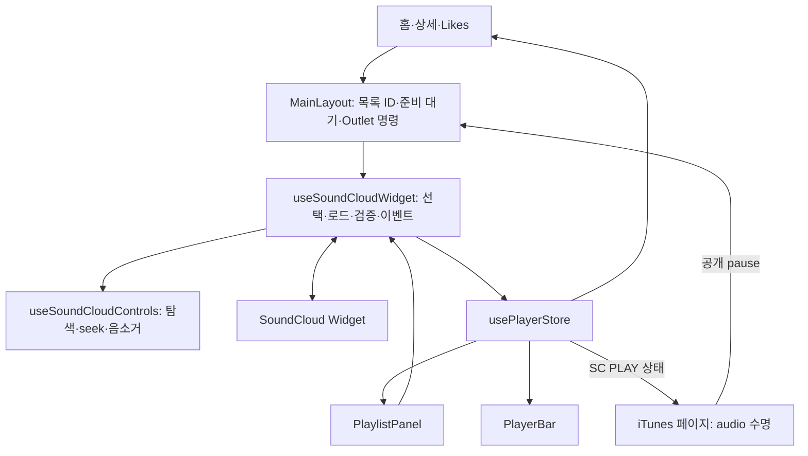
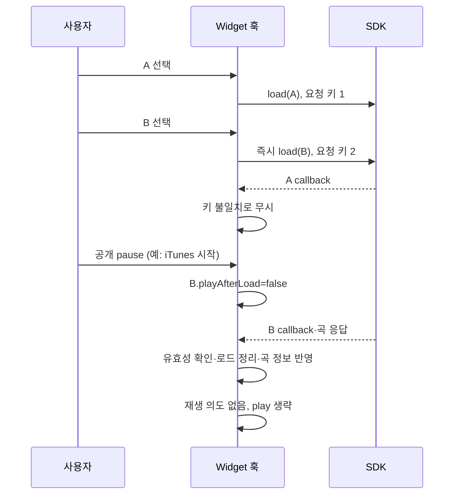

# NEWTRONOME 플레이어 리팩터링 인계 계획

- 갱신: 2026-11-18
- 현재 상태: PR-01~06 구현·자동 검증 완료. 기존 범위의 PR-07 검토 완료. 후속 요청 중심 정리안은 승인됐고 구현 전 회귀 테스트를 보강했다. 제품 구현은 아직 하지 않았다(4절). PR-08 실제 SDK 검증은 미완료.
- 작업 브랜치: `refactor/player-request-flow-pr05`. PR-05까지 커밋 `ccb323c`, GitHub PR [#93](https://github.com/jsjweb0/newtronome/pull/93) 생성. 원격 PR의 최신 머지 여부는 작업 시작 시 별도 확인한다.
- PR-06 제품·통합 테스트, REQ-01 회귀 테스트와 문서 정리는 PR #93에 포함하는 범위다. `ccb323c`는 PR-05 시점이며 전체 변경의 최종 커밋이 아니다. 최신 포함 여부는 Git 상태와 PR head로 확인한다.
- PR-01~08은 작업 ID이며 실제 GitHub PR 번호가 아니다.

## 1. 목표와 범위

곡 선택의 실행 흐름을 읽기 쉽게 만들고, 재생 동작을 보존하면서 상태 중복과 결합을 줄인다.

기존에는 `pendingSelectionRef`에 마지막 선택을 예약하고 이전 load 완료 후 실행했다. 대기 선택·응답 무효화·소스 수명을 함께 추적해야 했고 빠른 선택의 흐름도 복잡했다. 현재는 **곡 선택 → 요청 교체 → 즉시 실행 → 유효한 응답만 반영**한다. 대기 선택 ref와 실행 함수를 제거했다.

기존 기능과 외부 인터페이스를 가능한 한 보존한다. 기존 모듈 내부의 상태 소유권·요청 흐름 재구성과 중복 제거는 검토 범위에 포함한다. 최소 수정은 변경 줄 수보다 최종 복잡도와 회귀 위험을 기준으로 판단한다. 새 모듈·훅·스토어·서비스·의존성은 기존 구조보다 명확한 이점이 입증될 때만 별도로 제안하며, 도입은 합의 후 진행한다. 테스트 파일은 실제 연결 검증을 위해 추가했다. 현재 ref·식별자·분기 구성을 유지해야 한다는 제약은 없다.

제외 범위: 소스 전환 전 재생 시간 복원, 좋아요 큐·셔플 지속 모드·반복 재생 추가, 상세 조회 iframe 통합, SDK 교체, 플레이어와 무관한 전역 상태 변경, Firebase 데이터 구조 변경. 플레이어 내부 상태·요청 구조의 재검토는 제외하지 않는다.

협업·검증·승인 규칙은 [AGENTS.md](../AGENTS.md)를 따른다. 제품 코드 변경은 설명과 합의 후 진행하며 테스트와 검증은 Codex가 담당한다. 문서는 현재 설계와 판단 근거를 유지하고 단계별 실행 일지를 누적하지 않는다.

## 2. 확정된 재생 정책

| 상황 | 동작 |
| --- | --- |
| 초기 진입·목록 조회·READY·화면 이동 | 사용자 선택 없이 재생하지 않음 |
| 패널·홈의 곡 클릭 | 공유 플레이리스트 재생. 사용자가 시작한 목록의 자연 다음 곡 연결 허용 |
| 상세·Likes의 곡 클릭 | 단일 곡 재생. 종료하면 시간 0·정지, 다음 곡이나 패널 자동 재개 없음 |
| 다른 목록의 전체 재생 | 패널로 목록을 보내고 준비 후 첫 non-blocked 곡부터 시작 |
| 준비된 같은 목록의 전체 재생 | 기존 재생/일시정지 toggle 유지. single에서 복귀하는 분기는 기존 로직 유지 |
| 빈 목록·모두 blocked | 임의 재생하지 않음 |
| 단일 곡 재생 중 패널 | 기존 목록과 마지막 목록 곡 선택 유지 |
| 단일 곡 이후 패널 직접 선택 | 해당 곡을 다시 로드하고 처음부터 재생. 이전 시간 복원 없음 |
| 같은 소스의 일반 pause/resume | 위치 유지. 불필요 load/skip/시작 seek 금지 |
| 소스 로딩 중 | 현재 곡 toggle 버튼 잠금, 다른 곡 선택 가능. 홈도 이미 받은 목록은 유지 |
| iTunes 시작 | 공개 pause로 SC 정지·로드 후 재생 의도 취소. 진행 중 로드·완료 정리는 유지 |
| iTunes 종료·페이지 이탈 | SoundCloud 자동 재개 없음. 새 SC 선택은 새 재생 요청 |
| SC의 PLAY 확인 | iTunes 미리듣기 정지·리소스 정리 |

‘자동재생 없음’은 사용자 명령 없는 시작을 금지한다. 선택/전체 재생의 지연 실행과 사용자가 시작한 패널·홈의 자연 다음 곡은 허용한다.

## 3. 현재 아키텍처와 상태 소유권

| 파일 | 현재 책임 |
| --- | --- |
| `src/layouts/MainLayout.tsx` | 선택 목록, 전체 재생, iframe 준비 대기, 페이지 명령 연결. 공개 pause는 대기 재생도 취소 |
| `src/features/player/hooks/useSoundCloudWidget.ts` | SDK 연결·구독·cleanup, 요청 교체, skip/load 선택, 응답 검증·타이머·실패·재생 의도 |
| `src/features/player/hooks/useSoundCloudControls.ts` | 기본 play, seek/처음 이동, 이전·다음·랜덤 후보 선택, 음소거 |
| `src/features/player/stores/usePlayerStore.ts` | 표시용 곡·목록·모드·재생·시간·길이·음소거·소스 로딩 |
| `src/features/player/types/player.types.ts` | 곡·Store·선택 요청·알림 옵션 타입 |
| `src/features/player/components/SoundCloudWidget.tsx` | URL/frameVersion별 iframe 생성·ref 연결 |
| `src/components/player/PlaylistPanel.tsx`, `src/pages/HomePage.tsx` | 같은 목록 표시·선택·toggle, 현재 곡 로딩 잠금 |
| `src/components/layout/PlayerBar.tsx` | 현재 재생 표시·명령, 소스 로딩 중 toggle 잠금 |
| `src/features/playlists/pages/PlaylistDetailPage.tsx` | 별도 탐색 목록, single 선택, 전체 재생 요청 |
| `src/features/playlists/hooks/usePlaylistTracks.ts` | 상세 목록 조회용 별도 iframe |
| `src/features/bookmarks/pages/LikedTracksPage.tsx` | 저장 곡 조회·검색·single 선택 |
| `src/features/itunes/pages/ITunesSearchPage.tsx` | HTMLAudioElement, preview 요청 경합·오류·종료·이탈 정리 |
| `src/features/player/utils/mapSoundCloudWidgetTrack.ts` | 외부 데이터 검증·정규화 |

### 선택 요청과 상태

`TrackSelectionRequest`는 `kind`로 구분한다. 기존 `selectTrack(index, forceLoad?)`, `playSingleTrack(track, options)` 인터페이스를 유지하고 내부에서 요청을 만든다.

| 요청 | 필드 |
| --- | --- |
| playlist | kind, requestKey, playlistUrl, trackId, index, playAfterLoad |
| single | kind, requestKey, track, options(onResolved/onFailure), playAfterLoad |

| 값 | 현재 구현의 소유자·의미 |
| --- | --- |
| 선택 목록 ID/URL·pendingPlaybackRef | MainLayout. 새 iframe/목록 준비 전 실행 예약. 훅의 제거된 pendingSelectionRef와 다른 단계 |
| tracks/currentTrack/playbackMode/isPlaying/currentTime/duration/isMuted | 기존 Zustand Store. isPlaying은 실제 Widget 이벤트로 반영 |
| isPlaybackLoading | Store 한 곳. 소스 로딩 시작·완료·실패·cleanup에서 갱신. UI와 명령이 함께 사용 |
| currentRequestRef·playAfterLoad | Widget 훅. 최신 선택과 로드 후 재생 의도. pause는 playAfterLoad만 false로 변경 |
| requestKey | 선택마다 현재 키+1. 같은 곡 재요청도 새 키. 메타데이터만 비교하면 A→B→A를 구분하지 못함 |
| transitionIdRef | load·초기 연결·실패·cleanup·retry 수명. 새 선택 없이 실패해도 이전 callback을 무효화 |
| latestRequestVersionRef | PLAY·PAUSE·목록 skip 선택·확인 timeout에 따른 곡/길이 조회 응답 유효성 |
| pendingTrackIdRef | skip 후 PLAY로 확인할 목표와 연속 다음/랜덤 탐색의 기준. 확인 후 해제 |
| widgetTrack | 마지막 목록 곡. single을 포함한 Store currentTrack과 의미가 달라 유지 |
| playlistStatus/isReady | 목록 준비와 Widget 준비. 소스 로딩 여부와 같지 않음 |
| bookmarkRequestRef | single 실패 알림의 수명·1회 보고 관리 |
| 로드·PLAY 확인 타이머, retry 함수 | Widget 훅. 성공·실패·교체·cleanup에서 정리. 10초 확인 기한 유지 |
| preview 곡 ID·audio·요청/알림 번호 | iTunes 페이지. 별도 플레이어 수명 유지 |

`isPlaylistLoading`은 playlistStatus의 파생 반환값이며 별도 저장 상태가 아니다. async callback은 Store의 최신 로딩 여부를 getState()로 확인한다.

### 재생·취소 흐름

- 준비된 같은 playlist: 원래 index로 skip → PLAY에서 목표 곡 확인 → 현재 곡·재생 상태 반영.
- 다른 소스 또는 전환 중 선택: 이전 완료를 기다리지 않고 최신 요청으로 즉시 load.
- playlist/single 모두 auto_play=false → callback → getCurrentSound → 요청·Widget·소스 수명·곡 ID·차단 상태 검증 → 타이머/로딩 정리 → 의도가 유효하면 play → PLAY 이벤트로 상태 반영.
- single의 onResolved가 pause나 새 선택을 호출할 수 있어, 알림 뒤 play 직전에도 유효성을 재검사한다.
- 공개 pause: Layout의 준비 대기 예약 제거 → 훅의 현재 요청 playAfterLoad=false → SDK pause. 로드 자체와 완료 정리는 유지한다.
- 이전 Widget·로딩 중·실패 처리된 single의 FINISH는 무시한다. 정상 single FINISH는 seekTo(0)·시간 0·정지. playlist FINISH에서 수동 곡 전환은 하지 않는다.
- 언마운트: 구독·타이머·현재 Widget 연결 정리. 화면 이동으로 Outlet만 바뀌는 경우와 Layout 재마운트를 구분한다.

## 4. 중요한 설계 결정과 이유

- **로드와 재생 의도를 분리:** 로딩 중 pause는 재생만 취소한다. 요청을 null로 비우거나 모든 callback을 무효화하면 완료 정리가 빠질 수 있다. 별도 shouldPlayAfterLoadRef 대신 요청의 boolean을 사용한다.
- **로딩 값 단일화:** ref와 화면 state를 함께 갱신하는 구조를 없애고 기존 Store에 isPlaybackLoading을 추가했다. playAfterLoad와는 정보가 달라 통합하지 않는다.
- **목록도 확인 후 명시적 play:** auto_play에 맡기면 전환 중 PLAY가 callback보다 먼저 와 무시될 수 있었다. 곡 확인 뒤 play하고 실제 PLAY로 표시를 반영한다.
- **Layout 준비 대기 유지:** 아직 준비되지 않은 iframe의 요청 예약은 이미 실행 중인 훅의 소스 교체와 다르다. iTunes pause에서 두 단계의 재생 의도를 모두 취소한다.
- **기존 홈 목록 유지:** 목록 조회 상태가 loading이어도 tracks가 있으면 목록을 표시한다. 현재 곡 잠금과 다른 선택 허용을 패널과 일치시킨다. 빈 목록 초기 로딩만 Skeleton이다.
- **현재 수명 구분(PR-07):** skip은 선택 키만 바뀌고, failLoad는 선택 없이 transition을 바꾸며, PAUSE는 같은 요청/소스의 이전 조회를 무효화한다. 모든 사건에서 하나의 식별자를 무조건 교체하면 pause가 필요한 로드 완료 정리까지 취소할 수 있다. 이는 현재 구현의 역할 설명이며 숫자 식별자 셋이 필수이거나 현재 구성이 가장 단순하다는 결론은 아니다.
- **playlist/single 완료 분기 유지(PR-07):** playlist는 widgetTrack도 갱신하고 blocked를 실패 처리한다. single은 패널 선택을 보존하고 onResolved·별도 실패 보고를 처리한다. 공통 완료 함수는 정책 옵션·분기를 늘리므로 도입하지 않는다.
- **공개 타입 정리 보류(PR-07):** PlayerBar/PlaylistPanel의 전체 ReturnType은 Pick과 typed fixture로 좁힐 여지가 있으나 런타임 복잡도 감소가 작다. SoundCloudWidget의 로컬 controller 타입은 이미 좁다. type-only import는 런타임 순환을 만들지 않는다.
- **미사용 공개 반환값 유지(PR-07):** widgetRef/isPlaylistLoading과 앱 UI 소비처 없는 play는 이번에 제거하지 않는다. 공개 계약 유지 원칙을 따르며 현재 오류로 분류하지 않는다. 신규 manager·모듈은 필요 없다.

### [변경됨] 승인된 후속 정리안 — 제품 구현 전

독립 검토 뒤 요청 객체 비교와 목표 ID 중복 제거를 채택했다. 기존 PR-07의 완료 판단은 이 설계의 안전성 근거로 사용하지 않는다. 3절은 현재 구현이며 아래 내용은 승인된 목표다.

표시 기준(2026-11-18): **[변경됨]은 설계·계획이 변경됐다는 뜻이며 제품 구현 완료를 뜻하지 않는다. [추가됨]은 새로 명시한 작업이다.** 완료 여부는 체크리스트로 구분한다.

| 변경 항목 | 이전 계획·현재 구현 | 승인된 변경 방향 | 구현 상태 |
| --- | --- | --- | --- |
| 선택 식별 | requestKey를 발급하고 비교 | 새 요청 객체 자체 비교로 대체 | 미구현 |
| skip 목표 | 요청 trackId와 pendingTrackIdRef에 중복 저장 | 요청 trackId 재사용, 확인 대기는 요청 필드로 표현 | 미구현 |
| Controls 연결 | pendingTrackIdRef 전달 | 호출 시 최신 탐색 기준 ID를 읽는 함수 전달 | 미구현 |
| PR-07 이후 진행 | 기존 검토 종료 후 PR-08 마무리 | REQ-01~03 후속 정리를 거쳐 PR-08 최종 검증 | REQ-01만 완료 |
| 소스·조회 수명, 재생 정책 | 기존 가드·정책 | 유지. 숫자 식별자 전체 통합은 채택하지 않음 | 변경 없음 |

- `requestKey`를 제거하고 매 선택·재시도마다 만드는 요청 객체의 정체성으로 비교한다. 기존 키 비교 7곳은 객체 비교로 바뀌며 가드 자체가 없어지는 것은 아니다.
- `pendingTrackIdRef`를 제거하고 playlist 요청의 `trackId`를 재사용한다. 확인 대기 정보는 요청의 명시적인 `awaitingPlayConfirmation`으로 표현한다. ID 중복은 제거되지만 대기 정보는 이동하는 것이다.
- Controls는 호출 시 탐색 기준 ID를 읽는 함수를 전달받는다. 확인 대기 중이면 요청 목표, 그 외에는 Store의 현재 곡을 사용한다. Controls에 전체 요청 구조를 노출하지 않는다.
- `transitionIdRef`의 소스 수명과 `latestRequestVersionRef`의 이벤트 조회 수명은 유지한다. 초기 준비에는 선택 요청이 없고, 같은 소스의 skip은 목록 조회를 취소할 필요가 없으며, 자연 전환·PAUSE는 새 선택 없이 곡 조회를 무효화하기 때문이다.
- `playAfterLoad`와 Store `isPlaybackLoading`은 유지한다. Pause는 같은 요청 객체의 재생 의도만 변경하고 로드 완료 정리를 허용한다. Pause에서 객체를 복사·교체하지 않는다.
- 새 선택은 새 요청으로 대체하고, 확인 성공·실패·타임아웃에는 확인 대기를 해제한다. cleanup에서도 이전 요청 연결을 해제한다. 기존 소스·Widget 가드는 유지한다.
- bookmark 실패 관리, 타이머, Layout 준비 예약은 이번 정리에서 통합하지 않는다. 소스·조회 토큰을 객체 안에 옮기는 것만으로 정보가 줄었다고 계산하지 않는다.

제품 동작 변경은 없다. 목적은 선택 키 발급과 목표 ID 복사를 제거하고 선택·확인 대기를 한곳에서 읽게 하는 것이다. 대상 네 ref는 세 개로 줄지만 필요한 비동기 가드와 확인 분기는 남는다.

- [x] **REQ-01 — 구현 전 회귀 기준선 확보.** 기존 전체 434개 통과 후 skip A→B→A, 확인 후 자연 전환과 늦은 조회, PLAY→PAUSE→PLAY 역순 조회, iframe 교체 후 탐색 기준 초기화 검사 4개 추가. 현재 구현에서 전체 438개 및 필수 검증 통과.
- [ ] **REQ-02 — 승인된 요청 정리 구현.** 대상: player.types.ts, useSoundCloudWidget.ts, useSoundCloudControls.ts와 관련 테스트. 제품 코드는 공동 구현 규칙에 따라 설명 후 진행한다.
- [ ] **REQ-03 — 변경 후 동일 회귀·필수 명령·재생 E2E 검증.** REQ-01 통과를 미구현 대안의 검증 완료로 간주하지 않는다.

### [추가됨] 앞으로의 작업 순서와 완료 기준

순서: **REQ-02A → REQ-02B → REQ-02C → REQ-03 → PR-08A → PR-08B**. REQ-02A~C는 기존 REQ-02의 하위 작업이며 별도 아키텍처를 추가하지 않는다. 초기 원칙인 PR-01~08 순서는 유지하고 PR-07 후속 정리를 PR-08 최종 완료 전에 수행한다.

| ID·우선순위 | 목적·변경 대상 | 구현 범위·선행 조건 | 검증·완료 기준 | 주요 위험 |
| --- | --- | --- | --- | --- |
| REQ-02A / P1 | 선택 식별 단일화. `src/features/player/types/player.types.ts`, `src/features/player/hooks/useSoundCloudWidget.ts` | REQ-01 완료 후 requestKey 선언·발급 제거, 비교 7곳을 객체 비교로 교체. 소스·Widget 가드 유지 | A→B→A, 실패·재시도, onResolved에서 pause/새 선택, 로딩 중 Pause 회귀 통과. 요청마다 새 객체, Pause에서는 같은 객체 유지 확인 | 요청 객체 복사로 정상 load 완료까지 무효화하거나, 기존 키 참조를 남기는 오류 |
| REQ-02B / P1 | 목표 ID 중복 제거. 위 타입·Widget 훅과 `src/features/player/hooks/useSoundCloudControls.ts` | REQ-02A 후 pendingTrackIdRef 제거. playlist 요청에 확인 대기 표현. 확인 대기일 때만 요청 목표를 탐색·곡 확인 기준으로 사용. Controls에는 최신 기준 ID 조회 함수 전달 | 연속 다음·이전·랜덤, skip A→B→A, 확인 후 자연 전환, source load 중 연속 다음 검증. 기존 공개 재생 명령 인터페이스 유지 | 마지막 선택을 항상 기준으로 사용해 자연 전환을 막거나, 확인 전 연속 다음이 같은 곡을 다시 선택함 |
| REQ-02C / P1 | 요청 종료 경계 정리. Widget 훅 및 인접 테스트 | REQ-02B 후 확인 성공·실패·타임아웃의 대기 해제, cleanup의 요청 연결 해제, 새 요청 교체를 전수 점검. 소스·조회 수명은 유지하며 역할을 설명 | 실패 후 새 선택·동일 곡 재시도, 늦은 callback, iframe 교체·언마운트, 로딩 중 iTunes 전환 검사. pendingTrackIdRef/requestKey의 제품 참조가 남지 않음 | cleanup 또는 실패 정리가 새 요청까지 지우거나, Pause가 로드 정리를 취소함 |
| REQ-03 / P1 | 변경 후 전체 회귀. Widget·Controls 테스트, Layout 통합 테스트, `tests/e2e/playback.spec.js` | REQ-02A~C 완료 후 아래 필수 명령 실행. Controls 테스트 fixture는 새 입력 계약에 맞추되 사용자 동작 assertion 유지 | typecheck·lint·test:run·build 및 playback-desktop/mobile E2E 통과. 실패 원인·미검증 항목 기록. 현재 기준선 결과와 구분 | Mock 통과를 실제 SDK 성공으로 확대 해석 |
| PR-08A / P1 | 실제 SoundCloud 검증·남은 위험 확인 | REQ-03 후 desktop/mobile에서 빠른 single↔playlist, 일반 pause/resume 위치 유지, 자연 다음 곡, 전체 재생, 로딩 중 iTunes·종료·이탈 검사 | 브라우저·기기, 곡/목록 URL, 조작 순서, 기대·실제 결과 기록. 공개 pause→PAUSE 사이 응답 경합은 가짜 callback 순서로 별도 재현 검토. 미확정 모바일 E2E 실패는 근거 없이 해결 처리하지 않음 | 실제 SDK 이벤트 출처·모바일 재생 제한. 제품 수정 필요 시 원인과 수정안을 먼저 설명 |
| PR-08B / P2 | 현재 설계와 문서 일치. `docs/player-refactoring-plan.md`, `README.md` | PR-08A 결과 반영. 구현 완료된 항목만 3절 상태 표·요청 타입·시퀀스에 반영하고 README의 이전 대기 방식 설명 교체 | 문서와 실제 코드 대조, 완료/미완료·남은 위험·다음 작업 갱신. 실제 SDK 미검증이면 PR-08 미완료 유지 | 목표 설계를 현재 구현처럼 기록하거나 과거 통과 수를 최신 결과로 재사용 |

- [ ] REQ-02A: 요청 객체 비교 구현·관련 검증
- [ ] REQ-02B: 목표 ID 재사용·Controls 연결 구현·관련 검증
- [ ] REQ-02C: 종료·실패·cleanup 경계 점검·관련 검증
- [ ] REQ-03: 변경 후 전체 자동 검증
- [ ] PR-08A: 실제 SDK 검증·남은 위험 조사
- [ ] PR-08B: 최종 문서 일치 확인

각 구현 묶음 뒤 `npm run typecheck`, `npm run lint`, `npm run test:run`, `npm run build`를 실행한다. Widget 연결 변경에는 `npm run test:e2e -- --project=playback-desktop --project=playback-mobile`도 실행한다. 같은 코드에 대한 검증을 새 변경이나 미해결 사유 없이 반복하지 않는다. 테스트 실행·필요한 테스트 수정은 Codex가 맡으며 제품 코드는 실행 흐름과 수정 예시를 설명한 뒤 공동 구현한다. 한 번에 여러 구현 단계를 자동 적용하지 않는다.

독립적으로 준비 가능한 일은 기존 테스트의 시나리오 대응 확인과 실제 SDK 검증용 곡·목록 선정이다. REQ-02B~C는 같은 요청 생명주기를 변경하므로 병렬 구현하지 않는다. 커밋·푸시·PR 갱신은 별도 요청 시 진행한다.

주의: 공개 pause 호출과 PAUSE 이벤트 사이에 skip의 곡 조회 응답이 오면 재생 표시가 잠시 true가 될 가능성이 코드상 남는다. 이번 새 테스트는 PAUSE 이벤트 이후의 늦은 응답을 검증하며 이 간격의 안전성을 입증하지 않는다. 별도 재현·판단 없이 제품 정책을 바꾸지 않는다.

## 5. PR-01~08 체크리스트

순서: PR-01 → 02 → 03 → 04 → 05 → 06 → 07 → 08. 완료는 실제 코드·검증으로만 갱신한다.

- [x] **PR-01 / P1 — 기준선·경합 시나리오 확정.** 기존 테스트의 보호 범위와 이벤트 순서 분리 확인.
- [x] **PR-02 / P1 — 요청 형식 통일.** player.types.ts·Widget 훅에서 요청 키·playlist/single 계약 정리. 기존 공개 명령 유지.
- [x] **PR-03 / P0 — single 즉시 교체.** 이전 load 완료 대기 제거, 오래된 callback·실패 중복 보고 방어.
- [x] **PR-04 / P1 — 혼합 전환·대기 코드 제거.** playlist 복귀와 빠른 선택의 최신 load, pendingSelectionRef/runPendingSelection 제거. Layout 준비 대기는 유지.
- [x] **PR-05 / P0 — 사용자 중단·종료·수명 방어.** 요청 playAfterLoad·Store 로딩 단일화·공개 pause/toggle·화면 잠금·FINISH·Layout 대기 취소. 위치 유지와 취소 후 새 선택 검사.
- [x] **PR-06 / P1 — 화면별 정책 통합 검증.** 실제 Layout+훅과 홈·패널·상세·Likes·iTunes 연결, 홈 목록 유지 수정. 아래 보호 범위 참조.
- [x] **PR-07 / P2 — 기존 범위의 남은 중복·공개 계약 검토.** Widget 훅·Controls·타입·UI props·실제 소비처 검토. 당시 추가 제품 변경 없이 완료·회귀 검사 통과. 후속 요청 정리안은 4절의 별도 승인 범위이며 제품 구현 완료는 REQ-02~03으로 추적한다.
- [ ] **PR-08 / P1 — 전체 회귀·실제 Widget 검증·문서 마무리.** 선행 PR-07. 대상: 재생 E2E·필요한 최소 제품 수정·이 문서·README. 아래 남은 검증을 수행하고 기록해야 완료.

PR-08 완료 기준: 필수 명령 결과와 실제 브라우저·곡 URL·조작 순서·관찰 결과 기록, 미확정 E2E 실패 재현 조사, README의 이전 대기 방식 설명을 현행 코드와 일치시킴. 실제 검증을 못 하면 해당 항목을 미완료로 남긴다. Mock 통과만으로 완료하지 않는다.

## 6. 테스트 보호 범위와 최신 검증

| 검사 파일 | 보호하는 동작·경계 |
| --- | --- |
| `src/features/player/hooks/useSoundCloudWidget.test.tsx` | SDK 명령과 이벤트 분리, 빠른 선택·이전 callback/조회 무시, pause 후 완료 정리·재생 금지, 실패 1회·재시도, 타이머·cleanup, 45초 pause/resume 위치 유지·불필요 load/skip/seek 금지 |
| `src/features/player/hooks/useSoundCloudControls.test.tsx` | 탐색·blocked 후보·seek·음소거. pending 목표를 사용하는 연속 탐색은 Widget 훅 테스트에서 검증 |
| `src/layouts/MainLayout.playback.test.tsx` | 실제 Layout+훅+iframe, 초기 READY 무재생, 목록 교체·같은 목록 toggle, blocked/empty, 마지막 준비 대기 선택, single 종료·복귀·재마운트. 실제 Home·iTunes 연결도 검사. 패널은 iframe을 렌더하는 대체 UI |
| `src/layouts/MainLayout.home-panel.test.tsx` | 실제 Home·PlaylistPanel·Layout·훅. 양방향 선택/표시·toggle 동기화, 로딩 중 다른 선택·최신 callback·홈 목록 유지 |
| `src/layouts/MainLayout.single-pages.test.tsx` | 실제 상세·Likes·Layout·훅, 별도 조회 iframe. single 종료·이탈 후 패널 목록·선택 유지, 직접 복귀는 처음부터. 패널 UI는 선택을 표시하는 대체 컴포넌트 |
| HomePage/PlaylistDetailPage/LikedTracksPage/PlaylistPanel/PlayerBar/TrackItem 인접 테스트 | 개별 화면의 명령 전달·상태 표시·현재 곡 잠금·다른 곡/형제 액션 허용. 실제 훅 연결 검사와 구분 |
| `src/features/itunes/pages/ITunesSearchPage.test.tsx` | preview play Promise·요청 경합·오류·알림 중복·정지·이탈 정리 |
| `tests/e2e/playback.spec.js`, `tests/e2e/soundcloud.js` | desktop/mobile UI·키보드·empty/error/retry·지연 조회. 외부 Widget은 Mock |

최신 자동 검증(2026-11-18, REQ-01 테스트 보강 후, 현재 제품 구현 기준):

| 명령 | 결과 |
| --- | --- |
| `npm run typecheck` | 통과 |
| `npm run lint` | 경고·오류 없이 통과 |
| `npm run test:run` | 49개 파일·438개 통과 |
| `npm run build` | 통과. 기존 압축 청크 500 kB 경고 유지 |
| `npm run test:e2e -- --project=playback-desktop --project=playback-mobile` | desktop/mobile 전체 12개 통과. 최초 로컬 서버 실행은 포트 권한 오류로 시작하지 못했고 권한 허용 후 실행 성공. 기존 모바일 READY 간헐 실패는 이번에도 재현되지 않았으나 근본 원인은 미확정 |

중요 실패 사례는 재발 방지 근거만 보존한다.

- **해결:** iTunes pause 후 Layout 대기 예약이 뒤늦게 재생됨 → Layout 예약도 취소. 성공/empty/error 종료 및 이후 새 선택 검사가 보호.
- **해결:** 소스 reload 중 Home의 기존 목록까지 Skeleton으로 대체됨 → tracks가 없을 때만 Skeleton. 실제 홈·패널 연결 검사가 보호.
- **미확정:** 모바일 `missing READY times out and retry can finish with an empty result`가 최초 전체 실행에서 빈 목록 안내 대신 main 텍스트 없음으로 1회 실패. 단독 재검사와 전체 재실행은 통과. 기대값·타임아웃 변경 없음. PR-08의 동일 모바일 시나리오 3회 반복에서도 재현되지 않았다. 근본 원인은 아직 확정하지 못해 간헐 위험으로 유지한다.

## 7. 남은 한계와 다음 작업

- 같은 Widget에서 새 로드 완료 뒤 도착한 raw PLAY/PAUSE/FINISH/ERROR에는 요청 키가 없다. 현재 키만 읽어 이전 소스 이벤트를 식별했다고 주장하지 않는다. 이벤트 가드와 callback 식별을 구분한다.
- 실제 SDK 연속 load·모바일 자동재생 제한·자연 다음 곡·실제 음원 출력은 Mock 검증으로 보장하지 않는다. 로컬 정상 동작 보고를 재현 환경 없는 종합 검증으로 계산하지 않는다.
- 세부 테스트 fixture에서 전체 ReturnType을 이중 캐스팅하는 부분은 선택적 타입 개선으로 남긴다. 이번 필수 수정으로 확대하지 않는다.
- README에는 이전 ‘로딩 완료까지 선택을 미루는’ 설명이 남아 있다. PR-08에서 실제 구현에 맞게 수정한다.

다음 세션은 [AGENTS.md](../AGENTS.md), 이 문서, Git 상태·워크트리·브랜치를 먼저 대조한다. PR #93의 PR-06 변경·REQ-01 테스트 보강·문서가 현재 체크아웃에 포함됐는지 확인하고 미커밋 변경도 대조한다. 문서와 코드가 다르면 차이를 보고하고, 완료된 검토·기준선 검증을 이유 없이 반복하지 않는다.

**[변경됨] 다음 세션 첫 작업:** 4절 REQ-02A. `player.types.ts`의 요청 키와 Widget 훅의 발급·비교 위치를 확인하고, 객체 비교로 바꿀 한 묶음의 수정 위치와 실행 흐름을 설명한다. REQ-01은 완료됐지만 대안은 미구현이며 현재 테스트 통과가 대안의 안전성을 보장하지 않는다. 제품 코드를 자동 수정하는 승인으로 간주하지 않는다.

**PR-08의 다음 작업:** 모바일 E2E 재시도 3회는 통과했으나 최초 실패 원인은 미확정이다. 이 한계를 유지하며 실제 SoundCloud 브라우저 검증을 진행한다. 기록 항목은 브라우저/기기, 곡·목록 URL, 클릭·이벤트 순서, 기대·관찰 결과다. 빠른 single↔playlist 전환, 로딩 중 iTunes 시작, preview 종료/이탈, 일반 pause/resume 위치 유지, 패널 자연 다음 곡, 전체 재생을 포함한다.

새 기능·설계 변경이 필요하면 먼저 이유와 대안을 설명한다. 완료 기준·남은 위험·다음 작업은 해당 절을 갱신하고 과거 실행 기록을 새 절로 계속 붙이지 않는다. 커밋·푸시·PR 갱신은 요청 범위에 따라 진행한다.
