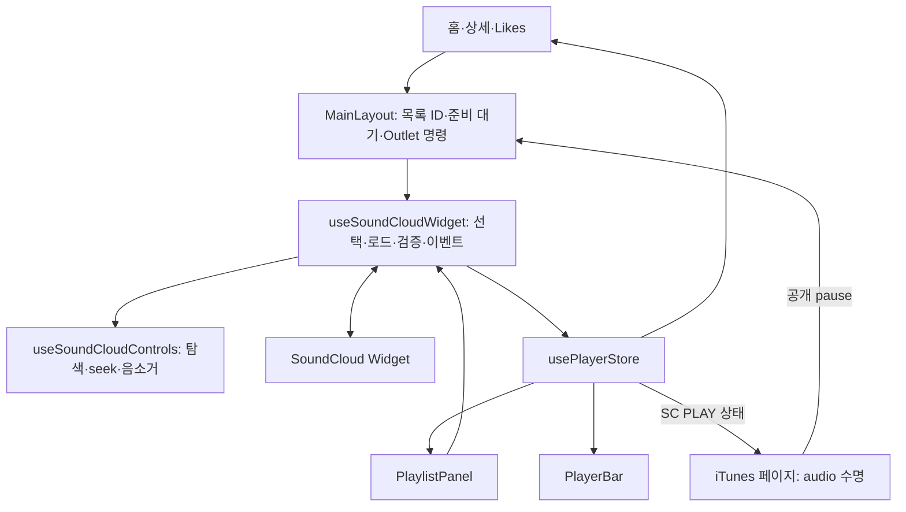
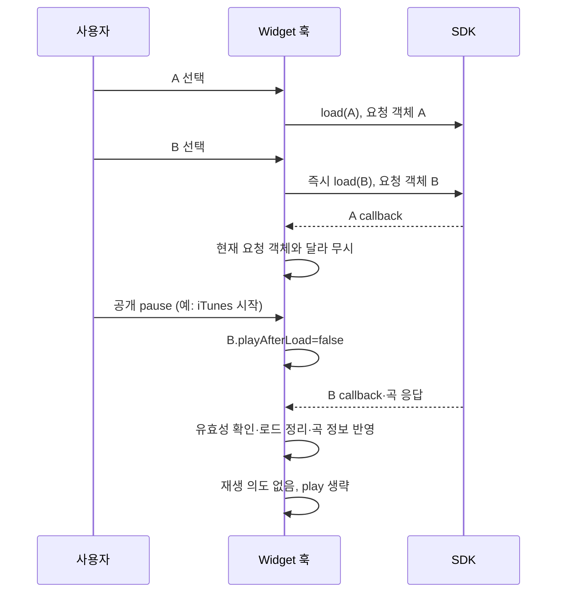

# NEWTRONOME 플레이어 리팩터링 인계 계획

- 갱신일은 2026-11-19다.
- 구현·자동 검증·README 반영은 완료했다. PR-08A는 수동 검증의 환경·곡 URL 기록이 남아 있어 미완료로 유지한다.
- 작업 브랜치는 `refactor/player-request-ownership`이며 기준 커밋은 PR [#93](https://github.com/jsjweb0/newtronome/pull/93)의 squash 커밋 `d9f912a`다.
- PR-01~08은 계획의 작업 ID다. 커밋·푸시·PR 상태는 Git과 GitHub에서 확인한다.

## 1. 목표와 범위

곡 선택의 실행 흐름을 읽기 쉽게 만들고, 재생 동작을 보존하면서 상태 중복과 결합을 줄인다.

기존에는 `pendingSelectionRef`에 마지막 선택을 예약하고 이전 load 완료 후 실행했다. 대기 선택·응답 무효화·소스 수명을 함께 추적해야 했고 빠른 선택의 흐름도 복잡했다. 현재는 **곡 선택 → 요청 교체 → 즉시 실행 → 유효한 응답만 반영**한다. 대기 선택 ref와 실행 함수를 제거했다.

기존 기능과 외부 인터페이스를 가능한 한 보존한다. 기존 모듈 내부의 상태 소유권·요청 흐름 재구성과 중복 제거는 검토 범위에 포함한다. 최소 수정은 변경 줄 수보다 최종 복잡도와 회귀 위험을 기준으로 판단한다. 새 모듈·훅·스토어·서비스·의존성은 기존 구조보다 명확한 이점이 입증될 때만 별도로 제안하며, 도입은 합의 후 진행한다. 테스트 파일은 실제 연결 검증을 위해 추가했다. 현재 ref·식별자·분기 구성을 유지해야 한다는 제약은 없다.

제외 범위: 소스 전환 전 재생 시간 복원, 좋아요 큐·셔플 지속 모드·반복 재생 추가, 상세 조회 iframe 통합, SDK 교체, 플레이어와 무관한 전역 상태 변경, Firebase 데이터 구조 변경. 플레이어 내부 상태·요청 구조의 재검토는 제외하지 않는다.

협업·검증·승인 규칙은 [AGENTS.md](../AGENTS.md)를 따른다. 제품 코드 변경은 설명과 합의 후 진행하며 테스트와 검증은 Codex가 담당한다. 문서는 현재 설계와 판단 근거를 유지하고 단계별 실행 일지를 누적하지 않는다. 다만 문제 제기의 출발점, 제안의 재검토 이유, 채택·기각한 대안과 남은 한계는 설계 결정 기록으로 보존한다. 반복된 테스트 실행 기록을 줄이는 것과 결정 과정을 지우는 것을 구분한다.

## 2. 확정된 재생 정책

| 상황 | 동작 |
| --- | --- |
| 초기 진입·목록 조회·READY·화면 이동 | 사용자 선택 없이 재생하지 않음 |
| 패널·홈의 곡 클릭 | 공유 플레이리스트 재생. 사용자가 시작한 목록의 자연 다음 곡 연결 허용 |
| 상세·Likes의 곡 클릭 | 단일 곡 재생. 종료하면 시간 0·정지, 다음 곡이나 패널 자동 재개 없음 |
| 다른 목록의 전체 재생 | 패널로 목록을 보내고 준비 후 첫 non-blocked 곡부터 시작 |
| 준비된 같은 목록의 전체 재생 | 기존 재생/일시정지 toggle 유지. single에서 복귀하는 분기는 기존 로직 유지 |
| 빈 목록·모두 blocked | 임의 재생하지 않음 |
| 단일 곡 재생 중 패널 | 기존 목록과 마지막 목록 곡 선택 유지 |
| 단일 곡 이후 패널 직접 선택 | 해당 곡을 다시 로드하고 처음부터 재생. 이전 시간 복원 없음 |
| 같은 소스의 일반 pause/resume | 위치 유지. 불필요 load/skip/시작 seek 금지 |
| 소스 로딩 중 | 현재 곡 toggle 버튼 잠금, 다른 곡 선택 가능. 홈도 이미 받은 목록은 유지 |
| iTunes 시작 | 공개 pause로 SC 정지·로드 후 재생 의도 취소. 진행 중 로드·완료 정리는 유지 |
| iTunes 종료·페이지 이탈 | SoundCloud 자동 재개 없음. 새 SC 선택은 새 재생 요청 |
| SC의 PLAY 확인 | iTunes 미리듣기 정지·리소스 정리 |

‘자동재생 없음’은 사용자 명령 없는 시작을 금지한다. 선택/전체 재생의 지연 실행과 사용자가 시작한 패널·홈의 자연 다음 곡은 허용한다.

## 3. 현재 아키텍처와 상태 소유권

| 파일 | 현재 책임 |
| --- | --- |
| `src/layouts/MainLayout.tsx` | 선택 목록, 전체 재생, iframe 준비 대기, 페이지 명령 연결. 공개 pause는 대기 재생도 취소 |
| `src/features/player/hooks/useSoundCloudWidget.ts` | SDK 연결·구독·cleanup, 요청 교체, skip/load 선택, 응답 검증·타이머·실패·재생 의도 |
| `src/features/player/hooks/useSoundCloudControls.ts` | 기본 play, seek/처음 이동, 이전·다음·랜덤 후보 선택, 음소거 |
| `src/features/player/stores/usePlayerStore.ts` | 표시용 곡·목록·모드·재생·시간·길이·음소거·소스 로딩 |
| `src/features/player/types/player.types.ts` | 곡·Store·선택 요청·알림 옵션 타입 |
| `src/features/player/components/SoundCloudWidget.tsx` | URL/frameVersion별 iframe 생성·ref 연결 |
| `src/components/player/PlaylistPanel.tsx`, `src/pages/HomePage.tsx` | 같은 목록 표시·선택·toggle, 현재 곡 로딩 잠금 |
| `src/components/layout/PlayerBar.tsx` | 현재 재생 표시·명령, 소스 로딩 중 toggle 잠금 |
| `src/features/playlists/pages/PlaylistDetailPage.tsx` | 별도 탐색 목록, single 선택, 전체 재생 요청 |
| `src/features/playlists/hooks/usePlaylistTracks.ts` | 상세 목록 조회용 별도 iframe |
| `src/features/bookmarks/pages/LikedTracksPage.tsx` | 저장 곡 조회·검색·single 선택 |
| `src/features/itunes/pages/ITunesSearchPage.tsx` | HTMLAudioElement, preview 요청 경합·오류·종료·이탈 정리 |
| `src/features/player/utils/mapSoundCloudWidgetTrack.ts` | 외부 데이터 검증·정규화 |

### 선택 요청과 상태

`TrackSelectionRequest`는 `kind`로 구분한다. 기존 `selectTrack(index, forceLoad?)`, `playSingleTrack(track, options)` 인터페이스를 유지하고 내부에서 요청을 만든다.

| 요청 | 필드 |
| --- | --- |
| playlist | kind, playlistUrl, trackId, index, playAfterLoad, awaitingPlayConfirmation |
| single | kind, track, options(onResolved/onFailure), playAfterLoad |

| 값 | 현재 구현의 소유자·의미 |
| --- | --- |
| 선택 목록 ID/URL·pendingPlaybackRef | MainLayout. 새 iframe/목록 준비 전 실행 예약. 훅의 제거된 pendingSelectionRef와 다른 단계 |
| tracks/currentTrack/playbackMode/isPlaying/currentTime/duration/isMuted | 기존 Zustand Store. isPlaying은 실제 Widget 이벤트로 반영 |
| isPlaybackLoading | Store 한 곳. 소스 로딩 시작·완료·실패·cleanup에서 갱신. UI와 명령이 함께 사용 |
| currentRequestRef·playAfterLoad | Widget 훅. 최신 선택과 로드 후 재생 의도. pause는 playAfterLoad만 false로 변경 |
| 선택 요청 식별 | callback이 기억한 요청 객체와 currentRequestRef.current를 비교. 같은 곡을 다시 선택해도 새 객체가 생성됨 |
| widgetLoadVersionRef | load·초기 연결·실패·cleanup·retry 수명. 새 선택 없이 실패해도 이전 callback을 무효화 |
| playbackLookupVersionRef | PLAY·PAUSE·목록 skip 선택·확인 timeout에 따른 곡/길이 조회 응답 유효성 |
| awaitingPlayConfirmation | playlist 요청에 저장하는 skip 확인 대기. 목표 ID는 요청 trackId를 재사용. 확인 성공·타임아웃·실패에 해제하고 cleanup에서 요청 연결 해제 |
| widgetTrack | 마지막 목록 곡. single을 포함한 Store currentTrack과 의미가 달라 유지 |
| playlistStatus/isReady | 목록 준비와 Widget 준비. 소스 로딩 여부와 같지 않음 |
| bookmarkRequestRef | single 실패 알림의 수명·1회 보고 관리 |
| 로드·PLAY 확인 타이머, retry 함수 | Widget 훅. playbackTimerRef는 skip 확인 또는 목록 load 후 곡 정보 재조회 예약에 사용. 성공·실패·교체·cleanup에서 정리. 최초 로드 기준 10초 기한 유지 |
| preview 곡 ID·audio·요청/알림 번호 | iTunes 페이지. 별도 플레이어 수명 유지 |

`isPlaylistLoading`은 playlistStatus의 파생 반환값이며 별도 저장 상태가 아니다. async callback은 Store의 최신 로딩 여부를 getState()로 확인한다.

### 재생·취소 흐름

- 준비된 같은 playlist: 원래 index로 skip → PLAY에서 목표 곡 확인 → 현재 곡 정보 반영. 공개 pause로 playAfterLoad가 false이면 지연 조회에서 재생 표시를 켜지 않는다.
- 다른 소스 또는 전환 중 선택: 이전 완료를 기다리지 않고 최신 요청으로 즉시 load.
- playlist/single 모두 auto_play=false → callback → getCurrentSound → 요청·Widget·소스 수명·곡 ID·차단 상태 검증 → 타이머/로딩 정리 → 의도가 유효하면 play → PLAY 이벤트로 상태 반영. playlist는 같은 ID의 필수 정보가 불완전하거나 조회 응답이 없으면 최초 10초 기한 안에서 250ms 간격으로 재확인한다.
- single의 onResolved가 pause나 새 선택을 호출할 수 있어, 알림 뒤 play 직전에도 유효성을 재검사한다.
- 공개 pause: Layout의 준비 대기 예약 제거 → 훅의 현재 요청 playAfterLoad=false → SDK pause. 로드 자체와 완료 정리는 유지한다. 명시적 play는 재생 의도를 true로 바꾸고, toggle은 표시 상태에 따른 다음 의도를 기록한다. 곡 확인 대기 중에도 직접 재개할 수 있다.
- 이전 Widget·로딩 중·실패 처리된 single의 FINISH는 무시한다. 정상 single FINISH는 seekTo(0)·시간 0·정지. playlist FINISH에서 수동 곡 전환은 하지 않는다.
- 언마운트: 구독·타이머·현재 Widget 연결 정리. 화면 이동으로 Outlet만 바뀌는 경우와 Layout 재마운트를 구분한다.

## 4. 중요한 설계 결정과 이유

### 출발점과 AI 협업에서 바꾼 검토 기준

이번 리팩터링은 `pendingSelectionRef`와 당시 `latestRequestVersionRef`를 함께 따라가야 하는 어려움에서 시작했다. 프로젝트 작성자는 “두 값이 마지막 선택만 실행하는 것처럼 보이는데 왜 나뉘어 있는가”라고 문제를 제기했다. 실제로 두 값의 역할이 완전히 같았다는 뜻은 아니다. **마지막으로 고른 곡을 재생한다는 동작을 이해하는 데 대기 선택과 응답 무효화를 각각 추적해야 하는 구조가 필요한가**가 출발점이었다. 요청 객체 비교는 이 검토의 후속 결정이며 최초 목적이 아니었다.

초기 AI 설명에는 이전 로드 완료까지 다음 선택을 기다려야 한다는 전제가 있었다. 이후 SDK 검토에서 새 `load()`를 바로 호출할 수 있다는 점과 이전에 등록한 콜백이 뒤늦게 실행될 수 있다는 점을 구분했다. 이에 대기 선택을 제거하되, 최신 요청 여부를 검사하는 방향을 채택했다. SDK·가상 iframe 확인만으로 실제 재생 성공을 확정하지 않고 Mock 회귀 검사와 실제 브라우저 확인을 별도로 진행했다.

후속 검토에서는 AI가 각 ref의 현재 용도를 설명하는 것만으로 유지 필요성을 판단하고, 통합 가능성에 대한 설명을 바꾸는 문제가 있었다. 프로젝트 작성자는 “현재 사용 중이라는 사실만으로 유지 필요성을 주장하지 말 것”, “관리 정보·갱신 지점·가드 조건을 비교할 것”, “전체 검토 후 추천안 하나를 제시할 것”을 요구했다. PR-07의 기존 완료 판단도 최종 설계의 근거로 삼지 않고 REQ 작업에서 다시 검토했다.

이 기록에서 프로젝트 작성자의 기여는 복잡도에 대한 문제 제기, 재생 정책·검토 기준 결정, 대안 재검토 요구와 실제 재현·로그 제공으로 구분한다. 구현안과 테스트는 AI와 함께 마련했으며 자동 테스트 작성·실행은 Codex가 담당했다. 최종 코드를 혼자 고안·작성했다거나 모든 테스트를 직접 작성했다고 표현하지 않는다.

### 주요 변경의 이유와 대안

| 결정 ID · 관련 작업 | 문제·검토한 대안 | 채택한 변경과 경계 |
| --- | --- | --- |
| DEC-01 · PR-02~04 | 이전 load가 끝나야 마지막 선택을 실행하는 대기 구조를 유지할 필요가 있는지 검토 | `pendingSelectionRef`·`runPendingSelection`을 제거하고 최신 선택을 즉시 실행. 기다리지 않는 것과 이전 콜백을 무시하는 것은 별도 문제이므로 응답 검증은 유지. |
| DEC-02 · PR-05 | 로딩 중 Pause에서 현재 요청을 무효화하면 완료 정리까지 건너뛸 수 있음. 별도 `shouldPlayAfterLoadRef` 추가안도 검토 | 요청의 `playAfterLoad`에 재생 의도를 저장. Pause는 의도만 취소하고 로드·곡 확인·타이머 정리는 계속함. 별도 재생 의도 ref는 두지 않음. |
| DEC-03 · PR-05 | `isPlaying=false`만으로 로딩 중과 로딩 완료·일시정지를 구분할 수 없고 ref만으로 UI 잠금을 갱신할 수 없음 | Store의 `isPlaybackLoading`을 명령과 UI가 함께 사용. 재생 의도와 로딩 여부는 별개 정보이므로 하나로 합치지 않음. |
| DEC-04 · REQ-02A | 같은 곡의 A→B→A 선택을 곡 ID만으로 구별할 수 없음. 요청 번호를 계속 발급하는 방법과 객체 비교를 검토 | 매 선택·재시도에 새 요청 객체를 만드는 조건을 이용해 `requestKey`를 제거. 콜백이 기억한 객체와 현재 요청을 비교. 기존 객체를 새 선택에 재사용하면 이 전제가 깨짐. |
| DEC-05 · REQ-02B | `pendingTrackIdRef`는 요청의 trackId와 중복이지만, 목표 곡의 재생 확인을 기다리는지 여부는 별도 정보 | 목표 ID 복사를 제거하고 요청의 trackId 재사용. `awaitingPlayConfirmation`은 확인 대기를 명시한 것으로, 정보 자체를 없앤 변경과 구분. |
| DEC-06 · REQ 검토 | 모든 비동기 유효성을 현재 선택 요청 하나로 판단할 수 있는지 검토 | 선택 전 iframe 준비·실패·cleanup과, 새 선택 없이 발생하는 자연 전환·PLAY/PAUSE 조회는 유효 기간이 다름. 로드·조회 버전은 유지하고 이름을 역할에 맞게 변경. 모든 식별자를 없앤 것으로 설명하지 않음. |
| DEC-07 · PR-08A | 실제 패널→단일 곡→패널 전환에서 요청·로드 검증은 통과하지만 곡 ID만 있고 제목이 없어 실패. 자동 테스트 통과만으로 외부 응답의 완전성을 보장할 수 없었음 | 같은 ID의 불완전 정보는 기존 10초 기한 안에서 재조회. 명백한 차단·다른 ID는 실패 처리. 새 ref나 무제한 재시도 대신 기존 타이머 사용. SDK 내부 원인은 확정하지 않음. |

위 결정의 최종 구조와 유지 이유는 다음과 같다. 상세 동작·검증 경계는 3절과 6절을 함께 확인한다.

| 결정 | 이유 |
| --- | --- |
| 최신 선택을 즉시 실행 | 이전 load 완료 뒤 실행할 선택을 별도로 예약하던 흐름을 없애고, 현재 요청 교체와 응답 검사를 따라가게 했다. MainLayout의 최초 iframe 준비 대기는 유지한다. |
| 요청 객체로 선택 식별 | 선택·재시도마다 새 객체를 만들어 비교한다. requestKey 발급을 제거했고 같은 곡 재선택도 구분한다. Pause는 같은 객체의 playAfterLoad를 false로 변경하며 명시적 play와 재개 toggle은 재생 의도를 갱신한다. |
| 요청의 trackId 재사용 | pendingTrackIdRef에 복사하던 ID를 제거했다. 확인 대기는 awaitingPlayConfirmation으로 표현하며, Controls는 호출 시 최신 탐색 기준 ID를 읽는다. |
| 로드·조회 버전 유지 | 곡 선택 전 iframe 준비와 실패는 widgetLoadVersionRef로 검사한다. 같은 소스의 자연 전환·PLAY·PAUSE 이후 조회는 playbackLookupVersionRef로 검사한다. |
| 로드 완료와 재생 의도 분리 | Pause 후에도 곡 확인·타이머 정리는 수행해야 한다. playAfterLoad는 재생 허용, Store의 isPlaybackLoading은 로딩과 UI 잠금을 담당한다. |
| 목록도 확인 후 명시적 play | 자동재생 PLAY가 로드 완료보다 먼저 오면 표시 갱신이 누락될 수 있었다. 곡 확인 후 play하고 실제 Widget 이벤트를 반영한다. |
| playlist/single 완료 분기 유지 | 목록은 widgetTrack도 갱신하고, 단일 곡은 패널 선택 보존·onResolved·실패 1회 보고를 처리한다. 이 차이를 옵션으로 옮기는 공통 완료 함수는 도입하지 않았다. |
| 목록 곡 정보를 제한적으로 재확인 | 같은 곡 ID에 제목이 없는 실제 응답을 즉시 실패 처리하던 문제를 보완했다. 기존 playbackTimerRef로 250ms마다 재조회하고 최초 10초 기한을 지킨다. 응답 전에 다음 조회를 예약해 무응답도 처리한다. |
| 기존 모듈과 공개 계약 유지 | 새 manager·훅·스토어를 추가하지 않았다. Pick 타입 축소·미사용 공개 반환값 제거는 이번 변경에서 보류했다. |

이름도 역할에 맞춰 transitionIdRef는 widgetLoadVersionRef로, latestRequestVersionRef는 playbackLookupVersionRef로 변경했다.

## 5. 작업 체크리스트

기존 순서는 PR-01 → 02 → 03 → 04 → 05 → 06 → 07 → 08이다. PR-07 후속 정리는 REQ-01 → REQ-02A → REQ-02B → REQ-02C → REQ-03 → PR-08A → PR-08B 순서로 진행했다. 문서 반영은 확인된 결과에 맞춰 수행했다.

- [x] **PR-01 / P1** — 기존 테스트 보호 범위와 경합 시나리오 확인
- [x] **PR-02 / P1** — playlist/single 선택 요청 형식 통일
- [x] **PR-03 / P0** — single 즉시 교체와 오래된 응답·실패 중복 보고 방어
- [x] **PR-04 / P1** — 혼합 전환·목록 복귀·pendingSelectionRef/runPendingSelection 제거
- [x] **PR-05 / P0** — 재생 의도·공통 로딩 상태·Pause/FINISH·Layout 예약 취소
- [x] **PR-06 / P1** — 홈·패널·상세·Likes·iTunes의 실제 연결 회귀 검사
- [x] **PR-07 / P2** — 남은 중복과 공개 계약 검토. 이후 독립 검토에 따른 REQ 작업 진행
- [x] **REQ-01 / P1** — 후속 정리 전 선택·자연 전환·조회 경합 기준선 확보
- [x] **REQ-02 / P1** — 승인된 요청 중심 정리 구현. 하위 작업은 다음 세 항목
- [x] **REQ-02A / P1** — requestKey 제거·요청 객체 비교
- [x] **REQ-02B / P1** — pendingTrackIdRef 제거·확인 대기 필드·Controls 탐색 연결
- [x] **REQ-02C / P1** — 성공·실패·타임아웃·cleanup의 요청 종료 경계 점검
- [x] **REQ-03 / P1** — 변경 후 전체 자동 회귀 검증
- [ ] **PR-08A / P1** — 실제 SDK 수동 시나리오 정상 보고와 발견 문제 보완 완료. 실제 iPhone·Xcode 시뮬레이터 검증 포함. 브라우저/iOS 버전·곡/목록 URL 기록은 미수집. Safari 제한과 환경 기록 범위는 7절 참조
- [x] **PR-08B / P2** — README·인계 문서의 현재 구현·검증 범위·남은 한계 대조
- [ ] **PR-08 / P1** — 전체 마무리. PR-08A의 남은 기록 확인 후 완료 판단

| 변경 묶음 | 관련 파일 |
| --- | --- |
| 요청 식별·목표 ID 정리 | player.types.ts, useSoundCloudWidget.ts, useSoundCloudControls.ts와 인접 테스트 |
| 화면별 명령·정책 연결 | MainLayout.tsx, HomePage.tsx, PlaylistPanel.tsx, PlayerBar.tsx, TrackItem.tsx와 상세·Likes·iTunes 화면 및 테스트 |
| 패널 복귀·Pause 조회 보완 | useSoundCloudWidget.ts, useSoundCloudWidget.test.tsx |
| 최종 문서 | README.md, docs/player-refactoring-plan.md |

경로의 전체 위치는 3절과 아래 테스트 표에 있다. 진행 상태는 실제 코드·검증 결과를 확인한 뒤 갱신한다.

## 6. 테스트 보호 범위와 최신 결과

개별 테스트명과 상세 실행 순서는 테스트 코드에서 확인한다. 아래는 변경 시 유지해야 할 동작과 경계다.

| 테스트 파일 | 보호 범위 |
| --- | --- |
| `src/features/player/hooks/useSoundCloudWidget.test.tsx` | 최신 선택·오래된 callback/조회 무시, skip 확인·자연 전환, Pause 후 완료 정리·재생 금지, 불완전 메타데이터/조회 무응답 복구, 최초 기한 유지, 실패 1회·재시도, 중복 응답·타이머·언마운트 정리, 같은 위치 재개 |
| `src/features/player/hooks/useSoundCloudControls.test.tsx` | 이전·다음·랜덤 후보와 blocked 제외, seek·음소거. 연속 탐색의 최신 기준은 Widget 훅 테스트에서도 확인 |
| `src/layouts/MainLayout.playback.test.tsx` | 실제 Layout·훅·iframe 연결, 초기 무재생, 목록 교체·토글·empty/error, 준비 대기·single 종료/복귀·재마운트, 홈·iTunes 연결. 패널은 대체 UI |
| `src/layouts/MainLayout.home-panel.test.tsx` | 실제 Home·PlaylistPanel·Layout·훅의 선택·표시·토글, 로딩 중 새 선택과 기존 홈 목록 유지 |
| `src/layouts/MainLayout.single-pages.test.tsx` | 실제 상세·Likes·Layout·훅과 조회 iframe, single 종료·패널 목록/선택 보존·직접 복귀. 패널은 대체 UI |
| 화면·컴포넌트 인접 테스트 | 명령 전달, 재생 표시, 현재 곡 로딩 잠금, 다른 곡·형제 액션 허용 |
| `src/features/itunes/pages/ITunesSearchPage.test.tsx` | preview play Promise·요청 경합·오류·알림 중복·정지·페이지 이탈 정리 |
| `tests/e2e/playback.spec.js`, `tests/e2e/soundcloud.js` | Chromium 데스크톱/모바일 UI·키보드·empty/error/retry·지연 응답. 외부 Widget은 Mock |

### 유지해야 할 중요한 회귀 사례

| 발생 조건 | 적용한 처리와 검증 |
| --- | --- |
| 목록 복귀 응답의 ID는 맞지만 제목이 없음 | 같은 곡의 필수 정보가 준비될 때까지 제한적으로 재조회. Pause·새 선택·실패·언마운트·늦은 중복 응답과 최초 10초 기한을 검사 |
| skip의 PLAY 곡 조회 → 공개 pause → PAUSE 이벤트 전 조회 응답 | playAfterLoad가 false이면 재생 표시를 켜지 않음. 곡 정보·타이머 정리와 확인 완료 전/후 명시적 play·toggle 재개까지 검사 |
| iTunes 시작 후 iframe 준비 예약이 뒤늦게 실행됨 | Layout 예약과 Widget의 재생 의도를 함께 취소. 이후 새 선택 허용까지 검사 |
| 소스 reload 때 홈의 기존 목록이 사라짐 | tracks가 있을 때 기존 목록을 유지. 실제 홈·패널 연결 검사 |

### 최신 자동 검증

2026-11-19, 패널 복귀·공개 Pause 조회 경합 보완 후 현재 워크트리 기준이다.

| 명령 | 결과 |
| --- | --- |
| `npm run typecheck` | 통과 |
| `npm run lint` | 경고·오류 없이 통과 |
| `npm run test:run` | 49개 파일·451개 통과 |
| `npm run build` | 통과. 기존 압축 청크 500 kB 경고 |
| `npm run test:e2e -- --project=playback-desktop --project=playback-mobile` | 12개 통과 |

### 수동 확인 범위

| 환경 | 확인한 동작 |
| --- | --- |
| 데스크톱 브라우저, 이후 Mac Safari 자동재생 허용 환경 | single↔패널 복귀 보완 후 정상 재생, 같은 위치 재개, 패널 자연 다음 곡, 전체 재생의 목록 교체·동일 목록 토글, 이전·다음·랜덤, 상세/Likes 단일 곡 종료 후 시간 0·정지, iTunes 시작/종료/이탈·SC 로딩 중 재생 취소·패널 복귀 |
| 실제 iPhone·Xcode iPhone 시뮬레이터의 Safari | 실제 기기와 시뮬레이터에서 수동 검증했음을 확인. 남은 기본 동작이 모두 정상이라는 보고. 환경별 버전·곡 URL·개별 조작 기록은 미수집 |

수동 결과는 실행자의 정상 보고를 기록한 것이다. 실제 iPhone 미검증이라는 이전 기록은 정정한다. 브라우저/iOS 버전·곡/목록 URL 기록은 남아 있다. 자동 E2E는 Chromium의 데스크톱·Pixel 7 에뮬레이션이며, Mock 통과와 실제 음원 재생 결과를 구분한다. Firefox 호환성은 아직 검증하지 않았다.

## 7. 남은 한계와 미확인 사항

- **Safari 첫 재생** — Mac Safari의 localhost에서 ‘사운드가 있는 미디어 중단’ 설정이면 첫 클릭 후 무음·정지됐다. 앱의 toggle 1회 뒤 위젯 play/pause가 관측됐으며 앱 pause 호출은 없었다. ‘자동 재생 모두 허용’으로 바꾸면 첫 클릭부터 정상 재생됐다. 차단 설정에서의 사용성 문제와 시뮬레이터의 유사 증상은 남아 있다.
- **SDK 이벤트 귀속** — 같은 Widget의 raw PLAY/PAUSE/FINISH/ERROR에는 앱 요청 키가 없다. 현재 callback 검증이 오래된 raw 이벤트의 출처까지 식별한다고 볼 수 없다. 불완전 메타데이터나 응답 누락의 SDK 내부 원인도 미확정이다.
- **모바일 E2E 간헐 실패** — READY 누락 후 재시도 시 빈 목록 안내가 나오지 않은 실행이 한 번 있었다. 단독·전체 재실행과 반복 검사에서는 재현되지 않았고 최신 12개는 통과했다. 기대값·타임아웃 변경으로 해결 처리하지 않았으며 최초 원인은 미확정이다.
- **환경 기록·검증 범위** — 실제 iPhone과 Xcode iPhone 시뮬레이터에서 수동 검증했다. 브라우저/iOS 버전·곡/목록 URL과 환경별 모바일 세부 결과는 미수집이다. Mac Safari의 자동재생 설정 변경 결과를 iPhone에서도 같은 방법으로 해결됐다는 근거로 사용하지 않는다. Firefox 호환성은 미검증이다.

## 8. 다음 세션 시작점

[AGENTS.md](../AGENTS.md)와 이 문서, Git 상태·브랜치·실제 워크트리를 먼저 대조한다. 문서와 구현의 차이가 있으면 보고하고, 승인된 작업의 완료 여부는 검증 후 갱신한다.

구현·자동 검증·README 반영은 완료했다. 다음은 PR-08A의 미수집 환경 기록과 남은 검증 범위를 정리하고 PR-08 완료 여부를 판단하는 작업이다. 정상 보고된 수동 시나리오와 알려진 제한사항은 위에 정리돼 있다. 커밋·푸시·PR 생성은 별도 요청 시 진행한다.
