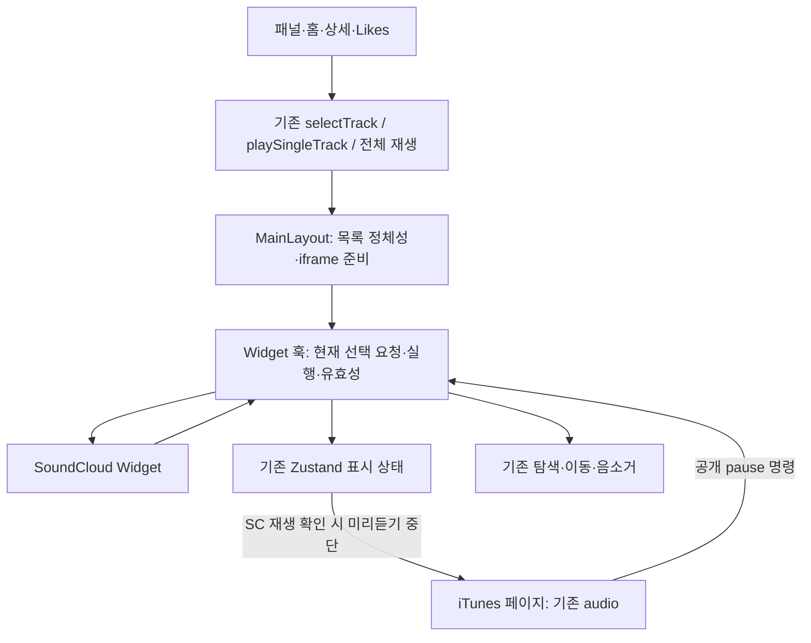
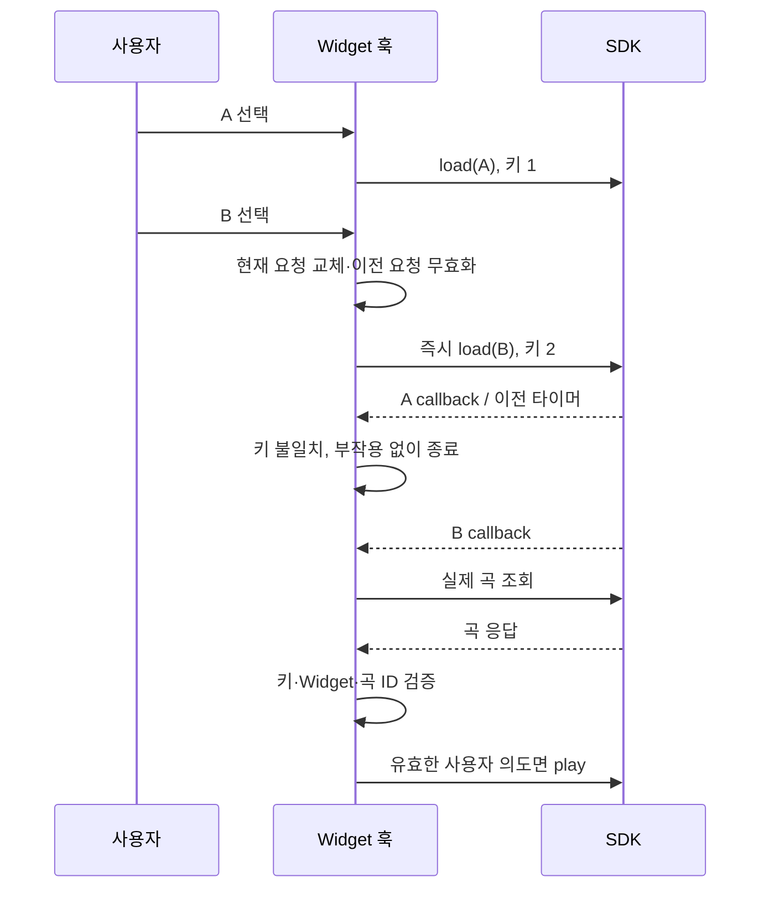

# NEWTRONOME 플레이어 리팩터링 인계 계획

- 작성일: 2026-11-13
- 상태: **PR-01~05 코드·자동 검증 완료 — 최신 결과: 23절, 테스트 413개·재생 E2E 12개 통과. 다음은 PR-06 화면별 정책 통합 검증. 실제 SoundCloud 종합 검증은 PR-08**
- 확정일: 2026-11-13. 사용자가 문서 확정 요청에 “확정해줘”라고 답하여 설계와 작업 순서를 승인했다.
- 조사 기준 HEAD: `f81e93c11377e4932ed8f4b362b3ad1e1d762e25`
- 최초 작성 직전 Git 작업 트리: 변경 없음. 현재는 PR-02~05 제품·테스트 변경과 이 문서가 미커밋 상태다. 시작 시 실제 Git 상태를 다시 확인한다.
- 사용자 추가 요구사항 전달 및 전체 실행 계획 검토: 완료. 재생 정책과 PR-01~08 작업 계획을 확정했다.
- 최종 갱신: 2026-11-17 (PR-05 대기 재생 취소 연결·회귀 검증 완료). PR-02~04 결과 갱신: 2026-11-16. 패키지 설치 없음.

## 1. 목적과 승인 경계

사용자가 리팩터링을 요청한 이유는 코드 이해의 어려움이다. 특히 `pendingSelectionRef`의 대기 선택과 `latestRequestVersionRef`의 응답 무효화를 함께 따라가야 한다는 점에서 논의가 시작되었다.

목표 흐름은 **곡 선택 → 현재 요청 교체 → 즉시 실행 → 유효한 응답만 반영**이다. 파일 분리나 줄 수 감소 자체가 목표가 아니다. 요청 객체를 추가하면서 기존 대기 분기를 그대로 남기는 변경은 완료로 인정하지 않는다.

승인 단계:

- [x] 이 문서의 최종 설계·작업 순서 검토 승인 (2026-11-13)
- [x] PR-02~04 공동 구현 및 테스트·검증 진행. 후속 단계도 같은 협업 규칙을 적용하며 일괄 자동 수정 승인이 아님

2026-11-13 사용자가 “p1진행해줘”로 직전 안내의 첫 작업 PR-01을 승인했다. 이번 실행 권한은 기준선 검증·시나리오 조사·인계 갱신으로 기록한다. 전체 후속 구현 승인을 받은 것으로 확대하지 않는다.

문서 작성 요청은 구현 승인이 아니다. 다음 세션에서도 승인을 추정하지 않는다. 사용자가 두 단계를 한 번에 명시적으로 승인하면 승인 내용을 기록하고 진행할 수 있다.

## 2. 프로젝트와 리팩터링 전 기준 구조

React·TypeScript·Vite·Zustand 기반 음악 서비스다. SoundCloud Widget으로 주 재생을 처리하고, iTunes 검색 결과의 미리듣기는 페이지의 HTMLAudioElement로 처리한다. Firebase 북마크는 재생할 곡 데이터를 제공하지만 재생 엔진은 아니다.

| 기존 파일 | 실제 책임 |
| --- | --- |
| `src/layouts/MainLayout.tsx` | 선택 플레이리스트, 전체 재생, iframe 교체를 수반하는 목록 준비 대기, Outlet 명령 제공 |
| `src/features/player/hooks/useSoundCloudWidget.ts` | SDK 연결, 목록 조회, 선택·소스 전환, 이벤트·타이머·실패 처리 |
| `src/features/player/hooks/useSoundCloudControls.ts` | 기본 명령, seek, 이전/다음/랜덤 후보, 음소거 |
| `src/features/player/stores/usePlayerStore.ts` | 목록·현재 곡·모드·재생 여부·시간·길이·음소거 |
| `src/features/player/types/player.types.ts` | 내부 곡·상태·명령 옵션 타입 |
| `src/features/player/components/SoundCloudWidget.tsx` | URL/frameVersion별 iframe 생성, ref 연결 |
| `src/components/player/PlaylistPanel.tsx` | 재생 iframe 수용, 패널 목록과 마지막 플레이리스트 곡 표시 |
| `src/components/layout/PlayerBar.tsx` | 현재 재생의 표시·조작 |
| `src/pages/HomePage.tsx` | 패널과 같은 현재 목록 표시·재생 |
| `src/features/playlists/pages/PlaylistDetailPage.tsx` | 별도 목록 탐색, 단일 곡 선택, 전체 재생 요청 |
| `src/features/playlists/hooks/usePlaylistTracks.ts` | 별도 조회용 iframe으로 상세 목록 조회 |
| `src/features/bookmarks/pages/LikedTracksPage.tsx` | 저장 곡 조회 및 단일 곡 재생 |
| `src/features/itunes/pages/ITunesSearchPage.tsx` | 미리듣기 audio 수명, 요청 경합·오류, SoundCloud와 상호 정지 |
| `src/features/player/utils/mapSoundCloudWidgetTrack.ts` | 외부 곡 데이터 검증·정규화 |

관련 테스트는 위 파일의 인접 `.test.tsx`, `tests/e2e/playback.spec.js`, `tests/e2e/soundcloud.js`에 있다. `AGENTS.md`가 검증 규칙의 기준이다.

아래는 조사 기준 HEAD의 세 장치다. PR-04 이후 pendingSelectionRef는 제거됐으며 현재 역할 대응은 12절을 기준으로 한다.

- `pendingSelectionRef`: 현재 load 완료 후 실행할 마지막 함수를 보관한다.
- `transitionIdRef`: 소스 로드·실패·cleanup에 따른 이전 callback 무효화에 사용한다.
- `latestRequestVersionRef`: 선택·PLAY·PAUSE에 따른 이전 곡/길이 조회 응답을 무효화한다.

`MainLayout.pendingPlaybackRef`는 새 iframe의 목록 준비를 기다리는 별도 단계다. 훅의 대기 선택과 함께 무조건 제거하지 않는다.

### 확인된 사실과 미확인 위험

| 항목 | 근거 및 확인 수준 | 이번 처리 |
| --- | --- | --- |
| 선택이 이전 load 완료에 묶임 | 기준 HEAD에서 pendingSelection 대기 확인 | PR-03/04에서 즉시 교체·대기 제거, 자동 검증 완료 |
| 같은 곡 재선택 | A→B→A는 곡 ID만으로 요청을 구별할 수 없음 | 요청별 키 사용 |
| pause 중 늦은 load 완료 | Controls.pause는 SDK 호출만, single 완료는 play 호출 | PR-05에서 명령 순서 재현·처리 |
| FINISH 방어 차이 | handleFinish에 Widget 일치·전환 중 검사 없음 | PR-05에서 수명 방어 검증 |
| 목록 수신의 재생 상태 초기화 | setPlaylist가 매번 playing/time/duration 초기화 | PR-01에서 지연 응답 시나리오 조사; 별도 수정 자동 승인 아님 |
| 새 Widget 음소거 | READY에서 볼륨 재적용 경로 없음 | 실제 볼륨 불일치는 미확인, 별도 작업 |
| 미조회 목록을 empty로 분류 | 초기 단일 재생과 목록 상태가 얽힘 | 관찰·기록; 성공을 error로 바꾸는 UX 변경 제외 |
| same-Widget의 늦은 이벤트 | 이벤트에는 앱 요청 키가 없음 | 키 비교만으로 완전 해결했다고 주장하지 않음 |

공식 문서: <https://developers.soundcloud.com/docs/api/html5-widget>
SDK: <https://w.soundcloud.com/player/api.js>

공식 문서는 load가 iframe을 새 URL로 다시 로드하고 이벤트 리스너를 유지한다고 설명한다. 사용자가 전달한 별도 SDK·가상 iframe 조사에서는 연속 load 시 마지막 URL이 적용되고 이전 callback도 실행될 수 있었다. 해당 실험은 이번 문서 작성에서 재실행하지 않았으며, 실제 브라우저에서 모든 이벤트 순서가 안전하다는 증거로 취급하지 않는다.

## 3. 요구사항 분류와 확정된 재생 정책

| 요구사항 | 분류 | 적용 및 영향 |
| --- | --- | --- |
| 최신 선택 즉시 실행 | 설계 변경 필요 | 기존 직렬 대기를 바꿈. 외부 명령 API 유지 |
| 요청 형식 통일 | 기존 논의 반영 | playlist/single 구분, 기존 타입 파일 활용 |
| 사용자 선택 없이 재생하지 않음 | 기존 정책 유지·검증 보강 | 초기 진입·조회·마운트 자체로 play하지 않음 |
| 패널과 페이지 분리 | 기존 구조 유지 | 상세 조회용 iframe·목록 유지, 탐색만으로 패널 교체 금지 |
| 패널만 연속 재생 | 홈 예외로 보완됨 | 패널과 같은 목록을 쓰는 홈은 기존 목록 재생 유지 |
| 페이지 개별 곡은 단일 재생 | 기존 설계 반영 | 상세·Likes 개별 선택은 종료 후 정지 |
| 전체 재생 클릭 | 중간 요구사항을 최종 정정 | 목록 전달만 하는 안 폐기. 패널 목록 전달 후 재생 시작 |
| 같은 목록 전체 재생 | 사용자 명시 결정 | 현재 동작 유지. 준비된 playlist 재생이면 toggle; single 등 다른 분기는 기존 동작 유지 |
| 단일 곡 종료 후 패널 목록·선택 유지 | 기존 의도 유지·통합 검증 보강 | 패널을 자동 재개하지 않음 |
| 소스 전환 후 시간 복원 | 사용자 제외 결정 | 추가하지 않음. 패널 곡 재로드는 처음부터 |
| 일반 pause/resume 위치 유지 | 기존 기능 유지 | 같은 소스에서 불필요한 load/skip/시작 seek 금지 |
| 로딩 중 재생·정지 버튼 | PR-05 정책 변경 확정·미구현 | 로딩 완료 전 비활성화. 다른 곡 선택은 계속 허용 |
| iTunes 미리듣기 선택 | PR-05 정책 보강 확정·미구현 | Widget pause와 로드 완료 후 재생 금지. 진행 중 로드·곡 정보는 유지, 미리듣기 종료 후 SC 자동 재개 금지 |

‘자동재생 없음’은 다음을 금지한다: 초기 로딩 완료만으로 재생, 페이지 개별 곡 종료 후 다음 곡, 미리듣기 종료 후 SoundCloud 자동 재개, 취소된 요청의 늦은 완료로 재생 시작.

다음은 허용한다: 사용자의 곡 클릭·전체 재생 클릭을 로딩 후 실행, 사용자가 시작한 패널/홈 목록의 자연스러운 다음 곡 연결. SDK의 `auto_play` 옵션 이름만 보고 모두 false로 바꾸지 않는다. 사용자 명령의 출처와 유효성으로 판단한다.

전체 재생의 다른 목록 전환은 첫 non-blocked 곡을 선택한다. 빈 목록·모두 blocked면 임의 재생하지 않는다. 반복 재생·셔플 지속 모드·좋아요 큐는 추가하지 않는다.

## 4. 확정된 목표 아키텍처

신규 프로덕션 파일·훅·스토어·서비스·의존성은 추가하지 않는다. 필요하면 기존 테스트 파일 안에 테스트 도구를 보강한다.



### 선택 요청 계약

`player.types.ts`에 `kind`로 구분하는 요청 타입을 둔다. 다음은 필드 계약이며 구현 코드는 아니다.

| kind | 필요한 정보 |
| --- | --- |
| playlist | requestKey, playlistUrl, trackId, index |
| single | requestKey, track, 기존 PlaySingleTrackOptions(onResolved/onFailure) |

키는 현재 요청 객체의 requestKey에 1을 더해 발급한다(`(currentRequestRef.current?.requestKey ?? 0) + 1`). 별도 키 카운터 ref를 추가하지 않는다. transitionId를 요청 키로 재사용하던 중간 단계를 거쳐 PR-02에서 선택별 번호로 정리했다. 키는 단조 증가 번호를 사용한다. 곡 메타데이터 비교로 대체하지 않는다. 객체 참조 식별도 가능하지만 동시에 두 방식을 도입하지 않는다. 같은 곡 재시도에도 새 키를 발급한다.

`selectTrack(index, forceLoad?)`, `playSingleTrack(track, options)` 호출부는 유지한다. 내부에서 요청을 만들고 실행한다. retry는 새 사용자 시도로 구분하며 실패 알림도 새 요청 단위다.

요청 정보와 기존 ref의 역할을 PR-02에서 표로 대응시킨다. 현재 요청 객체가 실제로 대체하는 정보만 이전한다. 검증 없이 기존 두 세대 번호를 통합하지 않으며 제3의 전역 카운터를 무조건 추가하지 않는다.

### 실행 방식

- 준비된 동일 플레이리스트의 곡: 원래 index로 skip, PLAY의 곡 ID 확인 후 반영.
- 다른 소스로 바뀌거나 전환 중인 상태: playlist URL과 index로 load(auto_play=false). callback에서 요청·Widget·곡 ID·차단 여부를 확인하고 switching 해제 후 play. isPlaying=true는 PLAY 이벤트로 반영한다.
- single: permalink로 load(auto_play=false), 곡 ID·재생 가능 상태 확인 후 유효한 요청이면 play.
- 요청 모드가 playlist라는 이유만으로 현재 SDK 소스가 준비되었다고 판단하지 않는다. 예를 들어 single→playlist A load 중 B를 선택하면 미완료 소스에 skip하는 대신 최신 목표에 맞게 load를 대체해야 한다.
- 모든 선택을 load로 바꾸거나 사용자 pause/resume 때 다시 load하지 않는다.
- 폐기된 A의 callback은 B의 타이머·오류·switching·currentTrack을 바꿀 수 없다.
- 정리 함수로 공통화한다면 요청 키/Widget을 확인한 뒤 해당 요청만 종료한다. 무조건 실행되는 finishSourceSwitch()는 피한다.

### 상태 소유권

| 상태 | 소유자·규칙 |
| --- | --- |
| 선택 목록 ID/URL, iframe 교체 준비 대기 | MainLayout 유지 |
| tracks/currentTrack/mode/isPlaying/time/duration/isMuted | 기존 Store 유지. 새 재생 Store 없음 |
| 현재 선택 요청·요청 수명·타이머·SDK 연결 | Widget 훅 |
| pendingSelectionRef/runPendingSelection | PR-04에서 선언·저장·실행·cleanup·의존성 모두 제거, 사용처 0 |
| latestRequestVersion/transition ID | 먼저 역할 유지, PR-07에서 남은 필요성 검토 |
| pendingTrackId | 연속 다음 선택과 PLAY 확인에 필요. 요청 객체로 대체할 수 있는지 검증 후 결정 |
| widgetTrack | 마지막 목록 곡 보관 목적 유지. 현재 single 곡과 강제 통합 금지 |
| playlistStatus/isReady | 목록 처리와 SDK 준비 의미 유지. 상태 체계 재작성 제외 |
| 미리듣기 곡 ID·audio·요청/알림 번호 | iTunes 페이지 유지 |
| 상세 조회 목록·북마크·Query cache | 기존 경계 유지 |

전체 재생·단일 곡·초기 iframe 준비가 다른 수명을 가지므로 현재 요청 객체 하나로 모든 앱 상태를 표현하려 하지 않는다.

### 명령·이벤트 경합



callback·타이머는 요청 키를 캡처한다. SDK의 PLAY/PAUSE/FINISH/ERROR 이벤트에는 앱 요청 키가 없으므로 이벤트 발생 시 현재 키를 읽는 것만으로 출처를 증명하지 않는다. 같은 Widget의 이전 소스 이벤트는 실제 SDK 재현과 브라우저 검증이 필요하다. 이전 Widget 비교, 전환 중 이벤트 처리 규칙, 곡 확인을 유지한다. ERROR의 원래 소스를 확정할 수 없는 경우 무조건 현재 요청 실패로 귀속하는 위험을 PR-01/PR-05에서 기록한다.

pause는 관측된 isPlaying과 별개인 최신 사용자 의도다. 로딩 중 pause 후 완료가 다시 play하지 않게 한다. 이후 새 선택은 새 재생 의도다. 오류 처리용 내부 widget.pause와 사용자 pause를 혼동하지 않는다. 필요 시 play/pause/toggle만 Widget 훅으로 책임 이동하고 외부 이름은 유지한다. 별도 명령 관리자 모듈은 만들지 않는다.

iTunes 시작은 동일한 공개 pause 경로를 사용한다. SC의 늦은 로드가 미리듣기를 가로채지 않는지 검사한다. iTunes가 끝나거나 페이지에서 사라져도 SC를 자동 재개하지 않는다.

## 5. 범위와 제외 범위

포함: 통일된 선택 요청, 최신 선택 즉시 실행, 요청 수명 방어, 기존 대기 로직 제거, 연관된 pause/종료 경합, 합의된 화면별 정책의 회귀 검증, 남은 코드 가독성 검토.

제외:

- 시간 복원, 새로운 큐·반복·셔플 모드, 재생 상태 영속 저장.
- 신규 controller/preview 훅, 상태 머신 라이브러리, 전체 Controls 통합.
- 조회/재생 iframe 통합, iframe DOM 위치 이동, iTunes 전역화.
- Firebase 데이터·규칙·북마크 저장 정책 변경.
- 상세/Likes 공통 훅 추출, 외부 UI API 일괄 변경.
- 목록 미조회 상태를 error로 바꾸는 UX, 런타임 오류 토스트/재시도 정책 재설계.
- setPlaylist 초기화·음소거·rewind 등 독립 문제의 무조건 동시 수정.

제외 문제가 핵심 회귀 테스트를 막으면 숨기지 않는다. 재현·기대/실제·필요한 범위를 보고하고 이 문서의 결정 기록을 수정한 뒤 승인된 범위에서만 작업한다.

## 6. 구현 작업 체크리스트와 의존성

총 8개 작업: P0 2개(PR-03, PR-05), P1 5개(PR-01, PR-02, PR-04, PR-06, PR-08), P2 1개(PR-07). P0는 상태 무결성 관련 작업이라는 뜻이며 모든 위험을 실제 브라우저에서 재현했다는 뜻은 아니다.

필수 순서: PR-01 → PR-02 → PR-03 → PR-04 → PR-05 → PR-06 → PR-07 → PR-08.

PR-06의 정책 조사와 PR-01의 기준선 조사는 독립적으로 가능하지만 이 계획에서는 한 번에 한 작업만 진행한다. 음소거/목록 setter 등 독립 수정은 위 8개 작업 수에 포함하지 않는다.

### PR-01 · P1 · 기준선과 경합 시나리오 확정

- [x] 완료 (2026-11-13, 아래 PR-01 결과 기록 참조)
- 선행: 설계 및 구현 승인, AGENTS.md·Git 상태 확인.
- 파일: 기존 `useSoundCloudWidget.test.tsx`, `MainLayout.test.tsx`; 이 문서의 검증 기록.
- 목적/범위: 현재 명령·이벤트 분리 Mock과 가짜 타이머 확인. 보존할 계약과 폐기할 직렬 실행 기대값 식별. 필요하면 인스턴스별 Mock과 지연 callback 도구 보강.
- 테스트: 기존 전체 기준선; A/B 응답 역전, 기존 single 종료, iframe 교체, 늦은 getSounds, READY/PLAY/load callback 순서 조사.
- 완료 조건: 기존 실패를 기록하고 새 회귀 시나리오·명령 순서 목록 확정. 아직 구현하지 않은 목표의 실패 테스트는 PR-03/04와 함께 추가한다. failing 테스트를 통과로 기록하지 않는다.
- 위험: 실제 SDK와 다른 Mock이 즉시 교체의 안전성을 과장할 수 있음.

### PR-02 · P1 · 요청 형식과 기존 상태 대응

- [x] 완료 (2026-11-16 상태 확인·자동 검증, 12절 참조)
- 선행: PR-01.
- 파일: `src/features/player/types/player.types.ts`, `src/features/player/hooks/useSoundCloudWidget.ts`, 인접 훅 테스트.
- 목적/범위: playlist/single 요청 계약, 요청 키 발급·현재 요청 소유권 명시. 기존 공개 함수는 내부 요청 생성 진입점으로 유지.
- 테스트: A→B→A의 서로 다른 요청 키, single options 보존, 잘못된/blocked 선택의 기존 동작, 기존 회귀.
- 완료 조건: 기존 각 ref가 어떤 책임으로 남거나 대체되는지 기록. 형식 추가 단계에서는 기존 실행 방식 유지 가능하나 전체 리팩터링 완료로 표시하지 않음.
- 위험: 정보를 요청과 ref에 영구 중복 저장하거나 번호를 무작정 하나로 합침.

### PR-03 · P0 · 단일 곡 요청 즉시 교체

- [x] 완료 (2026-11-16 상태 확인·자동 검증, 12절 참조)
- 선행: PR-02.
- 파일: `useSoundCloudWidget.ts`, `useSoundCloudWidget.test.tsx`.
- 목적/범위: single A 로딩 중 B 선택 즉시 load(B). 이전 callback·조회·타이머·실패 알림 무효화. 현재 요청에 대해서만 곡 확인과 실패 1회 보고.
- 테스트: A→B, A→B→A, A→B→C; callback 순서 역전; 이전 timeout/실패; 같은 곡 재시도; 최신 blocked/invalid/missing URL; cleanup 후 응답.
- 완료 조건: A 완료 전에 B load 호출, A가 B 상태와 타이머를 바꾸지 않음. serial 대기 검사만 명시적으로 새 기대값으로 교체.
- 위험: A가 완료되며 B 타이머를 지우거나 onResolved/onFailure를 잘못 호출함. raw SDK ERROR는 request-bound callback과 구분해 보고.

### PR-04 · P1 · 혼합 전환 확장과 대기 코드 제거

- [x] 완료 (2026-11-16 상태 확인·자동 검증, 12절 참조)
- 선행: PR-03.
- 파일: Widget 훅·테스트, 필요 시 Controls·테스트(이동 기준 전달만).
- 목적/범위: single↔playlist, playlist load 중 재선택 적용. 로드된 소스와 요청 mode를 구분해 skip/load 선택. pendingSelectionRef/runPendingSelection와 관련 저장·실행·정리 분기 제거.
- 테스트: single A→목록 B→single C; single→목록 로드 중 다음 두 번; force retry; 원래 목록 index·blocked 건너뛰기; 자연 다음 곡 확인; 목록 보존.
- 완료 조건: 대기 코드 사용처 0, 최신 목표 실행, 일반 pause/resume에서 추가 load 없음. MainLayout 준비 대기는 유지.
- 위험: mode만 보고 준비 안 된 목록에 skip, 모든 선택을 load로 바꾸어 위치·성능 회귀.

### PR-05 · P0 · 사용자 중단과 종료·수명 방어

- [x] 코드·자동 검증 완료 (2026-11-17, 23절 참조). 실제 SoundCloud 종합 검증은 PR-08에서 별도 수행
- 선행: PR-04. 새 실행 수명 위에서 pause와 FINISH를 검증해야 중복 구현을 피할 수 있음.
- 파일: Widget 훅·Controls 및 각 테스트; PlayerBar·PlaylistPanel과 해당 테스트 등 실제 재생/정지 UI 소비자, 필요한 최소 범위의 MainLayout·테스트 및 iTunes 페이지 테스트.
- 정책 변경(2026-11-17, 이유는 13절): 로딩 중 재생·정지 버튼을 비활성화하고 다른 곡 선택은 허용한다. iTunes 시작은 기존 공개 pause를 통해 Widget을 정지시키고 로드 완료 후 재생도 막되 로드 자체는 유지한다.
- 목적/범위: 진행 중 요청의 명시적 pause가 완료 뒤 play로 뒤집히지 않게 함. 새 선택은 새 의도. 이전 Widget·전환 중 FINISH 가드. 기존 SDK unbind·타이머 cleanup 유지.
- 테스트: single/playlist 로딩 중 재생·정지 UI 잠금과 다른 곡 선택 허용; A 요청→공개 pause→완료, A→B→pause, pause→새 C, single/playlist load 중 iTunes 시작, 이전 FINISH/PLAY/ERROR, 언마운트, 정상 single 종료, 일반 pause/resume 45초 위치 유지. 로딩 중 pause 검사는 비활성 버튼 클릭이 아닌 공개 명령 경로로 재현한다.
- 완료 조건: 로딩 중 재생·정지 조작은 잠기고 최신 곡 선택은 실행된다. iTunes 시작 후 SC 로드는 완료되어도 play를 재발행하지 않으며 새 SC 선택은 다시 재생을 허용한다. 정상 종료 유지. 반환 명령 이름을 유지하고 UI 로딩 표시용 필드는 필요한 최소 범위로 추가할 수 있다. same-Widget 이벤트 출처 구분의 남은 한계를 기록.
- 위험: pause로 load 완료 전체를 무효화해 로딩 상태가 고정됨, 내부 실패 pause를 사용자 요청으로 오인, MainLayout의 준비 대기가 나중에 재생을 재시작함.

### PR-06 · P1 · 화면별 정책 통합 검증

- [ ] 완료
- 선행: PR-05.
- 파일: `src/layouts/MainLayout.test.tsx`, `src/pages/HomePage.test.tsx`, 상세·Likes·iTunes 페이지의 기존 테스트; 필요할 때만 해당 제품 파일 최소 수정.
- 목적/범위: 실제 Layout+실제 훅을 인스턴스별 SDK Mock으로 연결한 통합 검증. 정책 확인 목적이며 홈 재생을 single로 바꾸지 않음.
- 테스트: 초기 READY만으로 play 없음; 전체 재생→목록 전달→첫 허용 곡; 준비된 같은 목록 toggle; 홈·패널 동기화; 상세/Likes single 종료; 패널 목록·선택 유지; 직접 재생 시 처음부터; iTunes ended/이탈 후 SC 자동 재개 없음; 새 iframe 준비 중 마지막 사용자 의도.
- 완료 조건: 정책 표 각 항목에 검사 위치 연결. 홈 외 페이지 개별 재생이 패널 목록을 덮지 않음. 화면 이동과 Layout 재마운트 구분.
- 위험: 테스트용 Store 직접 조작만으로 통합 동작을 검증했다고 오인, 현재 동작 유지 범위의 불필요한 UI 수정.

### PR-07 · P2 · 남은 중복·공개 계약 가독성 검토

- [ ] 완료
- 선행: PR-06.
- 파일: Widget 훅·타입·테스트; 필요 시 PlayerBar/PlaylistPanel의 props 타입·테스트.
- 목적/범위: 제거 후 남은 중복만 검토. 요청 번호 두 개가 필요한 이유 기록. 공통 시작/완료 함수는 실제 중복과 안전한 요청 검증이 있을 때만 추가. 미사용 반환값 제거·Pick 타입 축소는 효과가 확인되면 수행.
- 테스트: 동일 회귀, typecheck, 필요한 타입으로 테스트를 작성하여 이중 캐스팅 감소 확인.
- 완료 조건: 선택→실행→응답 가드 경로가 명확하고 별도 manager가 없음. 추가 정리가 불필요하면 근거와 검토 결과로 완료 가능.
- 위험: 단순한 명시적 분기를 범용 함수로 감추거나 번호 통합 때문에 PLAY/PAUSE가 load callback까지 취소함.

### PR-08 · P1 · 전체 회귀와 실제 Widget 검증·인계 갱신

- [ ] 완료
- 선행: PR-07.
- 파일: `tests/e2e/playback.spec.js`, `tests/e2e/soundcloud.js`(필요한 검증 보강만), 이 문서; README는 실제 기능 설명과 차이가 있을 때만 수정.
- 목적/범위: 전체 명령과 데스크톱·모바일 실제 재생 검증. 아직 구현되지 않은 성과를 README에 쓰지 않음.
- 테스트: 아래 7절 전체. 빠른 연속 선택·종료·pause/resume·전체 재생·iTunes 전환을 실제 곡 URL로 확인.
- 완료 조건: 실행 명령·결과·브라우저·곡 URL·조작 순서·관찰 결과 기록. 실제 검증 불가 항목이 있으면 미완료와 위험을 남기며 성공으로 체크하지 않음.
- 위험: Mock 통과를 실제 재생 성공으로 간주하거나 모바일 자동재생 제한을 놓침.

## 7. 테스트 연결과 검증 명령

### 기존 안전망

| 테스트 파일 | 현재 검사 범위 | 연결 작업/부족한 범위 |
| --- | --- | --- |
| `src/features/player/hooks/useSoundCloudWidget.test.tsx` | pause/resume 위치·불필요 load/skip/seek 없음, 늦은 조회, 선택 확인, 실패 1회, timeout, 목록 오류·빈 상태, 현재 직렬 선택 | PR-01~05. 즉시 load 대체·늦은 FINISH·로딩 중 명시적 pause 보강 |
| `src/features/player/hooks/useSoundCloudControls.test.tsx` | 명령, seek, blocked 제외·원래 index, 랜덤, mute | PR-04/05/07. API 전달 성공이 실제 재생 성공은 아님 |
| `src/layouts/MainLayout.test.tsx` | 목록 전환, 같은 목록 toggle, 준비 대기 중 마지막 single, empty/error | PR-01/06. 현재 훅 mock이므로 실제 훅 결합 보강 |
| HomePage/PlaylistDetailPage/LikedTracksPage 인접 테스트 | 표시·선택 전달·차단/실패 안내·조회 retry | PR-06. 요청 전달과 실제 재생 완료 구분 |
| `src/features/itunes/pages/ITunesSearchPage.test.tsx` | play promise 역전·실패 중복·SC 시작 시 중단·unmount 후 실패 무시 | PR-05/06. ended와 실제 SC load 경합 보강 |
| PlayerBar/PlaylistPanel/SoundCloudWidget 인접 테스트 | 컨트롤 제한·retry·slider·iframe 교체·접근성 | PR-07/08 |
| `tests/e2e/playback.spec.js` | UI 동기화·키보드·빈 목록·오류·timeout·늦은 조회 | PR-08. 실제 SDK·iTunes 미검증 |

E2E Mock은 명령이 즉시 이벤트를 발생시키고 같은 Widget을 반환하는 부분이 있다. 빠른 연속 load 검증에는 인스턴스별 응답과 명령/이벤트 분리 보강이 필요하다. 단위 테스트는 기존 가짜 타이머를 재사용하고 임의 대기 시간을 넣지 않는다.

직렬 실행 자체의 테스트만 새 정책으로 교체한다. 마지막 선택·실패 1회·위치 보존 등 사용자 계약 검사를 약화하지 않는다. 변경 이유와 새 테스트의 대체 관계를 기록한다.

### 코드 변경 후

```bash
npm run typecheck
npm run lint
npm run test:run
npm run build
```

Widget 연결·재생 UI를 변경한 작업에는 다음도 실행한다. 마지막 단계까지 미루지 않는다.

```bash
npm run test:e2e -- --project=playback-desktop --project=playback-mobile
```

Firestore 변경은 범위 밖이다. 필요성이 생기면 별도 승인·범위 변경 및 `npm run test:rules` 검증을 따른다. 기존 AGENTS.md 경고 목록은 현재 실행 로그와 구분하며, 실패를 기대값 완화·규칙 비활성화로 숨기지 않는다.

### 실제 브라우저 필수 기록

- 브라우저/버전, 데스크톱·모바일 환경, 실제 SoundCloud 곡·목록 URL.
- A→B→A와 혼합 소스 선택의 순서, 최종 실제 소리와 UI 일치.
- PLAY/READY/load callback 및 종료 이벤트의 관찰 순서.
- 일반 pause/resume 위치 보존과 소스 복귀 시 처음부터 재생.
- 패널/홈 연속 재생, single 종료 후 정지, 목록 마지막 곡·blocked 곡의 SDK 동작.
- 초기 진입 무재생, 사용자 전체 재생, iTunes 진입·종료·SC 전환.
- 권한/로그인/모바일 재생 제한 등으로 확인 불가능하면 그 조건을 명시.

## 8. 변경 대상과 인터페이스 영향

핵심 제품 변경은 기존 `player.types.ts`, `useSoundCloudWidget.ts`다. Controls·Layout 변경은 요청 수명 또는 pause 연동에 필요한 범위로 제한한다. 홈·상세·Likes는 현재 API를 유지하고 통합 검증을 우선한다. UI·타입 축소는 PR-07의 조건부 작업이다.

외부 명령·props 이름, Firebase 데이터, URL·라우팅·화면 구조는 유지한다. Store shape 유지 원칙은 PR-05에서 사용자와 합의한 로딩 단일화를 위해 isPlaybackLoading/setPlaybackLoading 추가로만 예외 적용한다(19절). `forceLoad` 재시도 의미를 잃지 않는다. Hook 반환형에 필요한 타입 변경이 생기면 모든 실제 소비자를 확인한다.

## 9. 미해결 사항과 결정 기록

제품 정책 질문은 현재 답변 완료다. 다음은 구현 조사 사항이며 이미 해결됐다고 기록하지 않는다.

- 요청 키는 선택별 식별, transitionId는 소스 수명, latestRequestVersion은 조회 유효성으로 현재 분리했다(12절). 최종 통합·중복 제거는 PR-07에서 검토한다.
- 동일 Widget의 이전 소스 ERROR/FINISH를 구분할 수 있는 범위: PR-01/05/08.
- 새 iframe 준비 대기 중 single 요청은 Layout에서 기다리는 기존 예외 유지. 이를 ‘모든 상황에서 load 즉시 가능’으로 확대 해석하지 않음.
- setPlaylist 지연 응답 초기화가 핵심 작업을 막으면 별도 범위 변경 필요.
- 완료된 single의 런타임 ERROR를 다른 UX로 바꾸거나 retry 대상으로 전환하는 설계는 이번에 승인되지 않음.

| 결정 ID | 상태 | 내용·이유 |
| --- | --- | --- |
| D-01 | 사용자 합의 | 최신 선택 즉시 실행으로 대기 로직 제거, 가독성 우선 |
| D-02 | 사용자 합의 | 패널과 같은 홈 목록 재생은 변경하지 않음 |
| D-03 | 사용자 정정 반영 | 전체 재생은 목록만 전달하는 것이 아니라 전달 후 재생 시작 |
| D-04 | 사용자 합의 | 이미 준비된 같은 목록의 기존 재생/일시정지 toggle 유지 |
| D-05 | 사용자 합의 | 소스 복귀 시간 복원은 추가하지 않고 현재처럼 처음부터. 일반 pause/resume는 위치 유지 |
| D-06 | 사용자 승인·확정 (2026-11-13) | 8개 작업 순서와 최소 모듈 유지안 확정. 이후 공동 구현은 아래 D-07 방식으로 진행 |
| D-07 | 사용자 지정·문서 반영 승인 (2026-11-16 갱신) | 제품 코드 직접 수정은 사용자, Codex는 설명·예시와 테스트·검증 담당. 코드 수정 요청 때만 Codex가 제품 코드 적용. 관련 흐름 단위로 진행하고 매번 계속 여부를 묻지 않음 |
| D-08 | 공동 구현·검증 완료 | 선택 키는 현재 요청의 키+1로 발급. 기존 전환/조회 번호 유지. 대기 제거를 우선하고 최종 중복 정리는 PR-07로 유지 |
| D-09 | 사용자가 안내에 따라 적용·로컬 정상 보고 | 패널 복귀의 PLAY-before-callback 문제에 대응하여 목록 load도 auto_play=false → 곡 확인 → 명시적 play → PLAY 상태 반영으로 변경. 사용자 선택 재생 정책 유지 |
| D-10 | 사용자 문서 수정 승인 (2026-11-16) | AGENTS.md 협업 규칙과 PR-02~04 결과를 인계 문서에 기록. PR-05 제품 코드 자동 적용 승인은 아님 |
| D-11 | 사용자 합의·문서 반영 요청 (2026-11-17) | PR-05는 로딩 중 재생·정지 버튼 잠금, 다른 곡 선택 허용, iTunes 시작 시 SC 로드 유지·완료 후 재생 금지로 단순화. 기존 목록 auto_play 변경의 이유도 13절에 보강. 아직 PR-05 코드·테스트 적용 없음 |
| D-12 | 사용자 상시 문서 기록 지시 (2026-11-17) | 승인된 기능 추가·변경이 문서에 없거나 다르면 이유·이전/이후 동작·영향·검증·위험을 관련 문서에 기록. 이 기록과 진행 상태 갱신은 별도 문서 승인을 반복 요청하지 않음. 기능 구현 자체의 승인과 구분 |
| D-13 | 사용자와 합의·직접 적용 (2026-11-17) | 로딩 ref와 로컬 state의 이중 갱신을 제거하고 기존 Store의 isPlaybackLoading 하나로 통일. 요청의 playAfterLoad는 별도 의미로 유지. Store 필드 추가만 기존 구조 유지 원칙의 예외로 기록 |

이전 Claude 안의 지역 함수 공통화(C3)는 대기 제거 후 PR-07에서 재평가한다. 타입 축소(C5)는 조건부 후순위다. C1/C2/C4/C6/C7/C8을 일괄 필수 변경으로 채택하지 않는다.

## 10. 다음 세션 시작 및 연속성 규칙

1. AGENTS.md와 이 문서를 먼저 읽고 실제 Git status/HEAD/diff를 확인한다.
2. 승인 상태를 확인한다. 설계 승인과 구현 승인이 없으면 구현을 시작하지 않는다.
3. 현재 코드와 문서가 다르면 변경 출처·영향을 보고하고 사용자 변경을 덮지 않는다.
4. 체크된 작업도 실제 코드·검증 로그와 대조한다. 승인된 계획과 완료된 구현을 구분한다.
5. 한 번에 한 ID만 진행한다. 사용자 요청 없이 병렬 에이전트·관계없는 정리를 추가하지 않는다.
6. 제품 코드는 사용자 직접 수정 원칙으로 흐름·이유·예시를 설명한다. 별도 지시 없으면 매번 이어갈지 묻지 않는다. Codex는 테스트와 검증을 담당하며 직접 제품 수정은 요청받은 범위에 한한다.
7. 실제 완료 조건과 검증을 만족한 뒤에만 해당 체크박스를 갱신한다. 미실행 검증을 통과로 쓰지 않는다.
8. 승인된 기능 추가·변경이 문서에 없거나 다르면 관련 문서에 이유·이전/이후 동작·영향·검증 결과·남은 위험을 기록한다. 중요한 설계 변경은 결정 ID·승인 여부도 기록한다. 이 기록과 승인된 작업의 진행 상태 갱신은 별도 문서 수정 승인을 반복해서 묻지 않는다. 미구현 합의는 계획으로 기록하며 기능·정책·아키텍처 변경 자체의 승인을 대신하지 않는다.
9. 매 작업 후 다음 ID, 남은 위험, 실패/미실행 항목을 기록한다.

**다음 세션 첫 작업:** AGENTS.md·이 문서·실제 Git 상태를 확인한다. 현재 작업 폴더가 사용자 에디터와 같은지 확인한다. PR-05까지 코드·자동 검증 완료이며 최신 결과는 23절의 테스트 413개·재생 E2E 12개 통과다. 다음은 PR-06 화면별 정책 통합 검증으로, 기존 경계별 검사와 실제 연결 검사를 구분하여 필요한 범위만 보강한다. 14~22절의 실패 수치는 당시 기록이다. 사용자 요청 없이 제품 코드를 직접 수정하지 않는다. 이미 제거된 pendingSelectionRef를 다시 도입하지 않는다.

### 작업별 결과 기록 양식

각 작업 완료 시 아래 항목을 추가한다.

- 작업 ID / 날짜 / 기준 HEAD:
- 실제 변경 파일과 변경 요약:
- 추가·교체한 테스트와 이유:
- 실행 명령 및 결과:
- 실제 브라우저 관찰(해당 시):
- 미실행·실패·남은 위험:
- 설계 변경 및 승인 기록:
- 완료 조건 충족 여부 / 다음 작업:

### 현재 인계 상태

- PR-01~04 코드·자동 검증 완료. PR-05는 테스트 선행 진행 중이며 완료하지 않았다. PR-06~08 미착수. PR-08의 실제 재생 종합 검증은 여전히 필요하다.
- 제품 변경: player.types.ts, useSoundCloudWidget.ts.
- 테스트 변경: useSoundCloudWidget.test.tsx (Codex 담당). MainLayout·Controls·Store·페이지 제품 코드는 아직 변경하지 않았다.
- 최신 자동 검증: typecheck/lint/build 성공, 46개 파일·373개 테스트 성공, 재생 E2E 12개 성공.
- 문서와 위 코드·테스트는 아직 커밋되지 않았다. 커밋·배포는 실행하지 않았다.
- 실제 재생: 목록 복귀 수정 후 사용자의 로컬 정상 보고만 있음. Codex의 독립적인 실제 SDK 재생 완료 검증은 없음.

## 11. PR-01 결과 기록

- 실행일: 2026-11-13.
- 기준 HEAD: `f81e93c11377e4932ed8f4b362b3ad1e1d762e25` (최초 조사와 동일).
- 시작 Git 상태: 이 인계 문서만 untracked. 제품·테스트 변경 없음.
- 변경 파일: 이 문서. 새 테스트나 Mock 도구는 추가하지 않았다. 기존 Mock이 명령/이벤트 분리, 보관한 callback 직접 응답, 가짜 타이머, 교체 Widget 생성 수단을 이미 제공하므로 후속 구현 단계에서 필요한 검사를 함께 추가한다.

### 기준선 실행 결과

| 명령 | 결과 |
| --- | --- |
| `npm run typecheck` | exit 0 |
| `npm run lint` | exit 0, 경고 출력 없음 |
| `npm run test:run` | exit 0, 46개 파일·364개 테스트 통과 |
| `npm run build` | exit 0, 압축 후 500 kB 초과 청크 경고. firebase 청크 526.52 kB (gzip 122.33 kB) |

이번 test:run 로그에는 AGENTS.md에 과거 기록된 getAnimations 경고가 출력되지 않았다. 빌드 청크 경고는 제품 변경 전 기준선이며 이번 회귀가 아니다. 실행 로그는 세션 임시 저장이며 저장소에는 포함하지 않는다.

E2E는 PR-01에서 재생 UI/Widget 연결을 변경하지 않아 실행하지 않았다. 실제 SDK·브라우저 실험도 실행하지 않았다. 통과한 Mock 테스트를 실제 SoundCloud 재생 성공으로 해석하지 않는다.

### 보존할 검사와 교체할 검사

아래 이름은 `src/features/player/hooks/useSoundCloudWidget.test.tsx`의 실제 테스트다. 행 번호는 후속 수정으로 바뀔 수 있으므로 이름으로 검색한다.

| 실제 테스트 이름 또는 계열 | 후속 처리 |
| --- | --- |
| `%s 모드에서 일시정지 후 재개해도 같은 곡의 재생 위치를 유지한다` | 유지. 추가 load/skip/seek 없음 포함 |
| `ignores earlier track and duration lookups after %s playback` | 유지. latestRequestVersion의 보호 역할 |
| `ignores callbacks retained by a replaced Widget instance` | 유지. 현재 track/duration/progress를 검사하며 FINISH는 미검사 |
| `%s: ERROR와 시간 초과는 한 번만 보고하고 재시도 실패는 별도로 보고한다` | 유지. 요청별 알림 횟수 계약 |
| `stops a saved track instead of continuing when it finishes` | 유지. 정상 single 종료 계약 |
| `waits for playlist loading before applying a later track selection` | PR-04에서 대기·skip 순서를 최신 소스 요청으로 교체; 최종 선택 확인 유지 |
| `loads a later single track after the first single track finishes loading` | PR-03에서 A 완료 전 B load 검사로 교체 |
| `loads only the latest single track selected during another single-track load` | 마지막 선택 계약 유지; A 완료 후 C만 load하는 호출 횟수 검사를 즉시 B/C 요청과 오래된 응답 무시로 교체 |
| `loads the selected playlist track after a single track finishes loading` / `loads a single track after the playlist finishes loading` | PR-04에서 혼합 소스 즉시 교체로 변경 |
| `discards a pending selection when the active load fails` | PR-03/04에서 이미 실행된 B가 폐기된 A의 실패에 영향받지 않는 검사로 대체. 출처 불명의 raw ERROR는 별도 경계 |
| `discards a pending selection when the hook is cleaned up` | cleanup 이후 상태 갱신 금지 유지. cleanup 전 B도 이미 load됐다는 실행 방식만 변경 |
| `ignores an earlier load callback after a newer selection starts loading` | 오래된 응답 무시 유지. 대기 실행에 기대는 callback 순서 조정 |

MainLayout 테스트는 Widget 훅 전체를 mock하고 `isReady=true`를 제공한다. 이 검사는 목록 선택·대기 정책을 보호하지만 실제 iframe 연결까지 증명하지 않는다. 기존 준비 대기를 삭제하는 근거로 쓰지 않는다.

### 후속 테스트 시나리오 확정 (PR-01 당시 기록)

| ID | 작업 | 명령·이벤트 순서 | 검사할 결과 / 현재 확인 수준 |
| --- | --- | --- | --- |
| S-01 | PR-03 | single A 선택 → 완료 전 B 선택 → A callback → B callback/곡 응답 → PLAY | 즉시 B load, A의 상태·알림·타이머 변경 없음. 새 테스트 미작성 |
| S-02 | PR-03 | A→B→A → 첫 A 응답을 마지막에 전달 | 같은 곡도 요청별 식별. 새 테스트 미작성 |
| S-03 | PR-03 | A→B→C → callback 역순 | 마지막 C만 결과 반영, 폐기된 곡을 play하지 않음. 새 테스트 미작성 |
| S-04 | PR-03 | A 타이머 시작 → B 선택 → A의 기존 기한 경과 → B 응답 | B의 대기 시간이 A 기준으로 끝나지 않음. 실제 타이머 취소도 검사 |
| S-05 | PR-04 | single→playlist index 0 load 중 index 1 선택, 반대 방향도 검사 | mode와 실제 로딩 소스 구분, 올바른 URL/index의 최신 load. 새 테스트 미작성 |
| S-06 | PR-05 | single load → 공개 pause → load/곡 응답 | play 재발행 금지. 현재 코드는 전환 중 PAUSE 무시·완료 시 play라는 경로를 정적으로 확인; 실행 재현 미실시 |
| S-07 | PR-05 | 옛 Widget FINISH 보관 → 새 Widget 교체 → 옛 FINISH 전달; 전환 중 FINISH도 전달 | 현재 single 상태 덮어쓰기 금지. 기존 테스트가 보호하지 않는 영역 |
| S-08 | PR-06 | 실제 Layout·훅 → 전체 재생 B → B 준비 전 single C 선택 → B 조회 완료 | 마지막 사용자 선택 우선, 자동 B 재생 없음. 현재 Layout 단위 테스트만 존재 |
| S-09 | 별도 범위 판단 | READY → getSounds 보류 → PLAY/곡·길이 응답 → PROGRESS → 정상 getSounds 응답 | setPlaylist가 playing/time/duration을 초기화할 수 있는 코드 경로 확인. 기존 `does not let an old empty lookup replace an ERROR state`는 다른 상황임. 실행 재현 미실시, 본 작업에서 제품 수정 안 함 |
| S-10 | PR-05/08 | load callback보다 먼저 READY/PLAY, 또는 callback 후 READY/PLAY; 지연 raw ERROR/FINISH | 현재 전환 중 READY/PLAY 무시 검사 존재. 실제 SDK 순서·source 귀속은 미검증. 가짜 키를 이벤트에 넣어 해결했다고 간주하지 않음 |

위 표와 다음 설명은 PR-01 완료 당시 기록이다. 최신 S-01~10 실행 범위와 상태는 12절을 우선한다. PR-01 당시 실패한 테스트는 없었다. 당시 S-01~10은 향후 실행할 시나리오이며 PR-01에서 통과한 신규 검사로 계산하지 않는다. 관련 목표 테스트는 PR-03~06의 제품 변경과 함께 추가한다. PR-01 완료 범위는 기준선 통과, 기존 검사 분류, 경합 시나리오 확정이다.

- 남은 위험: same-Widget 이벤트 출처, pause 의도, 목록 응답 초기화, 실제 SDK·모바일 제한은 아직 해결/실재생 검증하지 않았다.
- 다음 작업: PR-02. 요청 형식을 도입하기 전에 기존 각 ref와 요청 필드의 대응표를 작성하고 외부 함수 계약을 유지한다.

## 12. PR-02~04 구현 및 검증 결과 (2026-11-16 갱신)

기준 HEAD는 여전히 `f81e93c11377e4932ed8f4b362b3ad1e1d762e25`다. 아래 변경은 워킹 트리에 있으며 아직 커밋되지 않았다. 작업 ID는 실제 GitHub PR 생성 여부와 관계없는 계획 ID다.

### 협업 및 변경 파일

- 제품 변경: `src/features/player/types/player.types.ts`, `src/features/player/hooks/useSoundCloudWidget.ts`.
- 테스트 변경 및 검증: `src/features/player/hooks/useSoundCloudWidget.test.tsx`.
- 이번 문서 갱신: `AGENTS.md`에 합의된 협업 규칙 반영, 이 문서에 완료 근거·다음 작업 기록.
- 프로덕션 모듈·의존성 추가 없음. 외부 selectTrack/playSingleTrack 인터페이스, 홈/패널/상세/Likes 정책 유지. README에 새 기능·성과를 추가하지 않음.

### PR-02 · 요청 형식·소유권

- playlist/single 유니언 `TrackSelectionRequest` 추가. 기존 PlaybackMode는 현재 Store 모드 타입으로 유지.
- Widget 훅의 `currentRequestRef`에 실행을 시작한 요청을 기록. skip과 load 양쪽에서 playlist 요청 생성.
- single의 곡·결과/실패 callback, playlist의 URL/index/trackId를 요청에서 읽음.
- load callback·중첩 곡 조회 callback·skip 확인 타이머에서 요청 키 검사. 기존 Widget/transition/조회 버전 검사도 유지.
- 재시도는 selectTrack 또는 single 실행 경로를 다시 거쳐 새 키를 발급.
- 초기에는 requestKey에 transitionId를 사용했으나 skip은 전환 번호를 올리면 안 되므로 현재 요청 키+1로 변경. 별도 전역 키 카운터 ref는 없음.

| 값 | 현재 역할 / 남겨둔 이유 |
| --- | --- |
| currentRequestRef | 실행을 시작한 곡 선택 요청과 단조 증가 선택 키. 아직 재생 성공을 의미하지 않음 |
| transitionIdRef | 소스 load·실패·cleanup 수명. 새 선택이 없어도 실패/cleanup으로 callback을 무효화해야 하므로 유지 |
| latestRequestVersionRef | PLAY/PAUSE/선택에 따른 곡·길이 조회 응답 무효화. 요청 키만으로 pause 이후 응답을 구별하지 못하므로 유지 |
| pendingTrackIdRef | skip의 PLAY 곡 확인 및 빠른 연속 이동 기준. 기존 Controls와 연결되어 유지 |
| bookmarkRequestRef | single의 실패 1회 보고·onFailure·전환 ID 기록. 현재 요청 정보 일부와 중복되지만 실패 수명까지 한꺼번에 변경하지 않음. PR-07 검토 대상 |
| retryLoadRef | 현재 실패를 재시도하는 명령. 요청 유효성 검사와 구분 |
| isSourceSwitchingRef | 준비 전 skip 금지 및 전환 중 이벤트 방어. 요청 대기열로 사용하지 않음 |
| pendingSelectionRef / runPendingSelection | PR-04에서 완전히 제거 |
| MainLayout.pendingPlaybackRef | iframe 교체의 목록 준비 대기. 변경하지 않음 |

PR-02 검증 시 46개 파일·365개 테스트와 재생 E2E 12개 통과. single→playlist load→skip→같은 single 재요청에서 이전 callback 무시·새 callback 실행 검사 추가. 요청 키를 private ref에서 읽는 테스트 대신 공개 명령·응답·상태로 계약을 검사한다. 최종 중복 상태 정리는 아직 PR-07 범위다.

### PR-03 · single 즉시 교체

- loadSingleTrack의 전환 중 대기 저장·return 분기 제거. A 완료 전 B load가 실행되고 새 요청 키·전환 번호·로드 타이머를 사용.
- A→B, A→B→A, A→B→C, 이전 곡 조회 지연, 교체 요청의 10초 타이머·실패 1회, cleanup 시 양쪽 callback 무시 검증.
- 기존 직렬 대기 검사 6개가 실제로 실패한 것을 확인. 기다리는 호출 횟수·순서만 새 정책에 맞게 재작성하거나 새 회귀 검사와 통합. 보호하던 오래된 응답·실패·정리 검사를 유지했다.
- PR-03 완료 시 typecheck/lint/build, 46개 파일·367개 테스트, 재생 E2E 12개 통과.
- raw SDK ERROR는 이벤트에 요청 출처가 없어 현재 활성 요청 실패로 처리하는 기존 정책 유지. `reports an unattributed Widget ERROR for the active single request and ignores both late load callbacks`로 이 경계를 명시했다. 이전 raw ERROR까지 구별해 무시한다고 주장하지 않는다.

### PR-04 · 목록 재생 복귀 수정과 혼합 즉시 교체

사용자가 `패널 곡 → 플레이리스트 상세 곡 A → B → 패널 곡`을 빠르게 선택했을 때 마지막 선택은 표시되지만 재생되지 않는다고 보고했다. 처음에 북마크라고 표현했으나 상세 페이지 곡으로 정정했고, Likes→패널→Likes는 정상이라고 보고했다.

테스트에서는 목록 load callback 전에 PLAY가 오면 전환 중 가드에 무시되고, callback은 전환만 종료하여 isPlaying=false로 남는 순서를 재현했다. 이는 상태 표시 결함의 재현이며 실제 소리가 나지 않은 원인을 동일하게 확정한 증거는 아니다.

목록 복귀 수정:

1. playlist load도 auto_play=false 사용.
2. callback 안에서 getCurrentSound로 요청 trackId·데이터·blocked 상태 확인.
3. 요청 키·Widget·transition 재검사 후 타이머 정리, switching 해제, 확인된 곡·길이 반영.
4. 명시적 widget.play 호출. isPlaying은 실제 PLAY 이벤트에서 true로 반영.

이후 사용자가 로컬 정상 동작을 보고했다. 보고 당시 브라우저 버전·실제 곡 URL·이벤트 로그는 수집하지 못했으므로 독립적인 실재생 검증 완료로 기록하지 않는다. 이 수정 후 전체 자동 테스트 372개·재생 E2E 12개 통과.

이어서 사용자가 적용한 대기 제거:

- selectTrack의 전환 중 대기 저장·return 제거.
- skip 조건을 playlist 모드, forceLoad 아님, switching 아님으로 제한. 전환 중 새 패널 선택은 다시 load.
- pendingSelectionRef/runPendingSelection 선언, 호출, 초기화, cleanup, 의존성 전부 제거. 검색 사용처 0.
- 목록 load 중 다음 2회는 원래 index 0→1→2를 즉시 load. 현재 선택을 선반영하는 기존 UI 정책과 Controls의 이동 기준은 유지.

최신 PR-04 검증:

| 명령 | 결과 |
| --- | --- |
| `npm run typecheck` | exit 0 |
| `npm run lint` | exit 0, 경고 없음 |
| `npm run test:run` | exit 0, 46개 파일·373개 테스트 통과 |
| `npm run build` | exit 0, 기존 500 kB 초과 청크 경고 유지 |
| `npm run test:e2e -- --project=playback-desktop --project=playback-mobile` | exit 0, 12개 통과 |

실행 로그에서 검증 결과를 확인했다. 임시 로그·개인 경로·권한 설정은 저장소에 포함하지 않는다. 기존 E2E는 Widget Mock 기반으로, 새 실제 SDK의 모든 혼합 load 순서를 직접 증명하지 않는다.

주요 회귀 검사(기존 Widget 테스트 파일에서 이름으로 검색):

- `single-track immediate replacement`: A→B/A→B→A/A→B→C, 늦은 곡 조회, 교체 타이머·실패 1회.
- `replaces an unfinished playlist load immediately instead of skipping on the unready source`: 준비 전 skip 금지와 최신 callback만 play.
- `two next commands during playlist loading target successive original indices and only confirm the last load`: 연속 다음 및 원래 index.
- `confirms the last panel selection after page A and B when playlist PLAY precedes its load callback`: 빠른 상세/패널 복귀, 전환 중 PLAY 무시 후 올바른 play 명령 재발행과 이후 PLAY 확인.
- `playlist load confirmation`: 잘못된/다른/차단 곡 재생 금지, 지연된 목록 곡 조회 무시, single→playlist→single→playlist 최종 선택만 재생.
- `times out a missing playlist load callback and replaces its retry with a newer selection`: timeout·재시도 직후 최신 선택 및 오래된 callback 차단.
- 기존 pause/resume 위치·blocked 후보 제외·단일 종료·SDK 교체 응답·빈 목록 등 검사도 계속 통과.

### PR-01 시나리오의 현재 상태

| ID | 현재 검증 수준 |
| --- | --- |
| S-01~03 | PR-03에서 즉시 single 교체·callback 역전·같은 곡 재선택 검사 통과 |
| S-04 | 교체 시 새 10초 기한, 이전 기한에 실패하지 않음 및 최신 실패 1회 검사 통과 |
| S-05 | PR-04에서 playlist 즉시 교체·single 양방향 전환·혼합 연속 선택 검사 통과 |
| S-06 | 미착수. PR-05에서 UI 잠금과 iTunes/공개 pause 후 로드 완료 시 재생 금지를 검사. 최신 정책·이유는 13절 |
| S-07 | 미착수. FINISH의 수명·전환 가드는 PR-05 |
| S-08 | 실제 Layout+실제 훅 통합 보강은 PR-06. 현재 Layout의 mock 기반 검사는 유지 |
| S-09 | 미해결. setPlaylist 응답 초기화 별도 범위 판단 유지 |
| S-10 | PLAY-before-playlist-callback의 Mock 재현·수정 검증 완료. 실제 SDK 순서·출처 없는 ERROR/FINISH 식별은 미확인 |

### 남은 위험과 다음 작업

- **다음은 PR-05.** 제품 코드를 바로 바꾸지 말고 공개 pause/toggle/play와 single/playlist load 완료 뒤 play 흐름을 설명한다. Codex가 로딩 중 pause와 늦은 FINISH 재현 테스트를 준비한다. 사용자와 최소 구현 방법을 합의해 관련 흐름 단위로 안내한다.
- PR-05에서 일반 pause/resume 45초 위치 유지와 불필요 load/skip/시작 seek 금지 검사를 유지한다. pause가 요청의 로드 완료까지 무조건 취소해 switching을 고정시키지 않도록 주의한다.
- iTunes 시작의 pause와 Layout 준비 대기가 뒤늦게 재생을 다시 시작하는지 함께 검토한다. 이번 PR-02~04에서 해결했다고 기록하지 않는다.
- same-Widget raw ERROR/FINISH의 출처 식별 한계, 정상 목록 조회의 setPlaylist 초기화, 새 iframe 음소거 동기화는 남아 있다.
- 독립적인 실제 SoundCloud·모바일 자동재생 제한·자연 종료 검증은 PR-08에서 브라우저/곡 URL/조작/결과를 기록한다. 현재 자동 테스트 통과가 이를 대신하지 않는다.
- 커밋·배포는 하지 않았다. 다음 작업자는 완료 체크와 실제 미커밋 diff를 대조하고 사용자 변경을 유지한다.


## 13. 재생 기능 변경 이유와 PR-05 정책 (2026-11-17)

### 13.1 목록 auto_play 변경 — PR-04에서 적용·검증 완료

변경 전에는 single→playlist 복귀 시 `widget.load(playlistUrl, { auto_play: true, start_track: index, ... })`로 목록의 자동 재생에 맡겼다. single은 이미 auto_play=false로 로드한 뒤 곡 확인 후 직접 play하는 방식이었다.

사용자가 패널→상세 곡 A→B→패널 순서에서 마지막 선택은 표시되지만 재생되지 않는다고 보고했다. 테스트에서는 load 완료 callback보다 PLAY가 먼저 오면 전환 중 가드로 무시되고, callback에서 전환만 끝낸 뒤 재생 확인을 보완하지 않아 isPlaying=false로 남는 순서가 재현됐다.

다음 이유로 목록 복귀도 single과 같은 명시적 순서로 바꿨다.

- 요청한 곡과 실제 Widget 곡이 같은지 확인한 뒤 재생한다.
- 준비 과정의 이벤트 순서에만 재생 시작을 맡기지 않는다.
- 사용자 선택→로드→곡 확인→재생 명령→PLAY 확인이라는 흐름을 두 소스에서 일관되게 읽을 수 있다.

```text
변경 전 목록: 사용자 선택 → load(auto_play=true) → SDK 재생·callback 순서에 의존
변경 후 목록: 사용자 선택 → load(auto_play=false) → callback에서 곡 확인
             → 전환 상태 해제 → widget.play() → PLAY 이벤트로 isPlaying 반영
```

여기서 직접 play는 사용자 클릭을 실행하는 과정이므로 초기 진입 자동재생 금지와 충돌하지 않는다. isPlaying=true를 임의로 먼저 설정하지 않는다. SDK의 실제 PLAY 이벤트를 기다린다.

영향 범위는 Widget 훅 selectTrack의 load 경로와 해당 테스트다. 준비된 목록의 skip, 같은 소스 pause/resume, 목록의 자연 다음 곡 연결은 그대로 유지한다. 검증에서는 auto_play 기대값만 바꾼 것이 아니라, callback의 실제 곡 응답·play 명령·후속 PLAY를 분리해 확인했다. 잘못된/다른/blocked 곡과 오래된 응답은 재생시키지 않는다.

사용자의 로컬 정상 보고와 Mock 회귀 통과는 12절에 기록되어 있다. 실제 무음 현상의 원인이 이 이벤트 순서 하나라고 확정하지 않으며, 독립적인 실제 SDK 전체 검증은 여전히 PR-08에 남아 있다.

### 13.2 PR-05를 단순화한 이유 — 정책 합의, 구현·검증 미착수

처음 제안은 로딩 중에도 사용자가 정지·재개할 수 있도록 모든 재생 의도를 관리하는 방식이었다. 사용자는 코드 흐름이 쉬워지는 것이 리팩터링 목적이라고 지적했고, 로딩 완료 전 재생·정지 버튼을 작동하지 않게 하는 대안을 제안했다.

합의한 규칙:

| 사용자 동작 | 처리 |
| --- | --- |
| SoundCloud 곡 선택 | 해당 요청을 로드하고 유효하면 재생 |
| 로딩 중 다른 곡 선택 | 최신 선택으로 즉시 교체. 선택 버튼을 일괄 비활성화하지 않음 |
| 로딩 중 같은 곡의 재생·정지 토글 | 비활성화. PlayerBar뿐 아니라 패널·페이지에서 토글을 부르는 진입점도 확인 |
| iTunes 미리듣기 선택 | SC pause, 진행 중 SC 로드는 유지, 완료 후 SC play 금지 |
| iTunes 종료·실패·페이지 이탈 | SC를 자동으로 다시 재생하지 않음 |
| 이후 새 SoundCloud 곡 선택 | 새 사용자 선택이므로 로드 후 재생을 다시 허용 |
| 준비된 SC 곡의 일반 pause/resume | 기존처럼 위치를 유지하며 동작 |

UI 잠금으로 로딩 중 버튼 토글의 경우의 수를 줄인다. 다만 iTunes는 별도 audio 플레이어이므로 로딩 중에도 미리듣기를 시작할 수 있고 기존 onPauseSoundCloud 명령이 들어온다. 버튼 잠금만으로 이 경로를 해결했다고 간주하지 않는다.

Widget.pause 자체가 동작하지 않는 문제가 아니다. 현재 코드는 이후 load 완료 callback에서 widget.play를 다시 호출하므로 먼저 보낸 pause를 뒤집을 수 있다. 따라서 로드와 곡 확인은 끝까지 진행하되, iTunes 선택으로 정지했다면 마지막 play만 하지 않아야 한다. 위젯 제거·재생 목록 초기화·로드 취소는 필요하지 않다.

Widget.isPaused 조회만으로는 해결되지 않는다. auto_play=false로 기다리는 정상 로드와 사용자가 iTunes를 골라 멈춰야 하는 로드는 모두 paused일 수 있기 때문이다.

가장 작은 구현 후보는 기존 훅에 ‘로드 후 재생 허용’ 값 하나를 두는 것이다. 예시 이름은 shouldPlayAfterLoadRef이며 아직 추가하지 않았다. SoundCloud 선택은 허용, 기존 공개 pause는 금지, load 완료는 값이 허용일 때만 play하는 방향으로 설명했다. UI의 로딩 잠금에 필요한 렌더링 정보와 ref의 역할을 구분하고, 이름·연결 위치는 실제 구현 전에 사용자와 확인한다. single 로딩은 playlistStatus가 loading으로 바뀌지 않는 경로가 있으므로 기존 playlistStatus 하나만 검사해 버튼 잠금이 완성됐다고 판단하지 않는다.

### 13.3 다음 구현과 검증 기준

- 작업 ID PR-05와 이후 순서는 유지한다. 새로운 서비스·스토어·라이브러리를 도입하지 않는다.
- Codex는 먼저 로딩 중 iTunes/공개 pause 이후 완료 callback의 재생 재발행과 UI 잠금 테스트를 준비한다. 제품 코드는 설명·예시를 받은 사용자가 수정한다.
- 로딩 중 정지/재개 UI를 자유롭게 허용하는 기능은 이번 PR-05에서 구현하지 않는다. API의 pause 동작과 오래된 이벤트 방어는 여전히 필요하다.
- 새 SC 선택이 이전 iTunes 선택보다 우선하는지, 정상 곡 확인·blocked 처리·timeout·실패 1회·pause/resume 위치가 유지되는지 검사한다.
- 기존 계획의 FINISH 수명·전환 방어도 PR-05에 남긴다. 요청 키가 없는 raw SDK 이벤트를 전부 식별할 수 있다고 가정하지 않는다.
- MainLayout 준비 대기가 iTunes 시작 뒤 play를 다시 발행하는 경합도 검토한다. 코드를 보기 전에 새로운 취소 플래그를 여러 계층에 추가하지 않는다.
- 현재 문서 갱신은 정책과 이유 기록만이다. PR-05 제품 코드·테스트는 아직 수정하지 않았고 완료 체크도 하지 않았다. 구현 후 typecheck/lint/test/build와 재생 E2E, 가능한 실제 브라우저 검증 결과를 기록한다.


## 14. PR-05 테스트 선행 결과 (2026-11-17)

사용자가 “테스트부터 진행해줘”라고 요청하여 테스트만 추가했다. 제품 코드는 변경하지 않았다. 완료 체크는 미체크로 유지한다. 13절의 정책·변경 이유를 기준으로 하며, 구현 전에 실패를 확인하는 단계다.

변경 파일:

- `src/features/player/hooks/useSoundCloudWidget.test.tsx`: PR-05 loading interruption and event lifetime 묶음에 10개 검사 추가.
- `src/components/layout/PlayerBar.test.tsx`: 목록 로딩 중 재생 토글 비활성화와 준비 후 해제 검사 1개 추가.

| 검사 | 결과 | 확인한 현재 동작 |
| --- | --- | --- |
| single/playlist load → 공개 pause → load 완료 (2개) | 실패 | 로드와 곡은 유지되지만 widget.play가 1회 호출됨. 기대는 호출 없음 |
| single/playlist callback → 곡 조회 대기 → pause → 조회 응답 (2개) | 실패 | 지연 곡 응답에서도 widget.play가 1회 호출됨. 기대는 호출 없음 |
| single/playlist load → pause → 새 single 선택 (2개) | 통과 | 새 선택이 재생되고 이전 callback은 무시됨. 기능 구현 후에도 유지할 기준 |
| single/playlist load 중 toggle, 이후 다른 곡 선택 (2개) | 실패 | widget.toggle이 1회 호출됨. 기대는 로딩 중 명령 차단. 다른 곡 선택은 허용해야 함 |
| single load 중 FINISH (1개) | 실패 | seekTo(0)가 호출됨. 기대는 이전 소스의 종료가 현재 로딩을 건드리지 않음 |
| Widget 교체 후 옛 FINISH listener 호출 (1개) | 실패 | 이전 Widget의 seekTo(0)가 호출됨. 기대는 현재 상태·옛 Widget 명령 모두 변경 없음 |
| PlayerBar 목록 loading → ready (1개) | 실패 | 현재 재생 버튼의 disabled=false. 기대는 loading 동안 true, ready 뒤 false 및 toggle 허용 |

실행 결과:

- `npm run typecheck`: 통과. 테스트 작성 중 잘못 사용한 Testing Library 옵션을 수정한 뒤 재실행해 성공 확인.
- `npm run lint`: 통과.
- `npm run test:run`: **384개 중 375개 통과·9개 실패**. 기존 373개는 통과, 신규 11개 중 2개 통과·9개 실패. 위의 미구현 정책에 대응하는 실패이며 통과로 표시하지 않는다.
- `npm run build`: 통과. 기존 500 kB 초과 청크 경고 유지.
- E2E·실제 SoundCloud: 이번 테스트 전용 단계에서는 미실행. 제품 변경 후 필수 재생 E2E를 다시 실행한다. PR-04의 과거 12개 통과 결과를 이번 실행 결과로 쓰지 않는다.

범위와 한계:

- iTunes가 사용하는 것과 같은 공개 pause 명령 경로를 훅 테스트에서 호출했다. 실제 iTunes 페이지·audio와 실제 훅을 함께 렌더한 통합 재현은 아직 아니다. 이를 미리듣기 전체 검증 완료라고 기록하지 않는다.
- PlayerBar UI 검사는 기존 컨트롤러 계약으로 표현 가능한 playlist loading을 먼저 다룬다. single 로딩의 실제 UI 상태 전달·잠금과 패널/홈/상세/Likes의 토글 진입점 검사도 구현에 맞춰 보강해야 한다. 새 로딩 필드 이름을 테스트를 위해 미리 강제하지 않는다.
- 정상 single FINISH, 일반 pause/resume 위치, 요청 교체·타이머 등 기존 검사는 계속 통과한다. raw same-Widget 이벤트 출처 구분의 한계는 그대로다.
- 제품 구현 전까지 전체 테스트는 실패 상태다. 다음 작업자는 이것을 기존 회귀로 오인해 테스트를 삭제·skip하거나 기대를 낮추지 않는다.

다음 작업: 하나의 로드 후 재생 허용 값을 기존 pause와 load 완료에 연결하는 최소 방법을 사용자에게 설명한다. 제품 코드는 사용자가 수정하고 Codex가 결과를 확인한다. 이후 UI 로딩 잠금과 FINISH 수명 방어를 관련 흐름 단위로 진행하고 새 테스트·기존 회귀를 함께 검증한다.

## 15. PR-05 요청 취소 방식 검토 및 해야 할 일 (2026-11-17)

별도 대화에서 사용자는 상태를 계속 추가하기보다 기존 요청 처리를 활용해 쉽게 읽히는 흐름을 원한다고 설명했다. 이 절은 그 논의와 남은 작업을 정리한 검토안이다. PR-01~08 순서나 기존 확정 정책을 대체하지 않으며, 아래 대안의 코드 적용이 승인·완료됐다는 뜻이 아니다.

### 원하는 동작

**기본은 정지이며, 유효한 사용자 재생 요청이 있을 때만 재생한다.**

```text
SoundCloud B 선택 → B 로드와 재생 요청
다른 곡 C 선택    → B 요청을 대체하고 C 로드와 재생 요청
iTunes 선택       → SoundCloud 정지, 완료 후 재생 요청은 취소, 로드는 유지
현재 로드 완료    → 곡 확인·로드 완료 처리, 유효한 재생 요청이 있을 때만 play
```

로딩 중 재생·정지 버튼 잠금, 다른 곡 선택 허용, 같은 소스의 일반 pause/resume 위치 유지는 기존 합의대로다. iTunes 종료 후 SC를 자동 재개하지 않는다.

### 왜 로드 완료와 재생 실행을 구분해야 하는가

현재 single과 playlist의 소스 load는 auto_play=false다. callback의 play는 사용자가 선택한 곡을 시작하기 위해 필요하지만, 그 사이 iTunes를 선택했다면 실행하면 안 된다.

Widget의 paused 상태 조회만으로는 ‘재생 준비를 기다림’과 ‘iTunes를 선택해 재생을 취소함’을 구별할 수 없다. 두 경우 모두 paused일 수 있다. 따라서 완료 시 재생 요청의 유효성을 판단해야 한다.

사용자의 제안은 별도 허용 플래그를 늘리기 전에 기존 요청 취소로 이 의미를 표현할 수 있는지 검토하자는 것이다. 재생 요청을 취소하더라도 진행 중 로드와 로드 완료 정리는 유지해야 한다.

### 현재 코드와 두 대안

2026-11-17 이 절 작성 시 실제 파일에는 shouldPlayAfterLoadRef, 공개 pause에서 false 설정, 새 요청에서 true 설정, 두 load 완료에서 조건부 play가 이미 추가되어 있었다. 별도 대화에서는 이 코드를 수정하거나 테스트하지 않았다. 앞 절의 ‘미구현’ 및 실패 수치는 그 절 실행 당시 기록이므로 현재 결과로 재사용하지 말고 다시 검증해야 한다.

| 대안 | 장점 | 주의점 |
| --- | --- | --- |
| 현재 추가된 허용 ref 유지 | load와 재생 허용 여부를 작게 나눠 구현 가능 | 요청 외에 함께 읽고 갱신할 값이 늘어남 |
| 기존 요청의 재생 실행을 취소하는 방식 | ‘최신 유효 요청만 실행’ 규칙으로 표현 가능 | 현재 callback의 조기 return과 키 발급을 함께 검토해야 함. 단순히 currentRequestRef=null만 적용하면 안 됨 |

요청 객체에 playAfterLoad를 넣는 안도 논의했으나, 필드 위치만 옮기는 것이 실제 복잡도를 줄이는지 판단해야 한다. 새 ref·필드가 전혀 필요 없다고 확정한 것은 아니다. 최종 구현 방법은 메인 작업에서 현재 코드와 테스트를 보고 합의한다.

### 해야 할 일

- [ ] PR-05-A · 현재 코드와 최신 테스트 결과 확인. 이미 추가된 허용 ref를 임의로 삭제하거나 되돌리지 않는다.
- [ ] PR-05-B · 재생 요청 취소를 기존 요청 관리로 표현 가능한지 검토. 현재 ref를 그대로 두는 안과 비교하여 실제 분기·상태 관리가 줄어드는 안을 선택한다.
- [ ] PR-05-C · callback 처리 순서를 구분한다. 교체된 옛 소스는 무시하고, 현재 소스는 로드를 완료 처리한 뒤 재생 요청이 유효할 때만 play한다. iTunes로 재생만 취소한 경우에도 로드 타이머·전환 상태가 남지 않아야 한다.
- [ ] PR-05-D · 요청 무효화 방법 점검. currentRequestRef를 비우면 현재 키+1 방식이 다시 1부터 시작할 수 있고, callback이 곡 확인·완료 처리 전에 반환할 수 있다. 기존 번호·객체 수명을 확인하지 않은 채 null 대입만으로 구현하지 않는다.
- [ ] PR-05-E · 기존 10초 로드 실패 타이머 유지·정리. 이 타이머는 Widget 로드와 별개인 앱의 setTimeout 예약이므로 성공해도 자동 취소되지 않는다. 완료 시 취소하지 않으면 성공 후 실패·pause가 발생할 수 있다. 타이머 정리는 로드를 취소하는 것이 아니라 불필요한 실패 예약을 취소하는 것이다.
- [ ] PR-05-F · 로딩 중 재생·정지 UI 잠금, 다른 곡 선택 허용. single과 playlist 양쪽의 실제 로딩 상태를 확인한다.
- [ ] PR-05-G · 기존 계획의 FINISH 수명·전환 방어를 이어서 구현·검증한다. 이번 논의가 이 작업을 없애는 것은 아니다.

위 세부 ID는 PR-05 안의 검토 체크리스트이며 별도 작업 순서를 추가하거나 PR-06~08을 바꾸지 않는다. 제품 코드는 사용자와 함께 설명·합의 후 수정하고, 테스트는 Codex가 담당한다.

### 반드시 확인할 결과

- B 선택만 하면 로드 완료 후 재생된다.
- B 로딩 중 iTunes를 선택하면 B 로드는 끝나고 곡은 유지되지만 play를 다시 호출하지 않는다.
- 이후 C를 선택하면 C는 정상 재생된다. B의 늦은 응답이 C를 덮지 않는다.
- 완료된 현재 로드가 10초 뒤 다시 실패 처리되지 않는다.
- 취소를 처리해도 로딩 표시·전환 상태가 고정되지 않는다.
- 일반 pause/resume 위치 보존, 단일 곡 종료, 패널 연속 재생은 유지한다.
- 요청 키·실패 1회 보고·cleanup·옛 FINISH 방어가 유지된다.

이번 기록에서는 문서만 수정했다. 제품·테스트 코드 수정, 테스트 실행, 구현 완료 체크는 하지 않았다.


## 16. 요청 단위 재생 취소 테스트 점검 (2026-11-17)

사용자는 shouldPlayAfterLoadRef를 제거했다고 알리고, TrackSelectionRequest에 boolean을 두는 제안과 관련된 테스트를 요청했다. 실제 코드에서도 별도 허용 ref와 조건부 play가 제거되어 있고 Controls에 기존 pause가 있으며, 요청 타입에 playAfterLoad는 아직 없는 것을 확인했다. 15절의 당시 코드 설명과 14절 결과는 과거 스냅샷이며 최신 상태는 이 절을 기준으로 한다.

이번에 제품 코드는 수정하지 않았다. 기존 PR-05 행동 테스트는 ref/필드/번호 중 어떤 내부 구현에도 의존하지 않으므로 그대로 재사용한다. 아직 없는 필드를 테스트에서 직접 만들어 구현이 된 것처럼 검사하지 않는다.

테스트 변경 파일: `src/features/player/hooks/useSoundCloudWidget.test.tsx`.

- single/playlist에서 곡 조회 응답 대기 중 pause한 경우에도 곡 반영·로딩 종료·10초 타이머 해제가 수행되는지 기존 검사를 보강했다. callback 초기에 반환하여 재생뿐 아니라 정리까지 건너뛰는 구현을 막기 위함이다.
- single의 onResolved에서 pause를 호출하면 직후 play를 발행하지 않는 검사 추가.
- single의 onResolved에서 새 곡을 선택하면 이전 완료 처리의 마지막 play도 무효화하는 검사 추가. 현재 callback 중간의 onResolved가 사용자 코드를 실행하므로, 그 호출 전 유효성 검사만으로 충분하다고 가정하지 않는다.
- 기존 재생 허용, 새 선택·이전 응답 무시, 요청별 timeout·실패 1회, 정상 pause/resume 검사는 유지했다.

실행 결과:

| 명령 | 결과 |
| --- | --- |
| `npm run typecheck` | exit 0 |
| `npm run lint` | exit 0 |
| `npm run test:run` | exit 1: 386개 중 375개 통과·11개 실패 (2개 파일 실패, 44개 통과) |
| `npm run build` | exit 0, 기존 500 kB 초과 청크 경고 |

실패 분류: 로드/곡 조회 대기 중 pause 이후 play 재발행 4개, onResolved 이후 pause/새 선택 무시 2개, 로딩 중 toggle 2개, FINISH 수명 2개, PlayerBar 로딩 잠금 1개. 기존 PR-04까지의 373개와 새 선택 재생 허용 2개는 통과했다. 테스트 기대를 낮추거나 skip하지 않았다.

E2E·실제 SDK 재생은 제품 구현 전 테스트 보강 단계여서 재실행하지 않았다. iTunes 전체 통합과 single UI 잠금 등 남은 검증 범위는 14절과 동일하다.

판정: 재생 취소의 필요성과 완료 정리를 보존해야 하는 조건은 테스트로 재현했다. 요청 boolean 방식 자체가 통과한 것은 아니며, 아직 적용 전이다. 다음은 사용자와 합의한 최소 수정안을 제품 코드에 연결하는 단계다. PR-05는 완료 체크하지 않고 미완료로 둔다.


## 17. PR-05 요청 필드 방식 적용 결과 (2026-11-17)

저장된 제품 코드와 테스트 실행 결과를 확인했다. PR-05 전체 완료가 아니라 재생 요청 취소 부분의 구현·검증 완료다.

### 변경과 이유

- TrackSelectionRequest의 single/playlist 양쪽에 playAfterLoad:boolean 추가. 새 요청은 true로 생성한다.
- 공개 pause를 Controls에서 Widget 훅으로 이동. 현재 요청의 playAfterLoad만 false로 바꾸고 Widget.pause를 호출한다. 요청 객체·키·전환 번호는 유지하므로 로드 확인·완료 정리를 막지 않는다.
- 각 load 완료 처리 마지막에 Widget 동일성, transitionId, 현재 요청 키, request.playAfterLoad를 확인하고 모두 유효할 때만 play한다. 타이머 해제·곡 반영·switching 해제는 이 재생 조건 밖에 유지한다.
- single onResolved가 pause 또는 새 선택을 실행할 수도 있으므로, callback 시작에서 검사했더라도 마지막 play 직전에 다시 검사한다.
- 별도 shouldPlayAfterLoadRef는 없다. latestRequestVersionRef의 조회 무효화 역할도 변경하지 않았다. 재생 의도는 요청에만 보관하여 별도 허용 ref와 중복하지 않는다.
- 외부 pause 이름은 유지하여 iTunes가 사용하는 기존 명령 경로와 연결한다. 실제 iTunes 페이지와 audio 전체 통합 재현은 아직 별도다.

제품 변경 파일: `src/features/player/types/player.types.ts`, `src/features/player/hooks/useSoundCloudWidget.ts`, `src/features/player/hooks/useSoundCloudControls.ts`.

Codex 수정 파일: `src/features/player/hooks/useSoundCloudControls.test.tsx`에서 이제 Controls가 제공하지 않는 pause 호출·검사를 제거했다. pause의 실제 명령 전달·로드 완료 후 재생 금지 검사는 Widget 훅 테스트에서 계속 수행한다. 테스트 완화를 위한 pause 검증 삭제가 아니라 책임 이동에 따른 검사 위치 변경이다.

### 검증 결과

| 명령 | 결과 |
| --- | --- |
| `npm run typecheck` | exit 0 |
| `npm run lint` | exit 0 |
| `npm run test:run` | exit 1: 386개 중 381개 통과·5개 실패 |
| `npm run build` | exit 0, 기존 청크 크기 경고 유지 |
| `npm run test:e2e -- --project=playback-desktop --project=playback-mobile` | exit 0, 12개 통과 |

16절 대비 통과한 6개: single/playlist 로딩 중 공개 pause 뒤 완료, single/playlist 곡 조회 대기 중 pause 뒤 완료, single onResolved에서 pause, single onResolved에서 새 선택. 로드 유지·완료 정리·10초 후 재실패 없음·수동 재개·새 선택 허용도 관련 검사에서 통과했다.

아직 실패하는 5개: single/playlist 로딩 중 toggle 차단 2개, PlayerBar 로딩 잠금 1개, 전환 중/이전 Widget FINISH 무시 2개. 기대값은 유지하며 미구현 기능으로 남긴다. PR-05 완료 체크는 하지 않는다.

Mock 기반 재생 E2E 통과를 실제 SoundCloud·모바일 자동재생 제한 검증으로 해석하지 않는다. 이번 수정의 독립적인 실제 SDK 검증은 실행하지 않았다.

다음은 로딩 중 재생·정지 UI 및 toggle 경로 잠금이다. 다른 곡 선택은 허용해야 하며, single 로딩이 playlistStatus에 반영되지 않는 현재 경로도 고려한다. 이어서 FINISH 수명 가드를 구현하고 전체 테스트를 통과시킨다. 제품 코드는 계속 사용자 직접 수정 원칙을 유지한다.


## 18. PR-05 toggle 경로 이동 (2026-11-17)

사용자가 toggle을 Controls에서 Widget 훅으로 옮겼다. isSourceSwitchingRef가 true면 반환하고, 로딩 종료 후 Widget.toggle을 호출하는 방식이다. 다른 곡 선택은 계속 허용한다.

Codex는 Controls 테스트에서 이동한 toggle 호출·검사를 제거하고 Widget 훅의 기존 single/playlist toggle 검사에 준비 후 다시 toggle이 허용되는 확인을 추가했다. 공개 명령 검사를 없앤 것이 아니라 담당 훅에서 검사한다.

`npm run test:run`: 386개 중 383개 통과·3개 실패. 남은 실패는 PlayerBar UI 잠금 1개와 FINISH 수명 2개다. 이 단계에서는 타입 검사·lint·build·E2E를 재실행하지 않았으며, 다음 UI 연결 묶음 후 필수 검증을 실행한다. PR-05는 계속 미완료다.

다음은 화면에 잠금 상태 전달이다. ref 변경만으로 React가 다시 그려지지 않으므로 현재 switching 값의 화면용 반영 방식을 설명·합의하고 구현한다. 전역 재생 의도 ref를 다시 추가하지 않는다. 제품 코드 직접 수정은 사용자 담당이다.


## 19. PR-05 로딩 상태 단일화·하단 버튼 잠금 (2026-11-17)

### 변경 이유와 현재 소유권

처음에는 isSourceSwitchingRef와 화면용 로컬 isPlaybackLoading state를 함께 갱신하는 helper를 제안했다. 사용자는 같은 값을 두 곳에 보관하기 전에 기존 상태와의 관계를 검토해 달라고 요청했다. 실제 중간 코드에서는 playlist만 helper를 쓰고 single/cleanup은 ref에 직접 대입하여, 명령 차단과 UI가 어긋날 수 있는 경로도 확인했다.

이중 보관을 계속 동기화하는 대신 기존 Zustand Store로 로딩 값을 옮기는 방식으로 변경했다.

- Store: isPlaybackLoading:boolean과 setPlaybackLoading 추가. 초기값 false.
- Widget 훅: 기존 로딩 ref, 로컬 state, setSourceSwitching helper 제거. 모든 로딩 시작·완료·실패·cleanup은 Store setter로 변경.
- 비동기 callback과 toggle/skip 판단: usePlayerStore.getState().isPlaybackLoading으로 호출 시점의 최신 값 확인. 오래된 callback이 렌더 시점의 값을 기억하지 않게 한다.
- 화면: 같은 Store 값을 구독하여 기존 controller의 isPlaybackLoading으로 전달. PlayerBar의 재생·정지 버튼만 기존 오류 조건에 로딩 조건을 더해 disabled 처리.
- isPlaying은 실제 재생 여부, playlistStatus는 목록 조회 상태이므로 로딩 여부로 재사용하지 않는다.
- 요청의 playAfterLoad는 그대로 유지. 로딩 중 iTunes를 선택하면 로딩은 true로 유지되고 이 요청의 재생 허용만 false가 된다. 서로 다른 정보이므로 중복이 아니다.

제품 수정 파일: `src/features/player/types/player.types.ts`, `src/features/player/stores/usePlayerStore.ts`, `src/features/player/hooks/useSoundCloudWidget.ts`, `src/components/layout/PlayerBar.tsx`.

### Codex 테스트 변경

- PlayerBar 테스트를 single/playlist 두 경우로 검사. 목록 상태는 ready여도 실제 곡 로딩이 true면 잠기고, false이면 해제되는지 검사한다. 이전 목록 전용 Mock 필드 대신 실제 추가된 isPlaybackLoading 계약을 사용한다.
- Widget 테스트에 Store와 반환된 controller가 함께 true/false로 갱신되는지, pause는 로딩을 취소하지 않는지 확인 추가.
- 이전 load callback이 새 로딩을 해제하지 않는 경우 2개, single/playlist의 ERROR·timeout 때 잠금 해제 4개 추가.
- cleanup 검사는 기존 재생 데이터를 모두 보존하면서 isPlaybackLoading만 false로 정리되는 것으로 변경했다. callback 재실행·play·알림이 없는 검사는 유지했다. 단순 객체 동일성 기대를 Store 이동 후 실제 cleanup 계약으로 바꾼 것이다.

### 실행 결과

| 명령 | 결과 |
| --- | --- |
| `npm run typecheck` | exit 0 |
| `npm run lint` | exit 0 |
| `npm run test:run` | exit 1: 393개 중 391개 통과·2개 실패 |
| `npm run build` | exit 0, 기존 청크 크기 경고 유지 |
| `npm run test:e2e -- --project=playback-desktop --project=playback-mobile` | exit 0, 12개 통과 |

남은 실패는 single 로딩 중 FINISH와 교체된 옛 Widget의 FINISH 무시 검사다. 아직 제품 가드를 추가하지 않았으며 PR-05 완료 체크는 하지 않는다. 현재 자동 검사에서 다른 실패는 없다.

하단 버튼 잠금과 공개 toggle 차단은 검증했다. 패널·홈·상세·Likes에서 현재 곡을 누르는 개별 토글 버튼의 잠금 표시/disabled는 아직 별도 확인·테스트 보강이 필요하다. 공개 toggle 가드가 있다는 이유만으로 모든 UI의 잠금 표시를 확인했다고 기록하지 않는다. 실제 SDK·모바일 재생은 이번에 검증하지 않았다.

다음 작업은 FINISH에 현재 Widget·진행 중 로딩·실패 처리 여부를 검사하는 최소 가드를 함께 검토하는 것이다. 정상 single 종료의 처음 위치·정지 동작과 패널의 자연 다음 곡은 유지한다. 이후 전체 회귀와 실제 UI 소비자 확인을 진행한다.

## 20. PR-05 FINISH 가드 구현·자동 검증 결과 (2026-11-17)

19절까지의 실패 2개는 `useSoundCloudWidget.ts`의 handleFinish 가드를 추가한 뒤 해소됐다. 저장된 구현을 확인하고 테스트를 보강·실행했다. 14~19절의 실패 수와 미구현 설명은 당시 기록이며 최신 결과는 이 절을 우선한다.

### 변경 이유와 동작

이전 FINISH 처리는 single 모드이면 재생 위치를 0으로 옮기고 정지 상태를 반영했다. 소스를 교체하는 중이거나 이전 Widget에서 늦게 도착한 종료 이벤트에도 이 처리가 실행되어 현재 곡의 위치·상태를 변경할 수 있었다.

현재 handleFinish는 다음 경우 종료 처리를 무시한다.

- 이벤트를 구독한 Widget과 현재 Widget이 다름.
- Store의 isPlaybackLoading이 true임.
- 단일 곡 요청의 실패가 이미 보고됨(bookmarkRequestRef.reported).

가드 통과 후 기존 모드 분기를 유지한다. 정상 single 종료는 seekTo(0)·시간 0·정지 상태 반영을 유지하며, playlist 종료에서 앱이 수동 seek/skip/load를 호출하지 않는다. 새로운 ref나 상태는 추가하지 않았다.

### 테스트와 실행 결과

`src/features/player/hooks/useSoundCloudWidget.test.tsx`의 기존 로딩 중 FINISH·교체된 Widget FINISH 검사를 유지했다. ERROR·timeout·차단 곡 실패 이후 FINISH 무시 3개와 playlist FINISH에서 수동 곡 전환·seek가 없는지 1개를 추가했다. 일반 일시정지·재개 시 위치 유지와 로드 후 재생 취소 회귀 검사도 함께 통과했다.

| 명령 | 결과 |
| --- | --- |
| `npm run typecheck` | 성공 |
| `npm run lint` | 성공 |
| `npm run test:run` | 46개 파일·397개 테스트 통과 |
| `npm run build` | 성공, 기존 500 kB 청크 경고 유지 |
| `npm run test:e2e -- --project=playback-desktop --project=playback-mobile` | desktop/mobile 합계 12개 통과 |

마지막 테스트 보강 후 typecheck·lint·전체 Vitest를 다시 실행했다. build·E2E는 동일한 제품 코드에 실행한 결과다. 기대값 완화나 검사 비활성화는 하지 않았다.

### 남은 작업과 다음 시작점

- [x] PR-05의 패널·홈·상세·Likes 현재 곡 토글 UI 로딩 잠금과 회귀 테스트 연결 완료. 상세 결과는 21절. 공개 toggle 차단과 PlayerBar disabled 검증도 유지한다.
- [ ] iTunes의 공개 pause 연결과 Layout의 재생 진입점을 검토하여 개별 훅 검사 외 통합 경로의 검증 범위를 정리한다.
- [ ] 실제 SoundCloud 브라우저 재생·일시정지 위치 유지·패널 자연 전환·모바일 제한을 확인하고 환경과 조작 순서 및 결과를 기록한다. Mock E2E 통과를 실제 SDK 재생 성공으로 간주하지 않는다.

PR-05 전체 완료 체크는 아직 하지 않는다. 다음 세션은 Git 상태와 최신 결과인 21절을 대조한 뒤 남은 통합 경로 확인부터 시작한다. 제품 코드 수정이 필요하면 기존 협업 규칙대로 원인과 최소 수정 방법을 안내한다.

주의: 같은 Widget에서 새 소스 로딩이 끝난 뒤 도착하는 raw FINISH에는 요청 키가 없다. 이번 가드로 모든 이전 소스 이벤트의 귀속을 구분했다고 주장하지 않는다. 기존 요청 키·transitionId에 의한 callback 방어와 이벤트 자체의 식별 한계를 구분한다.


## 21. PR-05 화면별 로딩 버튼 잠금 검증 (2026-11-17)

### 변경 내용과 이유

공개 toggle은 로딩 중 명령을 차단하지만, 화면의 현재 곡 버튼은 활성 상태여서 눌러도 반응하지 않는 불일치가 있었다. 기존 Store의 isPlaybackLoading을 UI에 연결해 현재 곡 버튼만 disabled 처리했다. 다른 곡 선택과 최신 요청으로의 교체는 계속 허용한다. 새로운 상태·훅·의존성은 추가하지 않았다.

| 변경 파일 | 내용 |
| --- | --- |
| `src/components/player/PlaylistPanel.tsx` | 기존 blocked 조건에 현재 곡이면서 로딩 중인 조건 추가 |
| `src/components/track/TrackItem.tsx` | 선택적 disabled prop 추가, 기본 false. 재생 버튼에만 적용하며 기존 blocked 조건 유지 |
| `src/features/playlists/components/PlaylistTrackList.tsx` | 선택적 isPlaybackLoading prop을 받아 현재 곡의 TrackItem에만 disabled 전달 |
| `src/pages/HomePage.tsx` | 기존 Store 로딩 값을 구독해 공용 목록으로 전달. playlist 모드의 현재 곡 판정 유지 |
| `src/features/playlists/pages/PlaylistDetailPage.tsx` | 같은 로딩 값 전달. single 모드의 현재 곡 판정 유지 |
| `src/features/bookmarks/pages/LikedTracksPage.tsx` | single 모드·현재 곡·로딩 중인 경우에만 TrackItem 잠금 |

TrackItem은 SoundCloud Store를 직접 구독하지 않는다. iTunes 등 다른 사용처는 disabled를 전달하지 않으면 기존 동작을 유지한다. 재생 버튼 외 저장·링크 등의 액션은 잠그지 않는다. README의 주요 기능·명령·폴더 구조는 이번 UI 연결로 달라지지 않아 수정하지 않았다.

### 테스트 보강

다음 기존 테스트 파일 5개에 총 6개 검사를 추가했다.

- `src/pages/HomePage.test.tsx`: grid/list 각각 현재 곡 잠금, 다른 곡 선택, Store 로딩 해제 시 토글 복구, single 모드에서는 패널 곡 선택 허용.
- `src/features/playlists/pages/PlaylistDetailPage.test.tsx`: single 현재 곡만 잠금, 다른 곡 재생 요청, 잠금 해제 후 토글, playlist 모드의 같은 ID 곡은 single 선택 허용.
- `src/features/bookmarks/pages/LikedTracksPage.test.tsx`: 같은 single 잠금·해제 및 모드별 선택 경계 검증.
- `src/components/player/PlaylistPanel.test.tsx`: 현재 곡만 잠금, 다른 index 선택, 완료 후 토글, single 모드에서는 패널 목록 곡 선택 허용.
- `src/components/track/TrackItem.test.tsx`: disabled 상태에서 재생 콜백 차단, 형제 액션 사용 가능, prop 해제 후 재생 복구, 기존 blocked 잠금 유지.

추가 테스트의 최초 실행에서 Home 검사의 테스트 간 정리 누락으로 버튼 조회가 중복됐다. 기존 describe의 초기화·cleanup 범위 안으로 옮겨 해결했으며 제품 코드나 기대값은 변경하지 않았다.

### 검증과 남은 범위

- `npm run typecheck`: 성공.
- `npm run lint`: 성공.
- `npm run test:run`: 46개 파일·403개 테스트 통과.
- `npm run build`: 성공. 기존 500 kB 청크 경고 유지.
- `npm run test:e2e -- --project=playback-desktop --project=playback-mobile`: 12개 통과. 최초 실행은 로컬 서버 포트 권한(EPERM)으로 시작되지 않았으며, 실행 권한을 확보한 재실행에서 통과했다.

로컬 확인 완료 보고가 있었으나 브라우저·곡 URL·조작 순서가 명시되지 않아 실제 SoundCloud 종합 검증 완료로 확대하지 않는다. 자동 UI 검사는 현재 곡/모드 기준의 버튼 잠금과 명령 전달을 보호하며 실제 음원 재생을 보장하지 않는다.

PR-05 전체 완료 표시는 보류한다. 다음 작업은 iTunes의 공개 pause와 MainLayout의 재생 진입점에 기존 통합 검사가 어디까지 연결되는지 확인하고 필요한 회귀 검증을 보강하는 것이다. raw SDK 이벤트의 소스 식별 한계와 실제 브라우저 검증은 남아 있다.


## 22. PR-05 iTunes·MainLayout 경계 검증과 취소 누락 (2026-11-17)

### 확인 범위

실제 코드 연결은 iTunes handlePreview → Outlet.onPauseSoundCloud → Widget 훅 pause다. MainLayout은 onPauseSoundCloud에 soundCloudWidget.pause를 직접 전달한다. Widget 훅의 공개 pause가 진행 중인 요청의 playAfterLoad만 취소하고 로드 정리를 유지하는 동작은 기존 훅 테스트가 보호한다.

이번에는 실제 페이지와 Layout의 각 경계를 검사했다. Layout 테스트는 Widget 훅을 Mock으로 대체하며 iTunes 테스트는 Outlet 명령을 Mock으로 대체한다. 실제 iTunes 페이지부터 실제 MainLayout·Widget 훅까지 모두 연결한 단일 통합 테스트가 통과한 것으로 해석하지 않는다.

변경 파일(테스트만):

- `src/layouts/MainLayout.test.tsx`: 공개 pause 명령 전달 1개, 목록 준비 대기 중 pause 후 playlist/single 대기 재생 금지 2개 추가. 안정적인 pause Mock과 테스트 Outlet 버튼 연결.
- `src/features/itunes/pages/ITunesSearchPage.test.tsx`: SoundCloud 로딩 중에도 preview의 audio.play보다 먼저 pause 명령을 보내고, preview 종료 시 SoundCloud 상태를 직접 바꾸거나 자동 재개하지 않는지 1개 추가.

### 확인된 문제 — P0, MainLayout 대기 요청의 취소 누락

발생 순서:

1. 다른 플레이리스트 전체 재생 → pendingPlaybackRef에 playlist 요청 보관, 목록 준비 대기.
2. 선택적으로 개별 곡 클릭 → 같은 ref의 대기 요청이 single로 교체됨.
3. iTunes preview 시작 → soundCloudWidget.pause는 호출되지만 Layout의 pendingPlaybackRef는 유지됨.
4. 목록 준비 완료 → MainLayout의 대기 처리 effect가 selectTrack 또는 playSingleTrack을 새로 호출.

테스트에서 pause가 1회 전달된 후에도 playlist는 selectTrack(0), single은 playSingleTrack(track, options)가 각각 1회 실행됐다. 훅으로 아직 전달되지 않은 Layout 대기 요청이므로 훅의 currentRequestRef.playAfterLoad 취소만으로 차단할 수 없다. preview 재생을 중단시키거나 SoundCloud가 다시 재생될 수 있는 경로다. 명령 실행은 Mock으로 재현했으며 실제 두 오디오의 재생 결과까지 확인한 것은 아니다.

위치: `src/layouts/MainLayout.tsx`의 pendingPlaybackRef, 대기 처리 useEffect, outletContext.onPauseSoundCloud. iTunes 페이지와 Widget 훅의 기존 pause 구현 결함으로 분류하지 않는다.

### 최소 수정 제안 — 아직 미적용

MainLayout에서 페이지용 pause callback을 두고 pendingPlaybackRef.current=null 처리 후 soundCloudWidget.pause를 호출하여 Outlet에 전달한다. 새 상태·서비스는 추가하지 않는다. 이미 진행 중인 로드는 그대로 두고, 아직 실행되지 않은 Layout 재생 예약만 취소한다. 기존 목록 준비·첫 재생 가능 곡 탐색·같은 목록 토글 로직은 유지한다.

다음 공동 구현 단계에서 이 수정 방법을 설명하고 검토한다. 테스트 실행 승인을 제품 코드 자동 수정 승인으로 확대하지 않았으며 이 단계의 제품 코드는 변경하지 않았다. 회귀 위험은 pendingPlaybackRef 초기화 범위를 잘못 넓혀 명시적인 새 선택까지 막는 경우이므로 새 전체 재생/단일 선택이 다시 실행되는 검사를 함께 보강한다.

### 실행 결과

| 명령 | 결과 |
| --- | --- |
| `npm run typecheck` | 성공 |
| `npm run lint` | 성공 |
| `npm run test:run` | 46개 파일 중 45개 통과·1개 실패, 407개 중 405개 통과·2개 실패 |
| `npm run build` | 성공, 기존 청크 크기 경고 유지 |
| 재생 E2E | 이번에는 테스트 코드만 변경하여 재실행하지 않음. 제품 코드 변경 후 필수 재실행. 직전 결과는 21절의 12개 통과 |

실패 테스트는 `does not start a pending playlist request after preview pause and later playlist readiness`, `does not start a pending single request after preview pause and later playlist readiness`다. 기대값은 재생 명령 0회, 실제값은 각 명령 1회다. 기대값 완화 없이 남겨 둔다. PR-05는 미완료이며 다음 작업은 위 Layout pause 연결의 최소 수정이다.


## 23. PR-05 MainLayout 대기 재생 취소 연결 결과 (2026-11-17)

22절의 최소 수정안대로 MainLayout에 pauseSoundCloud callback을 추가했다. 이 함수는 pendingPlaybackRef.current를 비운 뒤 기존 soundCloudWidget.pause를 호출하며, Outlet의 onPauseSoundCloud가 이 함수를 사용한다. Widget 훅·iTunes 제품 코드에는 추가 변경이 없다.

### 변경 이유와 유지되는 흐름

이전에는 iTunes 시작 시 Widget의 현재 요청만 정지·취소되고 Layout의 목록 준비 후 실행 예약은 남았다. 이제 페이지에서 전달된 pause가 Layout 예약과 Widget의 로드 후 재생 의도를 함께 취소한다. 목록/Widget의 진행 중 로딩을 중단하거나 로드 완료 정리를 생략하지 않는다. 이후 명시적인 곡 선택·전체 재생은 새 요청으로 정상 실행한다. 상태·ref·모듈은 추가하지 않았다.

제품 변경: `src/layouts/MainLayout.tsx`.

테스트 보강: `src/layouts/MainLayout.test.tsx`.

- 기존 playlist/single 대기 취소 2개를 ready/empty/error 종료 각각으로 확장(총 6개). pause 호출 후 로딩 종료에도 selectTrack/playSingleTrack이 호출되지 않는지 검사.
- 취소 직후 새 playlist/single 선택이 정상 실행되는 검사 2개 추가. playlist는 blocked 곡을 건너뛰며, single은 새 요청만 실행하고 취소한 예전 요청을 되살리지 않음.
- 이번 보강으로 테스트 수는 407개에서 413개로 증가. 기존 실패 2개는 모두 해소됐다.

### 실행 결과

- `npm run typecheck`: 성공.
- `npm run lint`: 성공.
- `npm run test:run`: 46개 파일·413개 테스트 통과.
- `npm run build`: 성공. 기존 500 kB 청크 경고 유지.
- `npm run test:e2e -- --project=playback-desktop --project=playback-mobile`: 12개 통과.

검증 범위는 실제 MainLayout의 Outlet → controller 명령 전달, iTunes 페이지의 preview → 공개 pause 전달, 실제 Widget 훅의 pause → load 완료 재생 금지 등 경계별 검사다. 이들을 모두 실제 컴포넌트로 연결한 새 통합 테스트나 실제 SoundCloud 음원 검증으로 확대하지 않는다. 실제 Widget·모바일 자동재생 제한과 raw SDK 이벤트 귀속의 한계는 PR-08에 남긴다.


PR-05 코드·자동 검증 완료 기준을 충족해 주 체크리스트를 갱신했다. 14~22절의 미완료·실패 기록은 당시 스냅샷이다. 15절의 세부 검토 체크리스트 역시 논의 당시 기록이며 현재의 완료 근거는 17~23절과 PR-05 주 체크리스트를 따른다. 다음 작업은 PR-06이며, 문서와 실제 Git 상태 확인 → 기존 화면별 정책 테스트 분류 → 부족한 연결 경로 검증 순으로 시작한다. 제품 코드 일괄 수정 승인은 없고, 실제 SDK 검증 완료로 표시하지 않는다.
